# Phase 1: Contract and Method Hardening - Research

**Researched:** 2026-06-02
**Domain:** TypeScript/Fastify/TypeBox payment connector contract hardening
**Confidence:** HIGH for repository contract boundaries and test patterns; MEDIUM for exact public error-code names because Phase 1 defines them

<user_constraints>
## User Constraints (from CONTEXT.md)

### Locked Decisions

## Implementation Decisions

### Error Contract

- **D-01:** Public invalid/unsupported setup errors should use a stable structured shape: an error code plus a safe human-readable message.
- **D-02:** Public responses should stay safe and minimal; internal logs should include richer redacted diagnostics such as route, correlation IDs, requested method, and validation failure category.
- **D-03:** Phase 1 should establish stable error-code categories for config, unsupported method, malformed request, and auth/session failures.
- **D-04:** Invalid enabler config, unsupported methods, and malformed processor payment requests must fail before Nuvei `openOrder` or commercetools Payment creation. No external state is created for invalid setup.

### Method Registry

- **D-05:** Phase 1 should keep processor and enabler registries mirrored rather than introducing a shared package/module immediately.
- **D-06:** Mirrored registries must be protected by a contract parity test that proves processor advertised methods, processor supported methods, and enabler-supported builders stay aligned.
- **D-07:** Registry entries should be shaped to support full PSP metadata in the future, but Phase 1 should populate only evidence-backed basics. Nuvei request-shaping details wait for Phase 2 sandbox evidence.
- **D-08:** Embedded drop-in remains exposed as supported but transitional. While exposed, it must receive the same validation and parity coverage as `card`; production-strength evidence is deferred.

### Claude's Discretion

Planner may choose the exact TypeScript structure for mirrored registries, error-code constants, and validation helpers, as long as the decisions above hold and no invalid setup creates Nuvei or commercetools state.

### Deferred Ideas (OUT OF SCOPE)

- Real Nuvei request-shaping metadata belongs after Phase 2 sandbox evidence.
- Final decision on long-term embedded drop-in production support belongs after sandbox evidence catches up to card.
- Wallets, APMs, express payments, and stored payment methods remain deferred to Phase 8 / v2.
</user_constraints>

<phase_requirements>
## Phase Requirements

| ID | Description | Research Support |
|----|-------------|------------------|
| CONT-01 | Enabler validates required constructor options before loading Nuvei SDK or calling the processor. | `NuveiEnabler` already calls `validateEnablerOptions()` in the constructor before any builder can load SDK or call the processor. Harden it to return/throw the Phase 1 structured safe error shape and keep existing option checks. [VERIFIED: enabler/src/index.ts] [VERIFIED: enabler/src/payment-enabler/payment-enabler.ts] |
| CONT-02 | Processor validates payment creation requests before creating Nuvei orders or commercetools Payments. | `createPaymentIntent()` currently reads cart/amount, calls Nuvei `openOrder`, then validates unsupported method before CT Payment creation. Unsupported methods therefore already create Nuvei state and must be moved ahead of Nuvei `openOrder`; malformed method-option shapes must be rejected at schema/helper boundary before orchestration. [VERIFIED: processor/src/services/nuvei-payment.service.ts] [VERIFIED: processor/src/dtos/nuvei-payment.dto.ts] |
| CONT-03 | Processor and enabler use one shared supported-method contract for `card` and any retained `embedded` drop-in mode. | Shared package is explicitly deferred; use mirrored registry files/exports and a parity test. Current enabler uses `PaymentMethod.dropin = "dropin"`, drop-in builder type `embedded`, and sends `paymentMethodOptions: { dropin: {} }`; processor advertises `dropins: [{ type: "embedded" }]` but supports method key `dropin`. This mismatch is the central contract risk. [VERIFIED: .planning/phases/01-contract-and-method-hardening/01-CONTEXT.md] [VERIFIED: enabler/src/payment-enabler/payment-enabler.ts] [VERIFIED: enabler/src/dropin/dropin-embedded.ts] [VERIFIED: processor/src/dtos/operations/payment-components.dto.ts] |
| CONT-04 | `GET /payment-components` advertises only methods the enabler can actually build and the processor can actually process. | Route delegates to `getSupportedPaymentComponents()`. Current implementation always advertises embedded drop-in and derives components from processor list excluding `dropin`; parity must prove those advertised entries correspond to enabler builders and accepted processor method keys. [VERIFIED: processor/src/routes/operation.route.ts] [VERIFIED: processor/src/services/nuvei-payment.service.ts] |
| CONT-05 | Unsupported payment methods fail with actionable errors and do not create Nuvei or commercetools state. | Current unit test proves CT Payment creation is not called for unsupported method, but the mocked `openOrder` is configured before rejection and current code calls it before validation. Add tests asserting both `openOrder` and CT Payment creation are not called for unsupported/malformed requests, plus safe structured route response. [VERIFIED: processor/test/unit/services/nuvei-payment.service.test.ts] [VERIFIED: processor/src/services/nuvei-payment.service.ts] |
</phase_requirements>

## Summary

Phase 1 should be planned as a contract-boundary hardening phase, not a Nuvei behavior phase. The planner should preserve the current two-application architecture: browser enabler validates and builds only supported UI components, processor validates every payment setup request and owns Nuvei/commercetools side effects, and `/payment-components` exposes only methods that both sides can honor. commercetools documents the template as a two-application payment connector where the enabler serves PSP UI assets and the processor orchestrates PSP calls, Payment updates, Payment Intents, and async events. [CITED: https://docs.commercetools.com/connect/templates/payment-integration.md]

The highest priority implementation slice is moving unsupported/malformed payment-method validation before Nuvei `openOrder` and before CT Payment creation. Current processor behavior violates the phase contract: `createPaymentIntent()` calls Nuvei `openOrder()` before `isSupportedPaymentMethod()` rejects the requested method. [VERIFIED: processor/src/services/nuvei-payment.service.ts]

The second priority is resolving the method-name boundary. The current code uses `card`, `dropin`, and `embedded` across different layers; Phase 1's user decision names `card` and transitional `embedded` drop-in. The safest plan is to introduce mirrored registries in processor and enabler that distinguish public advertised type, request method key, builder kind, display label, and transitional status, then lock parity with tests. [VERIFIED: .planning/phases/01-contract-and-method-hardening/01-CONTEXT.md] [VERIFIED: enabler/src/payment-enabler/payment-enabler.ts] [VERIFIED: processor/src/dtos/operations/payment-components.dto.ts]

**Primary recommendation:** Plan three implementation slices: (1) structured safe error contract, (2) mirrored method registries + parity tests, (3) processor pre-side-effect validation + route/schema tests proving invalid setup creates neither Nuvei nor CT Payment state.

## Project Constraints (from AGENTS.md / project context)

- Payment correctness and safe reconciliation outrank method breadth. [VERIFIED: AGENTS.md] [VERIFIED: .planning/PROJECT.md]
- No secrets, checksums, session tokens, PANs, or raw sensitive payment data may be exposed to shoppers or stored/logged unsafely. [VERIFIED: AGENTS.md] [VERIFIED: .planning/PROJECT.md]
- Use the existing Connect shape: `enabler` browser assets and `processor` backend service. [VERIFIED: AGENTS.md] [VERIFIED: .planning/PROJECT.md]
- Nuvei sandbox payload behavior must not be invented; Phase 1 should shape metadata for future use but not fill unproven Nuvei request-shaping values. [VERIFIED: .planning/PROJECT.md] [VERIFIED: .planning/phases/01-contract-and-method-hardening/01-CONTEXT.md]
- Current package strategy is separate npm packages with local `package-lock.json` files; do not introduce workspace/package-manager restructuring in this phase. [VERIFIED: .planning/PROJECT.md] [VERIFIED: processor/package.json] [VERIFIED: enabler/package.json]
- Planning artifact edits are explicitly requested here; no implementation files should be changed by this research task. [VERIFIED: user request]

## Architectural Responsibility Map

| Capability | Primary Tier | Secondary Tier | Rationale |
|------------|--------------|----------------|-----------|
| Enabler constructor validation | Browser / Client | — | Invalid `processorUrl`, `sessionId`, merchant IDs, and env must fail before SDK load or processor calls. [VERIFIED: enabler/src/payment-enabler/payment-enabler.ts] |
| Supported method registry | Browser / Client + API / Backend | — | Registry must be mirrored in both apps because a shared package is explicitly deferred. [VERIFIED: .planning/phases/01-contract-and-method-hardening/01-CONTEXT.md] |
| `/payment-components` advertisement | API / Backend | Browser / Client | Processor route advertises methods to Checkout; parity tests must prove enabler can build advertised entries. [VERIFIED: processor/src/routes/operation.route.ts] |
| Payment creation request validation | API / Backend | — | Processor is the last boundary before Nuvei `openOrder` and CT Payment creation. [VERIFIED: processor/src/services/nuvei-payment.service.ts] |
| Structured public errors | API / Backend + Browser / Client | — | Enabler constructor/build errors and processor route errors both need stable code + safe message. [VERIFIED: .planning/phases/01-contract-and-method-hardening/01-CONTEXT.md] |
| Nuvei request shaping metadata | Deferred / Phase 2 | API / Backend | Phase 1 may shape fields for future metadata but must not populate unproven Nuvei-specific values. [VERIFIED: .planning/phases/01-contract-and-method-hardening/01-CONTEXT.md] |

## Standard Stack

No new external packages are needed for Phase 1. [VERIFIED: processor/package.json] [VERIFIED: enabler/package.json]

### Core

| Library | Version | Purpose | Why Standard |
|---------|---------|---------|--------------|
| TypeScript | `^6.0.3` in both packages | Type definitions for registries, errors, and DTOs | Existing language and package setup; no framework change needed. [VERIFIED: processor/package.json] [VERIFIED: enabler/package.json] |
| Fastify | `^5.8.5` | Processor route schemas and response handling | Existing processor route framework; commercetools template expects processor endpoints for payment operations. [VERIFIED: processor/package.json] [CITED: https://docs.commercetools.com/connect/templates/payment-integration.md] |
| `@sinclair/typebox` | `^0.34.49` | Runtime request/response schemas | Existing DTO pattern for processor schemas; use it to tighten `paymentMethodOptions`. [VERIFIED: processor/package.json] [VERIFIED: processor/src/dtos/nuvei-payment.dto.ts] |
| Vitest | `^4.1.5` | Contract/unit tests | Existing tests use Vitest mocks and behavior assertions in both packages. [VERIFIED: processor/package.json] [VERIFIED: enabler/package.json] |

### Supporting

| Library | Version | Purpose | When to Use |
|---------|---------|---------|-------------|
| `@commercetools/connect-payments-sdk` | `^0.28.0` | Existing auth hooks and CT payment service abstraction | Keep route auth hooks unchanged while hardening payment setup contract. [VERIFIED: processor/package.json] [VERIFIED: processor/src/routes/nuvei-payment.route.ts] |
| Vite | `^8.0.10` | Enabler library build | No Phase 1 change; relevant only because enabler remains a thin browser asset. [VERIFIED: enabler/package.json] |

### Alternatives Considered

| Instead of | Could Use | Tradeoff |
|------------|-----------|----------|
| Mirrored registries | Shared package/module | User explicitly decided not to introduce shared package/module in Phase 1; shared package would add workspace/build restructuring risk. [VERIFIED: .planning/phases/01-contract-and-method-hardening/01-CONTEXT.md] |
| TypeBox schema hardening | Hand-rolled JSON parsing in routes | TypeBox is already used for DTOs and route schemas; hand-rolled parsing would create parallel validation conventions. [VERIFIED: processor/src/dtos/nuvei-payment.dto.ts] |
| Stable app-specific error type | Raw `Error` strings | Current raw errors are not stable public contracts and can leak details; decisions require code + safe message. [VERIFIED: enabler/src/index.ts] [VERIFIED: processor/src/routes/nuvei-payment.route.ts] |

**Installation:** Not applicable. Phase 1 should not install packages. [VERIFIED: user request] [VERIFIED: processor/package.json] [VERIFIED: enabler/package.json]

## Package Legitimacy Audit

No external packages are recommended or installed in this phase. [VERIFIED: processor/package.json] [VERIFIED: enabler/package.json]

## Architecture Patterns

### System Architecture Diagram

```mermaid
flowchart LR
  Checkout[Checkout / storefront] --> EnablerCtor[NuveiEnabler constructor]
  EnablerCtor -->|validate options| EnablerRegistry[Enabler mirrored registry]
  EnablerRegistry -->|card| CardBuilder[CardComponentBuilder]
  EnablerRegistry -->|embedded transitional| DropinBuilder[DropinEmbeddedBuilder]
  CardBuilder --> ApiCreate[POST /payments]
  DropinBuilder --> ApiCreate
  ApiCreate --> RouteSchema[TypeBox request schema]
  RouteSchema --> ProcessorRegistry[Processor mirrored registry]
  ProcessorRegistry -->|valid method only| CartRead[Read CT cart and amount]
  ProcessorRegistry -->|invalid/malformed| SafeError[Structured safe error]
  CartRead --> NuveiOpenOrder[Nuvei openOrder]
  NuveiOpenOrder --> CtPaymentCreate[Create CT Payment + attach to cart]
  CtPaymentCreate --> PaymentResponse[sessionToken + paymentReference]
  ProcessorRegistry --> Components[GET /payment-components]
  Components --> ParityTest[Contract parity tests]
  EnablerRegistry --> ParityTest
```



### Recommended Project Structure

Do not create a shared package. Add or adjust small files within existing package boundaries only. [VERIFIED: .planning/phases/01-contract-and-method-hardening/01-CONTEXT.md]

```text
enabler/src/payment-enabler/
├── payment-enabler.ts          # public types, options validation, exported registry/error constants if kept simple
└── method-registry.ts          # optional: enabler mirrored registry if planner wants separation

processor/src/dtos/operations/
├── payment-components.dto.ts   # processor mirrored registry + /payment-components schema
└── payment-errors.dto.ts       # optional: public safe error response schema if not colocated

processor/src/dtos/
└── nuvei-payment.dto.ts        # tightened paymentMethodOptions request schema

processor/src/services/
└── nuvei-payment.service.ts    # pre-side-effect validation in createPaymentIntent()

enabler/test/unit/
└── payment-enabler.test.ts     # enabler error/registry behavior

processor/test/unit/
├── contract/                   # recommended location for parity tests if cross-package imports are acceptable from processor tests
└── services/nuvei-payment.service.test.ts
```

### Pattern 1: Stable Error Contract

**What:** Use a narrow public error payload `{ code, message }` and richer redacted logs. [VERIFIED: .planning/phases/01-contract-and-method-hardening/01-CONTEXT.md]

**When to use:** Enabler invalid config, unsupported builder/method, malformed payment request, and auth/session failures. [VERIFIED: .planning/phases/01-contract-and-method-hardening/01-CONTEXT.md]

**Recommended codes:** `CONFIG_INVALID`, `METHOD_UNSUPPORTED`, `REQUEST_MALFORMED`, `AUTH_SESSION_INVALID`. These names are [ASSUMED] recommendations derived from D-03 categories; the categories are locked, but exact code strings are planner discretion. [VERIFIED: .planning/phases/01-contract-and-method-hardening/01-CONTEXT.md]

**Example:**

```ts
// Source: Phase 1 decisions + existing TypeScript patterns.
export type PublicPaymentErrorCode =
  | "CONFIG_INVALID"
  | "METHOD_UNSUPPORTED"
  | "REQUEST_MALFORMED"
  | "AUTH_SESSION_INVALID";

export type PublicPaymentError = {
  code: PublicPaymentErrorCode;
  message: string;
};

export class PaymentSetupError extends Error {
  constructor(
    public readonly code: PublicPaymentErrorCode,
    message: string,
    public readonly diagnostics: Record<string, unknown> = {},
  ) {
    super(message);
  }

  toPublicError(): PublicPaymentError {
    return { code: this.code, message: this.message };
  }
}
```

### Pattern 2: Mirrored Registry with Future Metadata Shape

**What:** Define the same data shape in enabler and processor, but keep values minimal and evidence-backed. [VERIFIED: .planning/phases/01-contract-and-method-hardening/01-CONTEXT.md]

**When to use:** Derive `SUPPORTED_PAYMENT_METHODS`, `/payment-components` output, enabler builder dispatch, CT payment display names, and parity tests. [VERIFIED: enabler/src/index.ts] [VERIFIED: processor/src/dtos/operations/payment-components.dto.ts] [VERIFIED: processor/src/services/ct-payment-creation.service.ts]

**Recommended shape:**

```ts
// Source: Repository registry seeds + Phase 1 decisions.
export type PaymentMethodKind = "component" | "dropin";

export type PaymentMethodRegistryEntry = {
  key: "card" | "embedded";
  kind: PaymentMethodKind;
  advertisedType: "card" | "embedded";
  displayName: string;
  transitional: boolean;
  pspMetadata: Record<string, never>; // intentionally empty until Phase 2 evidence
};

export const PAYMENT_METHOD_REGISTRY = [
  {
    key: "card",
    kind: "component",
    advertisedType: "card",
    displayName: "Nuvei card",
    transitional: false,
    pspMetadata: {},
  },
  {
    key: "embedded",
    kind: "dropin",
    advertisedType: "embedded",
    displayName: "Nuvei embedded drop-in",
    transitional: true,
    pspMetadata: {},
  },
] as const;
```

**Risk note:** Existing code uses `dropin` as the processor method key while `GET /payment-components` advertises `embedded`. If the planner keeps `dropin` as the request key, the parity test must explicitly prove how `embedded` advertised type maps to `dropin` request key; otherwise use `embedded` as the clean public key and update enabler create-payment calls accordingly. [VERIFIED: enabler/src/dropin/dropin-embedded.ts] [VERIFIED: processor/src/dtos/operations/payment-components.dto.ts]

### Pattern 3: Validate Before Side Effects

**What:** Extract requested method and validate method count/key/shape before cart mutation, Nuvei `openOrder`, or CT Payment creation. [VERIFIED: processor/src/services/nuvei-payment.service.ts]

**When to use:** At the beginning of `NuveiPaymentService.createPaymentIntent()` and the Payment Intents transaction path if it accepts method input in future. [VERIFIED: processor/src/services/nuvei-payment.service.ts] [VERIFIED: processor/src/services/nuvei-payment.service.ts]

**Example:**

```ts
// Source: Existing createPaymentIntent() flow, reordered to satisfy Phase 1.
public async createPaymentIntent(options?: PaymentMethodOptionsSchemaDTO) {
  const requestedMethod = validatePaymentMethodOptions(options); // throws structured safe error
  const cartId = getCartIdFromContext();
  const cart = await this.ctCartService.getCart({ id: cartId });
  const amountPlanned = await this.ctCartService.getPaymentAmount({ cart });
  const openOrderResponse = await nuveiClient().openOrder({ ... });
  return this.paymentCreationService.handleCtPaymentCreation({
    interactionId: openOrderResponse.sessionToken,
    amountPlanned,
    cart,
    paymentMethod: requestedMethod,
  });
}
```

### Anti-Patterns to Avoid

- **Validating unsupported methods after `openOrder`:** creates Nuvei state for a request that must fail safely. [VERIFIED: processor/src/services/nuvei-payment.service.ts]
- **Advertising `embedded` while accepting only `dropin` without a tested mapping:** Checkout/enabler/processor contract becomes ambiguous. [VERIFIED: processor/src/dtos/operations/payment-components.dto.ts] [VERIFIED: enabler/src/dropin/dropin-embedded.ts]
- **Filling PSP-specific metadata from guesses:** Phase 2 sandbox evidence is required before Nuvei request-shaping values are trusted. [VERIFIED: .planning/phases/01-contract-and-method-hardening/01-CONTEXT.md]
- **Returning raw exception messages from processor routes:** decisions require safe minimal public responses and richer redacted logs. [VERIFIED: .planning/phases/01-contract-and-method-hardening/01-CONTEXT.md]
- **Creating a shared package now:** user explicitly selected mirrored registries for Phase 1. [VERIFIED: .planning/phases/01-contract-and-method-hardening/01-CONTEXT.md]

## Don't Hand-Roll

| Problem | Don't Build | Use Instead | Why |
|---------|-------------|-------------|-----|
| Runtime HTTP request validation | Ad hoc route parsing | Existing TypeBox DTO schemas | Processor already uses TypeBox for request/response schemas. [VERIFIED: processor/src/dtos/nuvei-payment.dto.ts] |
| Cross-app contract confidence | Manual checklist only | Vitest parity tests comparing mirrored registry exports/fixtures | D-06 requires parity tests; existing tests use Vitest in both packages. [VERIFIED: .planning/phases/01-contract-and-method-hardening/01-CONTEXT.md] [VERIFIED: processor/package.json] [VERIFIED: enabler/package.json] |
| Error taxonomy | Free-form `Error` strings | Small app-specific error type/constants | Stable code + safe message is a locked decision. [VERIFIED: .planning/phases/01-contract-and-method-hardening/01-CONTEXT.md] |
| PSP metadata model | Nuvei-specific metadata guesses | Empty `pspMetadata`/reserved shape until Phase 2 | Nuvei sandbox evidence is explicitly deferred. [VERIFIED: .planning/phases/01-contract-and-method-hardening/01-CONTEXT.md] |

**Key insight:** Phase 1 is about making invalid setup impossible to execute, not about making more payment methods work. [VERIFIED: .planning/ROADMAP.md]

## Common Pitfalls

### Pitfall 1: `openOrder` Before Unsupported-Method Rejection

**What goes wrong:** Unsupported requests create Nuvei order/session state before rejection. [VERIFIED: processor/src/services/nuvei-payment.service.ts]
**Why it happens:** `createPaymentIntent()` extracts and validates `paymentMethod` after `nuveiClient().openOrder()`. [VERIFIED: processor/src/services/nuvei-payment.service.ts]
**How to avoid:** Move method extraction and validation to the first lines of the service method, before cart amount work if possible and definitely before Nuvei/CT Payment state creation. [VERIFIED: .planning/phases/01-contract-and-method-hardening/01-CONTEXT.md]
**Warning signs:** Tests assert only CT Payment creation is not called, but do not assert `openOrder` is not called. [VERIFIED: processor/test/unit/services/nuvei-payment.service.test.ts]

### Pitfall 2: `dropin` vs `embedded` Contract Drift

**What goes wrong:** Checkout sees `embedded`, enabler builder uses `DropinType.embedded`, but processor accepted method list contains `dropin`; parity can pass locally while public contract remains ambiguous. [VERIFIED: processor/src/dtos/operations/payment-components.dto.ts] [VERIFIED: enabler/src/payment-enabler/payment-enabler.ts]
**Why it happens:** Existing registry models payment-method key and drop-in rendering type as the same concern. [VERIFIED: processor/src/dtos/operations/payment-components.dto.ts]
**How to avoid:** Registry entries should separate `key`, `kind`, and `advertisedType`; parity tests should compare advertised output, accepted request keys, and enabler builder support. [ASSUMED]
**Warning signs:** `paymentMethodOptions: { dropin: {} }` in enabler while `/payment-components` returns `{ type: "embedded" }`. [VERIFIED: enabler/src/dropin/dropin-embedded.ts] [VERIFIED: processor/src/services/nuvei-payment.service.ts]

### Pitfall 3: TypeScript-Only Validation

**What goes wrong:** Invalid JSON from browser/Checkout can pass into service code because TypeScript types are erased at runtime. [VERIFIED: processor/src/dtos/nuvei-payment.dto.ts]
**Why it happens:** Existing schema allows `paymentMethodOptions` as `Record<string, Record<string, Unknown>>`, which permits arbitrary keys and multiple keys. [VERIFIED: processor/src/dtos/nuvei-payment.dto.ts]
**How to avoid:** Tighten TypeBox schema and service helper to reject non-object values, multiple methods, empty method keys, and unsupported methods with `REQUEST_MALFORMED` or `METHOD_UNSUPPORTED`. [ASSUMED]
**Warning signs:** `getRequestedPaymentMethod()` returns the first object key and ignores additional keys. [VERIFIED: processor/src/services/nuvei-payment.service.ts]

### Pitfall 4: Safe Error Shape Only in One App

**What goes wrong:** Processor returns structured errors while enabler still throws raw strings, or vice versa. [VERIFIED: enabler/src/index.ts] [VERIFIED: processor/src/routes/nuvei-payment.route.ts]
**Why it happens:** Current unsupported builder and validation paths use direct `Error` instances. [VERIFIED: enabler/src/index.ts] [VERIFIED: enabler/src/payment-enabler/payment-enabler.ts]
**How to avoid:** Define mirrored error code constants or equivalent shapes in both packages, and test public error shape at both boundaries. [ASSUMED]
**Warning signs:** Assertions only check substrings like `Component type "paypal" is not supported.` [VERIFIED: enabler/test/unit/payment-enabler.test.ts]

### Pitfall 5: Transitional Drop-In Treated as Production-Proven

**What goes wrong:** Future planning treats embedded drop-in as equally proven with card and expands scope too early. [VERIFIED: .planning/phases/01-contract-and-method-hardening/01-CONTEXT.md]
**Why it happens:** Current code advertises embedded drop-in with no transitional marker in registry output or tests. [VERIFIED: processor/src/services/nuvei-payment.service.ts]
**How to avoid:** Include `transitional: true` in internal registry/tests and avoid public readiness claims beyond "supported transitional path". [ASSUMED]
**Warning signs:** Registry/display names do not distinguish card from embedded drop-in evidence status. [VERIFIED: processor/src/dtos/operations/payment-components.dto.ts]

## Code Examples

### Tightened TypeBox Schema Sketch

```ts
// Source: Existing TypeBox DTO file; exact schema should match final registry keys.
export const PaymentMethodOptionsSchema = Type.Object({
  paymentMethodOptions: Type.Optional(
    Type.Union([
      Type.Object({ card: Type.Optional(Type.Record(Type.String(), Type.Unknown())) }, { additionalProperties: false }),
      Type.Object({ embedded: Type.Optional(Type.Record(Type.String(), Type.Unknown())) }, { additionalProperties: false }),
    ]),
  ),
});
```

### Contract Parity Test Sketch

```ts
// Source: Existing Vitest style in enabler/test/unit and processor/test/unit.
import { describe, expect, it } from "vitest";
import { PAYMENT_METHOD_REGISTRY as processorRegistry } from "../../../processor/src/dtos/operations/payment-components.dto";
import { PAYMENT_METHOD_REGISTRY as enablerRegistry } from "../../../enabler/src/payment-enabler/method-registry";

describe("payment method contract parity", () => {
  it("keeps processor and enabler registry keys aligned", () => {
    expect(processorRegistry.map((m) => m.key)).toEqual(enablerRegistry.map((m) => m.key));
  });

  it("advertises only builder-backed methods", () => {
    expect(enablerRegistry).toContainEqual(expect.objectContaining({ key: "card", kind: "component" }));
    expect(enablerRegistry).toContainEqual(expect.objectContaining({ key: "embedded", kind: "dropin", transitional: true }));
  });
});
```

### No-External-State Regression Test Sketch

```ts
// Source: Existing NuveiPaymentService tests use mocked nuveiClient and CtPaymentCreationService.
it("rejects unsupported methods before Nuvei openOrder or CT Payment creation", async () => {
  const { service } = createService();

  await expect(
    service.createPaymentIntent({ paymentMethodOptions: { paypal: {} } }),
  ).rejects.toMatchObject({ code: "METHOD_UNSUPPORTED" });

  expect(mockNuveiClientInstance.openOrder).not.toHaveBeenCalled();
  expect(mockHandleCtPaymentCreation).not.toHaveBeenCalled();
});
```

## State of the Art

| Old Approach | Current Approach | When Changed | Impact |
|--------------|------------------|--------------|--------|
| Raw unsupported errors | Stable code + safe message | Phase 1 planned | Enables safe public contract and operational diagnostics. [VERIFIED: .planning/phases/01-contract-and-method-hardening/01-CONTEXT.md] |
| Validate method after `openOrder` | Validate request before any payment state creation | Phase 1 planned | Prevents Nuvei state for invalid setup. [VERIFIED: processor/src/services/nuvei-payment.service.ts] |
| Processor/enabler comments asking manual sync | Mirrored registry + parity tests | Phase 1 planned | Turns sync requirement into executable contract. [VERIFIED: processor/src/dtos/operations/payment-components.dto.ts] [VERIFIED: .planning/phases/01-contract-and-method-hardening/01-CONTEXT.md] |
| Drop-in listed as ordinary support | Embedded drop-in marked supported but transitional | Phase 1 planned | Avoids overclaiming production evidence. [VERIFIED: .planning/phases/01-contract-and-method-hardening/01-CONTEXT.md] |

**Deprecated/outdated:**
- `dropin` as an unqualified public method key is risky because Phase 1 scope names `embedded` drop-in and current `/payment-components` advertises type `embedded`. [VERIFIED: .planning/phases/01-contract-and-method-hardening/01-CONTEXT.md] [VERIFIED: processor/src/dtos/operations/payment-components.dto.ts]
- Catch-all `PaymentMethodOptionsSchema` is too broad for a hardened contract. [VERIFIED: processor/src/dtos/nuvei-payment.dto.ts]

## Implementation-Relevant Findings

1. `validateEnablerOptions()` already validates required constructor fields; plan should refactor its thrown errors into stable structured errors without weakening existing checks. [VERIFIED: enabler/src/payment-enabler/payment-enabler.ts]
2. `NuveiEnabler` constructor already calls validation before builder creation, so CONT-01 mainly needs error shape and stronger tests. [VERIFIED: enabler/src/index.ts]
3. `CardComponent` calls `createPayment({ paymentMethodOptions: { card: {} } })` while mounting; this is the right callsite for card registry-derived method key. [VERIFIED: enabler/src/components/card.ts]
4. `DropinEmbeddedBuilder` calls `createPayment({ paymentMethodOptions: { dropin: {} } })`; this is the callsite that must align with the final registry key for transitional embedded support. [VERIFIED: enabler/src/dropin/dropin-embedded.ts]
5. Processor `SUPPORTED_PAYMENT_METHODS` is currently `['card', 'dropin']`; `/payment-components` advertises embedded separately. [VERIFIED: processor/src/dtos/operations/payment-components.dto.ts] [VERIFIED: processor/src/services/nuvei-payment.service.ts]
6. `CtPaymentCreationService` only has display name for `card`; embedded/drop-in currently falls back to `Nuvei`. Add evidence-backed display name only, not PSP metadata. [VERIFIED: processor/src/services/ct-payment-creation.service.ts]
7. `getRequestedPaymentMethod()` chooses the first method key and does not reject multiple keys; this is not a hardened contract. [VERIFIED: processor/src/services/nuvei-payment.service.ts]
8. Payment route currently does not wrap `createPaymentIntent()` errors into a stable public error response for `POST /payments`. [VERIFIED: processor/src/routes/nuvei-payment.route.ts]
9. Existing tests are already close to what Phase 1 needs but must add negative side-effect assertions for Nuvei `openOrder`, parity coverage, structured errors, and malformed multi-method requests. [VERIFIED: processor/test/unit/services/nuvei-payment.service.test.ts] [VERIFIED: enabler/test/unit/payment-enabler.test.ts]

## Recommended Plan Slices

### Slice 1 — Public Error Contract

- Add shared-in-shape but package-local error constants/types for enabler and processor. [ASSUMED]
- Update enabler validation and unsupported builder errors to expose stable `code` + safe `message`. [VERIFIED: enabler/src/payment-enabler/payment-enabler.ts] [VERIFIED: enabler/src/index.ts]
- Update processor payment creation route/service errors so invalid setup returns safe public shape and logs redacted diagnostics. [VERIFIED: processor/src/routes/nuvei-payment.route.ts]
- Validation: enabler unit tests for invalid constructor options and unsupported builders; processor route/service tests for safe error payload. [VERIFIED: enabler/test/unit/payment-enabler.test.ts]

### Slice 2 — Mirrored Method Registries

- Introduce or refactor package-local registries with the same shape in enabler and processor. [VERIFIED: .planning/phases/01-contract-and-method-hardening/01-CONTEXT.md]
- Resolve `dropin`/`embedded` naming explicitly; preferred clean contract is `card` and `embedded`, with `embedded` marked transitional. [ASSUMED]
- Derive enabler `SUPPORTED_PAYMENT_METHODS`, builder dispatch, processor supported-method checks, `/payment-components`, and CT display names from registries. [VERIFIED: enabler/src/index.ts] [VERIFIED: processor/src/dtos/operations/payment-components.dto.ts] [VERIFIED: processor/src/services/ct-payment-creation.service.ts]
- Validation: parity test proving registry keys, advertised components/dropins, processor accepted methods, and enabler builders align. [VERIFIED: .planning/phases/01-contract-and-method-hardening/01-CONTEXT.md]

### Slice 3 — Processor Pre-Side-Effect Validation

- Tighten `PaymentMethodOptionsSchema` and add a service helper that rejects malformed/unsupported method options before Nuvei and CT Payment creation. [VERIFIED: processor/src/dtos/nuvei-payment.dto.ts]
- Move validation before `nuveiClient().openOrder()` in `createPaymentIntent()`. [VERIFIED: processor/src/services/nuvei-payment.service.ts]
- Keep CT cart read allowed only if planner treats it as non-state-creating; the hard gate is no Nuvei `openOrder` and no CT Payment creation for invalid setup. [VERIFIED: .planning/phases/01-contract-and-method-hardening/01-CONTEXT.md]
- Validation: tests for unsupported key, multiple keys, non-object options, empty key, and valid `card`/`embedded`, asserting `openOrder` and `handleCtPaymentCreation` are not called for invalid inputs. [ASSUMED]

### Slice 4 — Advertisement Contract

- Update `getSupportedPaymentComponents()` to derive `dropins`, `components`, and `express` from processor registry. [VERIFIED: processor/src/services/nuvei-payment.service.ts]
- Ensure only `card` component and transitional `embedded` drop-in are returned. [VERIFIED: .planning/ROADMAP.md]
- Validation: operation route test already verifies `/payment-components`; extend to expected registry-derived output and parity. [VERIFIED: processor/test/unit/routes/operation.route.test.ts]

## Runtime State Inventory

This is a contract refactor/hardening phase, not a rename or data migration phase. Runtime state risk is side-effect creation during invalid setup, not stored legacy state. [VERIFIED: .planning/ROADMAP.md]

| Category | Items Found | Action Required |
|----------|-------------|------------------|
| Stored data | Existing CT Payments/Nuvei sessions may exist from prior manual runs, but Phase 1 does not migrate historical payment records. [ASSUMED] | None for Phase 1; tests must prove new invalid setup creates no new Nuvei or CT Payment state. |
| Live service config | No live service config changes are required for method contract hardening. [VERIFIED: .planning/phases/01-contract-and-method-hardening/01-CONTEXT.md] | None. |
| OS-registered state | None — this phase edits TypeScript contracts/tests only. [VERIFIED: .planning/ROADMAP.md] | None. |
| Secrets/env vars | Existing Nuvei/CT env vars are not renamed in Phase 1. [VERIFIED: .planning/phases/01-contract-and-method-hardening/01-CONTEXT.md] | None. |
| Build artifacts | No package/build artifact migration is required. [VERIFIED: processor/package.json] [VERIFIED: enabler/package.json] | None. |

## Assumptions Log

| # | Claim | Section | Risk if Wrong |
|---|-------|---------|---------------|
| A1 | Exact error code strings `CONFIG_INVALID`, `METHOD_UNSUPPORTED`, `REQUEST_MALFORMED`, `AUTH_SESSION_INVALID` are recommended names. | Pattern 1 | Low: categories are locked; names can change if planner chooses different constants. |
| A2 | Clean public method key should be `embedded` rather than `dropin`. | Pattern 2 / Plan Slice 2 | Medium: if Checkout/custom consumers already depend on `dropin`, planner may need a deliberate compatibility choice. |
| A3 | Registry should separate `key`, `kind`, `advertisedType`, `displayName`, `transitional`, and empty `pspMetadata`. | Pattern 2 | Low: exact shape is planner discretion; parity behavior is the requirement. |
| A4 | CT cart reads are acceptable before validation because D-04 forbids external payment state creation, not reads. | Plan Slice 3 | Low: if planner wants stricter fail-fast, validate before cart read too. |
| A5 | Existing historical Nuvei/CT state does not require migration. | Runtime State Inventory | Low: phase scope targets invalid future setup; no rename/migration requested. |

## Open Questions

1. **Should `dropin` remain as a backward-compatible request alias?**
   - What we know: current enabler sends `{ dropin: {} }`, processor supports `dropin`, and `/payment-components` advertises `embedded`. [VERIFIED: enabler/src/dropin/dropin-embedded.ts] [VERIFIED: processor/src/dtos/operations/payment-components.dto.ts]
   - What's unclear: whether any external consumer already sends `dropin` directly. [ASSUMED]
   - Recommendation: prefer a clean cutover to `embedded` for Phase 1 unless preserving compatibility is explicitly required; if alias is kept, parity tests must cover alias behavior and deprecation risk. [ASSUMED]

2. **Should processor `GET /payments` remain backward-compatible without method options?**
   - What we know: route comment says GET is backward compatible and calls `createPaymentIntent()` with no options. [VERIFIED: processor/src/routes/nuvei-payment.route.ts]
   - What's unclear: whether Checkout still uses GET in deployed integration. [ASSUMED]
   - Recommendation: keep GET if existing Checkout integration needs it, but treat missing method as a default `card` or explicit legacy path in tests; do not let it bypass validation semantics. [ASSUMED]

3. **Which HTTP status should malformed vs unsupported use?**
   - What we know: decisions require code + safe message, not specific HTTP status. [VERIFIED: .planning/phases/01-contract-and-method-hardening/01-CONTEXT.md]
   - What's unclear: project convention for 400 vs 422. [ASSUMED]
   - Recommendation: use `400` for malformed schema/auth setup and `422` for syntactically valid but unsupported method if Fastify route schema can express both cleanly; otherwise use `400` consistently with distinct error codes. [ASSUMED]

## Environment Availability

No external tools, services, package installs, or sandbox access are required to implement Phase 1 beyond existing local package test commands. This research task did not run tests/builds/linters as requested. [VERIFIED: user request]

| Dependency | Required By | Available | Version | Fallback |
|------------|-------------|-----------|---------|----------|
| Node/npm | Existing package tests during implementation | Not probed per assignment constraint | — | Use package-local npm scripts documented in package files. [VERIFIED: processor/package.json] [VERIFIED: enabler/package.json] |
| Nuvei sandbox | Not required for Phase 1 | Not required | — | Phase 2 captures sandbox evidence. [VERIFIED: .planning/ROADMAP.md] |
| commercetools sandbox | Not required for Phase 1 | Not required | — | Unit/contract tests cover invalid setup no-side-effect behavior. [VERIFIED: .planning/ROADMAP.md] |

**Missing dependencies with no fallback:** None for planning Phase 1. [VERIFIED: .planning/ROADMAP.md]

**Missing dependencies with fallback:** None. [VERIFIED: .planning/ROADMAP.md]

## Validation Architecture

### Test Framework

| Property | Value |
|----------|-------|
| Framework | Vitest `^4.1.5` in processor and enabler. [VERIFIED: processor/package.json] [VERIFIED: enabler/package.json] |
| Config file | `processor/vitest.config.ts`, `enabler/vitest.config.ts`. [VERIFIED: workspace tree] |
| Quick run command | `npm test -- payment-enabler.test.ts` from `enabler/`; `npm test -- nuvei-payment.service.test.ts` from `processor/`. [ASSUMED] |
| Full suite command | `npm test` from `enabler/` and `npm test` from `processor/`. [VERIFIED: processor/package.json] [VERIFIED: enabler/package.json] |

### Phase Requirements → Test Map

| Req ID | Behavior | Test Type | Automated Command | File Exists? |
|--------|----------|-----------|-------------------|--------------|
| CONT-01 | Invalid enabler options fail before SDK load / processor calls with structured safe error | unit | `npm test -- payment-enabler.test.ts card.test.ts dropin.test.ts` from `enabler/` [ASSUMED] | ✅ existing files; update needed. [VERIFIED: enabler/test/unit/payment-enabler.test.ts] [VERIFIED: enabler/test/unit/card.test.ts] [VERIFIED: enabler/test/unit/dropin.test.ts] |
| CONT-02 | Malformed payment creation request fails before Nuvei `openOrder` or CT Payment creation | unit + route | `npm test -- nuvei-payment.service.test.ts nuvei-payment.route.test.ts` from `processor/` [ASSUMED] | ✅ service file; route test file exists for payment route. [VERIFIED: processor/test/unit/services/nuvei-payment.service.test.ts] [VERIFIED: processor/test/unit/routes] |
| CONT-03 | Processor/enabler mirrored method registries stay aligned for `card` and `embedded` | contract unit | `npm test -- method-contract.test.ts` from chosen package [ASSUMED] | ❌ Wave 0 gap: add parity test file. |
| CONT-04 | `/payment-components` advertises only buildable/processable methods | unit route/service | `npm test -- operation.route.test.ts nuvei-payment.service.test.ts` from `processor/` [ASSUMED] | ✅ existing files; update assertions. [VERIFIED: processor/test/unit/routes/operation.route.test.ts] [VERIFIED: processor/test/unit/services/nuvei-payment.service.test.ts] |
| CONT-05 | Unsupported methods return actionable safe error and create no Nuvei/CT state | unit + route | `npm test -- nuvei-payment.service.test.ts nuvei-payment.route.test.ts` from `processor/` [ASSUMED] | ✅ service file; update to assert `openOrder` not called. [VERIFIED: processor/test/unit/services/nuvei-payment.service.test.ts] |

### Sampling Rate

- **Per task commit:** Run only package-specific tests touched by the slice, not project-wide commands. [VERIFIED: user request]
- **Per wave merge:** Run processor/enabler unit files affected by Phase 1. [ASSUMED]
- **Phase gate:** `npm test` in `processor/` and `enabler/` only after implementation, because Phase 1 changes both contracts. [ASSUMED]

### Wave 0 Gaps

- [ ] Add parity test file proving processor registry, processor advertisements, processor supported methods, and enabler builders align. [VERIFIED: .planning/phases/01-contract-and-method-hardening/01-CONTEXT.md]
- [ ] Add/extend processor payment route tests for structured safe error payloads on malformed/unsupported setup. [VERIFIED: processor/src/routes/nuvei-payment.route.ts]
- [ ] Add service tests asserting invalid setup does not call Nuvei `openOrder` or CT Payment creation. [VERIFIED: processor/test/unit/services/nuvei-payment.service.test.ts]
- [ ] Update enabler tests to assert structured error code/message, not only raw message substrings. [VERIFIED: enabler/test/unit/payment-enabler.test.ts]

## Security Domain

Security enforcement is enabled in `.planning/config.json`. [VERIFIED: .planning/config.json]

### Applicable ASVS Categories

| ASVS Category | Applies | Standard Control |
|---------------|---------|------------------|
| V2 Authentication | yes | Keep existing session/JWT/OAuth auth hooks; Phase 1 error category must include auth/session failures without exposing token/session details. [VERIFIED: processor/src/routes/nuvei-payment.route.ts] [VERIFIED: .planning/phases/01-contract-and-method-hardening/01-CONTEXT.md] |
| V3 Session Management | yes | Enabler requires `sessionId`; processor routes use session header auth for browser payment routes. [VERIFIED: enabler/src/payment-enabler/payment-enabler.ts] [VERIFIED: processor/src/routes/nuvei-payment.route.ts] |
| V4 Access Control | limited | Payment Intents routes already use OAuth/authorization hooks; Phase 1 mainly touches `/payments` and `/payment-components`. [VERIFIED: processor/src/routes/operation.route.ts] |
| V5 Input Validation | yes | TypeBox schemas + service validation for `paymentMethodOptions`; enabler constructor runtime validation. [VERIFIED: processor/src/dtos/nuvei-payment.dto.ts] [VERIFIED: enabler/src/payment-enabler/payment-enabler.ts] |
| V6 Cryptography | no direct Phase 1 change | Do not alter DMN checksum handling in this phase. [VERIFIED: processor/src/services/nuvei-payment.service.ts] |
| V9 Communications | limited | `processorUrl` validation uses URL parsing; no transport policy expansion in Phase 1. [VERIFIED: enabler/src/payment-enabler/payment-enabler.ts] |

### Known Threat Patterns for This Stack

| Pattern | STRIDE | Standard Mitigation |
|---------|--------|---------------------|
| Unsupported method creates Nuvei/CT state | Tampering / Repudiation | Validate method and request shape before side effects; assert no `openOrder`/CT Payment calls in tests. [VERIFIED: processor/src/services/nuvei-payment.service.ts] |
| Error leaks operational details to shopper | Information Disclosure | Safe `{ code, message }` public errors; redacted logs with route/correlation/method/category only. [VERIFIED: .planning/phases/01-contract-and-method-hardening/01-CONTEXT.md] |
| Multiple method keys create ambiguous processing | Tampering | Reject malformed `paymentMethodOptions` with more than one method key. [VERIFIED: processor/src/services/nuvei-payment.service.ts] |
| Session misuse in browser payment route | Spoofing | Keep `SessionHeaderAuthenticationHook` on `/payments`; classify auth/session failure safely. [VERIFIED: processor/src/routes/nuvei-payment.route.ts] |

## Sources

### Primary (HIGH confidence)

- `.planning/phases/01-contract-and-method-hardening/01-CONTEXT.md` — locked decisions, canonical refs, scope. [VERIFIED]
- `.planning/REQUIREMENTS.md` — CONT-01 through CONT-05. [VERIFIED]
- `.planning/ROADMAP.md` — Phase 1 goal and success criteria. [VERIFIED]
- `.planning/STATE.md` — project history/current focus. [VERIFIED]
- `.planning/PROJECT.md` / `AGENTS.md` — project constraints and architecture summary. [VERIFIED]
- `.planning/research/SUMMARY.md` — prior research context and risk framing. [VERIFIED]
- `enabler/src/payment-enabler/payment-enabler.ts` — enabler options, method enum, validation. [VERIFIED]
- `enabler/src/index.ts` — constructor validation and builder dispatch. [VERIFIED]
- `enabler/src/components/card.ts` — card create-payment request. [VERIFIED]
- `enabler/src/dropin/dropin-embedded.ts` — embedded drop-in create-payment request. [VERIFIED]
- `enabler/src/services/api-service.ts` — browser processor API wrapper and current raw fetch errors. [VERIFIED]
- `processor/src/dtos/operations/payment-components.dto.ts` — processor supported method list and advertisement schema. [VERIFIED]
- `processor/src/dtos/nuvei-payment.dto.ts` — payment creation request schema. [VERIFIED]
- `processor/src/services/nuvei-payment.service.ts` — payment creation flow, current validation order, component advertisement. [VERIFIED]
- `processor/src/services/ct-payment-creation.service.ts` — CT payment method display mapping. [VERIFIED]
- Existing unit tests under `enabler/test/unit` and `processor/test/unit`. [VERIFIED]

### Secondary (MEDIUM confidence)

- commercetools payment integration template — architecture, processor/enabler responsibilities, idempotency, fault tolerance, request validation, error handling, duplicate handling, and testing guidance. [CITED: https://docs.commercetools.com/connect/templates/payment-integration.md]
- commercetools Checkout connectors and applications docs — payment connector manages communication between merchant, Checkout, and PSP; custom PSPs use Connect/payment template. [CITED: https://docs.commercetools.com/checkout/connectors-and-applications.md]

### Tertiary (LOW confidence)

- Assumed exact names for error-code constants and final registry field names; these are planner-discretion implementation details, not locked external facts. [ASSUMED]

## Metadata

**Confidence breakdown:**
- Standard stack: HIGH — package manifests and existing code patterns are directly verified. [VERIFIED: processor/package.json] [VERIFIED: enabler/package.json]
- Architecture: HIGH — phase scope and commercetools template both match current two-application repository shape. [VERIFIED: .planning/PROJECT.md] [CITED: https://docs.commercetools.com/connect/templates/payment-integration.md]
- Pitfalls: HIGH — main risks are visible in current source and tests. [VERIFIED: processor/src/services/nuvei-payment.service.ts] [VERIFIED: enabler/src/dropin/dropin-embedded.ts]
- Exact error names / `dropin` alias policy: MEDIUM — categories and desired properties are locked, exact naming and compatibility are planner decisions. [VERIFIED: .planning/phases/01-contract-and-method-hardening/01-CONTEXT.md]

**Research date:** 2026-06-02
**Valid until:** 2026-07-02 for Phase 1 planning unless source contracts change.
