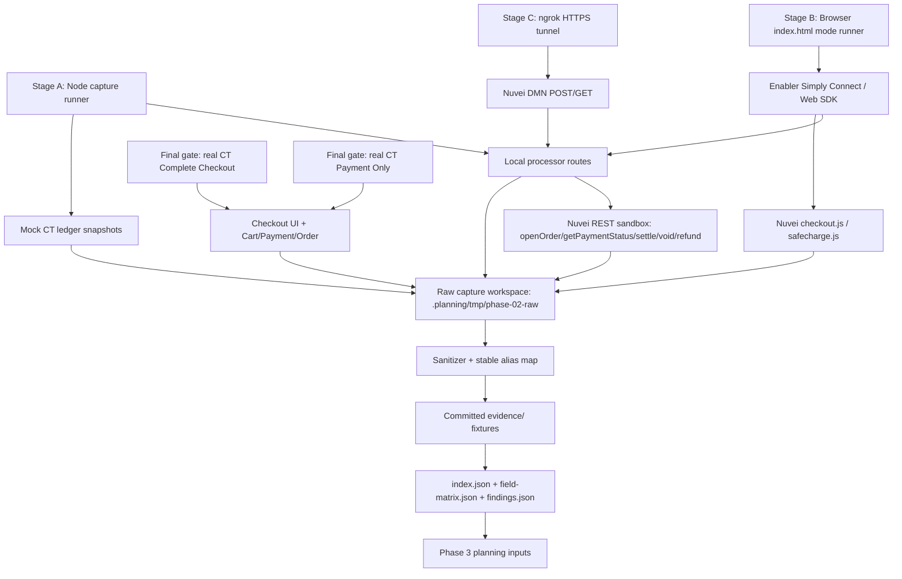

# Phase 02: Nuvei Sandbox Evidence and Checkout Validation - Research

**Researched:** 2026-06-08  
**Domain:** Nuvei sandbox evidence capture, commercetools Checkout validation, local automation harness  
**Confidence:** HIGH for repo/phase constraints and CT/Nuvei documented behavior; MEDIUM for sandbox scenario feasibility until credentials/account setup are exercised.

<user_constraints>
## User Constraints (from CONTEXT.md)

### Locked Decisions
## Implementation Decisions

### Evidence scope
- **D-01:** Phase 2 must capture evidence for all Phase 2 requirements `NUV-01` through `NUV-08`: successful card authorization, declined card authorization, 3DS frictionless approval, 3DS step-up approval, 3DS failure/abandonment, capture, cancel authorization, refund, duplicate DMN, mismatch cases, canonical field identification, Complete Checkout success, and Payment Only success.
- **D-02:** Capture/cancel/refund/duplicate/mismatch are included as evidence capture only. Phase 2 does not implement full reconciliation hardening or operation correctness beyond what is needed to observe and sanitize payloads.
- **D-03:** Missing required scenario evidence blocks Phase 2 completion. If a scenario cannot be produced because of Nuvei/commercetools/account constraints, the phase must record a blocker with exact attempts, environment, and missing prerequisite.

### Environment sequence
- **D-04:** Use local tunnel/mock harness first for maximum visibility into processor requests, Nuvei DMNs, and mock CT ledger state.
- **D-05:** After local evidence capture is working, validate real commercetools Checkout flows in both Complete Checkout and Payment Only modes.
- **D-06:** The local mock/tunnel path is allowed for fast Nuvei evidence and debugging, but it does not satisfy `NUV-07` or `NUV-08` by itself; those require real commercetools Checkout evidence.
- **D-06a:** Evidence capture should be automated and reproducible before manual sandbox runs are accepted as phase evidence. The plan should build local scripts/harness stages that can be rerun to capture/sanitize fixtures deterministically.
- **D-06b:** Stage evidence capture local-first: first exercise processor/Nuvei/server-side flows against a mock commercetools ledger, then exercise enabler/browser flows against the local processor, then run both sides together end-to-end with Nuvei DMNs through a tunnel.
- **D-06c:** Local mock commercetools data shapes are acceptable for automated evidence and should model the commercetools Cart/Payment/transaction structures closely enough for Phase 3 planning. This does not replace NUV-07/NUV-08; a later minimal real commercetools Checkout smoke remains the Phase 2 completion gate.

### Evidence artifacts
- **D-07:** The primary deliverable is a sanitized fixture bundle plus an index. Narrative prose is secondary; downstream Phase 3 needs machine-readable fixtures.
- **D-08:** Store committed sanitized evidence under `.planning/phases/02-nuvei-sandbox-evidence-and-checkout-validation/evidence/`.
- **D-09:** Use scenario-numbered fixture naming keyed to requirement IDs, for example `evidence/NUV-01-success-auth/openOrder-response.json`, `evidence/NUV-01-success-auth/dmn-auth.json`, `evidence/NUV-01-success-auth/ct-payment-after-dmn.json`.
- **D-10:** Phase 3 may later promote selected curated fixtures into package test fixture directories; Phase 2 should not prematurely put provisional sandbox evidence into source test folders.

### Sanitization and raw captures
- **D-11:** Committed evidence must be strictly sanitized with stable aliases. Preserve correlation by replacing sensitive values deterministically, for example `sessionToken-001`, `payment-001`, `cart-001`, `ppp-001`, `transaction-001`.
- **D-12:** No committed artifact may include secrets, raw checksums, session tokens, PAN-adjacent card data, raw Nuvei credentials, CT client credentials, shopper PII, or unsanitized DMN/webhook bodies.
- **D-13:** Agents may temporarily use a gitignored raw workspace for local debugging, for example `.planning/tmp/phase-02-raw/`, but raw captures must never be committed or referenced as canonical evidence.
- **D-14:** Dropping sensitive fields entirely is allowed only when stable aliasing would still expose sensitive data; otherwise prefer aliases so correlation remains visible.

### Checkout proof requirements
- **D-15:** Complete Checkout and Payment Only success proof requires all three: Checkout UI evidence, commercetools Cart/Payment/Order ledger evidence, and Nuvei dashboard/DMN/processor evidence.
- **D-16:** JSON fixtures and the evidence index are the canonical proof. Screenshots and long log excerpts are optional unless needed to explain a blocker.
- **D-17:** Minimal human proof is enough: each scenario index row must include fixture links, aliases, pass/fail conclusion, and gaps/blockers. Do not require screenshots for every scenario.

### Canonical field conclusions
- **D-18:** Phase 2 must produce a field matrix per scenario mapping CT Payment ID, CT Payment `interfaceId`, CT cart ID, Nuvei `sessionToken`, Nuvei `PPP_TransactionID` / casing variant, optional fiscal `TransactionID`, Nuvei `clientUniqueId`, DMN `merchant_unique_id`, amount, currency, and final observed status.
- **D-19:** The field matrix must explicitly identify whether each scenario confirms, contradicts, or leaves unresolved the locked identity model from Phase 1.1.1: `Payment.interfaceId=sessionToken`, terminal `transactions[].interactionId=PPP_TransactionID`, `clientUniqueId=cartId`, and optional `TransactionID` secondary only.
- **D-20:** If real Nuvei evidence reveals a different canonical field than expected, Phase 2 must not silently adapt code. It must record the contradiction and block or route to a follow-up decision before Phase 3 planning.

### Bug handling during evidence capture
- **D-21:** Fix only bugs that block evidence capture within Phase 2.
- **D-22:** All other bugs discovered during sandbox testing must be recorded in the evidence index as fixture-backed findings with severity, scenario, observed behavior, expected behavior, and target phase.
- **D-23:** Do not turn Phase 2 into reconciliation/security/frontend resilience hardening. Phase 3 owns reconciliation correctness; Phase 5 owns frontend resilience/security; Phase 7 owns operations/docs cleanup.

### Enabler integration modes
- **D-24:** Phase 2 must explicitly evaluate both Nuvei frontend integration modes: Simply Connect and Web SDK. Current code has shifted toward Simply Connect, but the original integration intent included Web SDK, and long-term support for both is desired if evidence shows both can be made safe and compatible.
- **D-25:** Treat Simply Connect as the current implemented/default path for evidence capture because it is what the enabler currently uses.
- **D-26:** Web SDK support is not automatically implemented in Phase 2. Phase 2 must gather enough evidence to decide how Web SDK differs from Simply Connect in component generation, request shape, result callbacks, 3DS handling, browser events, DMN payloads, and canonical identifier availability.
- **D-27:** Evidence fixtures and the field matrix must label the frontend mode used for each scenario: `simply-connect` or `web-sdk`.
- **D-28:** If both modes are feasible, downstream planning should preserve a clean enabler abstraction that can support both modes without conflating their result shapes or lifecycle semantics.
- **D-29:** If Web SDK evidence cannot be captured because account setup, documentation, SDK access, or Checkout embedding constraints are missing, Phase 2 must record a blocker or follow-up decision rather than silently treating Simply Connect as the only supported frontend path.

### Claude's Discretion
- Planner may choose exact JSON schema for the evidence index and fixture metadata as long as D-07 through D-20 are satisfied.
- Planner may choose the exact local tunnel tool and raw workspace naming if it remains gitignored and documented.
- Planner may decide whether to add small helper scripts for sanitization/index validation if they reduce evidence mistakes without expanding into full test automation.
- Planner may add small automation scripts for staged evidence capture, sanitization, fixture indexing, and schema validation when they make evidence reproducible. Keep them boring and local; do not build a new test framework if package-local npm scripts plus Node scripts are sufficient.

### Deferred Ideas (OUT OF SCOPE)
## Deferred Ideas

- Full reconciliation hardening, replay protection, amount/currency operation bounds, and wrong-payment protection remain Phase 3.
- Bounded frontend polling/resilience beyond exposing pending remains Phase 5.
- Deployment/runbook/readiness documentation cleanup remains Phase 7 unless a doc update is directly necessary to capture evidence safely.
</user_constraints>

<phase_requirements>
## Phase Requirements

| ID | Description | Research Support |
|----|-------------|------------------|
| NUV-01 | Sandbox testing captures sanitized Nuvei payloads for successful card authorization. | Stage A/B/C capture `openOrder`, browser result, `getPaymentStatus`, DMN, CT Payment snapshots, and field matrix for an approved card authorization. [VERIFIED: .planning/REQUIREMENTS.md][VERIFIED: docs/TEST_SCENARIOS.md] |
| NUV-02 | Sandbox testing captures sanitized Nuvei payloads for declined card authorization. | Nuvei provides decline test cards; capture rejected browser result, confirm `402`/`rejected`, failed Authorization, DMN/status evidence. [CITED: https://docs.nuvei.com/documentation/integration/testing/testing-cards/][VERIFIED: enabler/src/services/api-service.ts][VERIFIED: processor/src/services/nuvei-payment.service.ts] |
| NUV-03 | Sandbox testing captures sanitized Nuvei payloads for 3DS frictionless approval. | Nuvei documents 3DS frictionless cardHolderName/cardNumber combinations and amount-triggered scenarios; evidence index must record 3DS fields and final approval. [CITED: https://docs.nuvei.com/documentation/integration/testing/testing-cards/] |
| NUV-04 | Sandbox testing captures sanitized Nuvei payloads for 3DS step-up approval and failure or abandonment. | Nuvei documents challenge test combinations; browser harness must record `onPending`/challenge/cancel outcomes plus final status/DMN evidence. [CITED: https://docs.nuvei.com/documentation/integration/testing/testing-cards/][VERIFIED: examples/nuvei-web-ui/index.html] |
| NUV-05 | Sandbox testing captures sanitized Nuvei payloads for capture, cancel authorization, refund, duplicate DMN, and mismatch cases. | Processor already exposes Payment Intents and Nuvei client methods for settle/void/refund; Stage A should automate operations against mock CT ledger and real Nuvei sandbox where credentials permit, then store evidence-only findings. [VERIFIED: processor/src/routes/operation.route.ts][VERIFIED: processor/src/services/nuvei-payment.service.ts][VERIFIED: processor/src/clients/nuvei.client.ts] |
| NUV-06 | Sandbox evidence identifies the canonical DMN field that maps a Nuvei event to exactly one commercetools Payment. | Field matrix must compare `merchant_unique_id`, `sessionToken`, `PPP_TransactionID`, `TransactionID`, and `clientUniqueId`; Nuvei docs recommend `merchant_unique_id` for DMN mapping and define `PPP_TransactionID` as a unique payment page transaction ID. [CITED: https://docs.nuvei.com/documentation/integration/webhooks/][CITED: https://docs.nuvei.com/documentation/integration/webhooks/payment-dmns/] |
| NUV-07 | Complete Checkout card authorization succeeds in a commercetools sandbox. | Local evidence cannot satisfy this; final Phase 2 gate needs minimal real CT Complete Checkout smoke with Checkout UI + CT ledger + Nuvei evidence. [VERIFIED: .planning/phases/02-nuvei-sandbox-evidence-and-checkout-validation/02-CONTEXT.md][CITED: https://docs.commercetools.com/learning-implement-checkout/implement-commercetools-checkout/intro-to-commercetools-checkout.md] |
| NUV-08 | Payment Only card authorization succeeds in a commercetools sandbox. | Local evidence cannot satisfy this; final Phase 2 gate needs minimal real CT Payment Only smoke, and CT docs state Payment Only requires the Cart to have shipping and billing information before initialization. [VERIFIED: .planning/phases/02-nuvei-sandbox-evidence-and-checkout-validation/02-CONTEXT.md][CITED: https://docs.commercetools.com/checkout/overview.md] |
</phase_requirements>

## Project Constraints (from CLAUDE.md)

- `CLAUDE.md` exists and is empty; no project-specific directives were present there. [VERIFIED: CLAUDE.md]
- The repository-level guidance in `AGENTS.md` says the project core value is card-first reconciliation correctness and repeats constraints around reliability, security, platform alignment, Nuvei sandbox evidence, npm/package-lock strategy, and card-first scope. [VERIFIED: AGENTS.md]
- No project-local skills exist under `.claude/skills/` or `.agents/skills/`. [VERIFIED: read .claude/skills][VERIFIED: read .agents/skills]
- No `.planning/graphs/` knowledge graph exists, so no graph context was available. [VERIFIED: read .planning/graphs]

## Summary

Phase 2 should be planned as a reproducible evidence-capture pipeline, not as reconciliation/security hardening. [VERIFIED: 02-CONTEXT.md] The primary work is to automate sanitized, deterministic local captures first, then run a minimal real commercetools Checkout smoke for `NUV-07` and `NUV-08`; local automation de-risks but does not replace the real Checkout gate. [VERIFIED: 02-CONTEXT.md][CITED: https://docs.commercetools.com/checkout/overview.md]

Use three local stages: **Stage A processor/Nuvei/server-side against a mock CT ledger**, **Stage B enabler/browser against local processor**, and **Stage C combined browser + processor + Nuvei DMN through an HTTPS tunnel**. [VERIFIED: 02-CONTEXT.md] Existing assets already provide the main pieces: `examples/nuvei-web-ui/mock-commercetools-server.mjs` for a ledger-shaped mock CT server, `api-e2e-test.mjs` for current smoke checks, `index.html` for dual-mode browser exercise, and `start-dmn-tunnel.mjs` for DMN tunnel setup. [VERIFIED: examples/nuvei-web-ui/mock-commercetools-server.mjs][VERIFIED: examples/nuvei-web-ui/api-e2e-test.mjs][VERIFIED: examples/nuvei-web-ui/index.html][VERIFIED: examples/nuvei-web-ui/start-dmn-tunnel.mjs]

The deliverable should be a committed sanitized fixture bundle under `evidence/`, plus `index.json`, `field-matrix.json`, `findings.json`, and per-scenario `metadata.json`. [VERIFIED: 02-CONTEXT.md] Raw captures should live only in a gitignored workspace such as `.planning/tmp/phase-02-raw/`; current `.gitignore` does not ignore `.planning/tmp/`, so the plan must include adding an ignore rule before any raw workspace is used. [VERIFIED: .gitignore]

**Primary recommendation:** Plan Phase 2 as an evidence harness and schema implementation with four gates: sanitize/index validation, Stage A server evidence, Stage B/C browser+tunnel evidence, then real Complete Checkout and Payment Only smoke. [VERIFIED: 02-CONTEXT.md]

## Architectural Responsibility Map

| Capability | Primary Tier | Secondary Tier | Rationale |
|------------|--------------|----------------|-----------|
| Evidence folder/index/schema | Repository planning artifacts | Local Node scripts | Evidence is a Phase 2 planning artifact under `.planning/phases/.../evidence/`; scripts only generate and validate it. [VERIFIED: 02-CONTEXT.md] |
| Raw capture workspace | Local filesystem | — | Raw Nuvei/CT/browser evidence must not be canonical or committed; it belongs in a gitignored temp area. [VERIFIED: 02-CONTEXT.md][VERIFIED: .gitignore] |
| Sanitization and aliasing | Local Node scripts | Processor/logger inputs | Sanitization should happen before writing committed evidence; processor code should not be broadly refactored in Phase 2 except evidence blockers. [VERIFIED: 02-CONTEXT.md] |
| Processor/Nuvei server-side capture | Processor service | Mock CT ledger | Processor owns Nuvei `openOrder`, `getPaymentStatus`, DMN handling, and operations; mock CT ledger supplies inspectable Cart/Payment shapes. [VERIFIED: processor/src/services/nuvei-payment.service.ts][VERIFIED: examples/nuvei-web-ui/mock-commercetools-server.mjs] |
| Enabler/browser capture | Browser / enabler assets | Processor | Browser owns Simply Connect/Web SDK mount/submit/callback observations; processor owns session creation and confirmation. [VERIFIED: enabler/src/components/simply-connect-card.ts][VERIFIED: enabler/src/components/web-sdk-card.ts] |
| DMN tunnel capture | Network boundary / local tunnel | Processor webhook | Nuvei sends DMNs to a public HTTPS URL; the local tunnel forwards to `/webhooks/nuvei`. [CITED: https://docs.nuvei.com/documentation/integration/webhooks/][VERIFIED: examples/nuvei-web-ui/start-dmn-tunnel.mjs] |
| Real Complete Checkout smoke | commercetools Checkout | Browser + processor + Nuvei | Complete Checkout renders hosted UI, manages checkout flow, and creates an Order after payment success; local mock cannot prove this. [CITED: https://docs.commercetools.com/checkout/overview.md][VERIFIED: 02-CONTEXT.md] |
| Real Payment Only smoke | commercetools Checkout | Browser + processor + Nuvei | Payment Only renders payment UI within an existing checkout flow and requires prepared cart shipping/billing data. [CITED: https://docs.commercetools.com/checkout/overview.md] |

## Standard Stack

### Core

| Library / Tool | Version | Purpose | Why Standard |
|----------------|---------|---------|--------------|
| Node.js | Local `v24.5.0`; repo README/example says Node.js 18+ | Run local evidence scripts and example harness | Existing packages are ESM Node projects; use package-local npm scripts and avoid root workspace assumptions. [VERIFIED: bash node --version][VERIFIED: examples/nuvei-web-ui/README.md][VERIFIED: processor/package.json][VERIFIED: enabler/package.json] |
| npm | Local `11.5.1` | Package-local commands | Repo has package-local `package-lock.json` files and no root package manifest in the observed tree. [VERIFIED: bash npm --version][VERIFIED: PROJECT.md][VERIFIED: processor/package.json][VERIFIED: enabler/package.json][VERIFIED: examples/nuvei-web-ui/package.json] |
| Fastify | Repo `^5.8.5`; registry latest `5.8.5`, modified 2026-04-14 | Processor HTTP service | Existing processor routes are Fastify and already separate payment, webhook, and operation concerns. [VERIFIED: processor/package.json][VERIFIED: npm registry][VERIFIED: processor/src/routes/nuvei-payment.route.ts][VERIFIED: processor/src/routes/operation.route.ts] |
| TypeScript | Repo `^6.0.3`; registry latest `6.0.3`, modified 2026-04-16 | Processor/enabler source and test typing | Existing packages use TypeScript; Phase 2 helper scripts can be plain Node ESM to avoid build changes unless package-local TS integration is necessary. [VERIFIED: processor/package.json][VERIFIED: enabler/package.json][VERIFIED: npm registry] |
| `@commercetools/connect-payments-sdk` | Repo/registry `0.28.0`, modified 2026-04-20 | Processor session/OAuth/JWT auth, CT services, Payment Intents plumbing | Existing processor routes use the SDK hooks and payment service abstractions; do not hand-roll CT auth or Payment APIs. [VERIFIED: processor/package.json][VERIFIED: npm registry][VERIFIED: processor/src/routes/operation.route.ts] |
| Nuvei REST 1.0 + browser SDKs | API endpoints used by repo: `openOrder`, `getPaymentStatus`, `settleTransaction`, `voidTransaction`, `refundTransaction`; browser scripts `checkout.js` and `safecharge.js` | PSP session creation, status verification, operations, Simply Connect/Web SDK card capture | Nuvei docs require backend `/openOrder` because checksum uses the secret key, and require server-side verification via `/getPaymentStatus` or DMNs. [VERIFIED: processor/src/clients/nuvei.client.ts][CITED: https://docs.nuvei.com/documentation/accept-payment/web-sdk/quick-start-for-web-sdk/][CITED: https://docs.nuvei.com/documentation/accept-payment/simply-connect/quick-start-for-checkout/] |
| Vitest | Repo `^4.1.5`; registry latest `4.1.8`, modified 2026-06-01 | Existing unit tests; optional schema validator unit tests if scripts are added | Existing test configs include `test/**/*.test.ts` for processor and enabler. [VERIFIED: processor/vitest.config.ts][VERIFIED: enabler/vitest.config.ts][VERIFIED: npm registry] |

### Supporting

| Library / Tool | Version | Purpose | When to Use |
|----------------|---------|---------|-------------|
| Express | Example repo `^4.18.3`; registry latest `5.2.1`, modified 2026-05-19 | Current mock CT server | Keep existing Express mock for Phase 2 unless a blocker requires replacement; do not spend Phase 2 on framework migration. [VERIFIED: examples/nuvei-web-ui/package.json][VERIFIED: npm registry][VERIFIED: examples/nuvei-web-ui/mock-commercetools-server.mjs] |
| ngrok CLI | Installed `/usr/bin/ngrok`, version `3.39.6` | Public HTTPS tunnel for Nuvei DMNs | Prefer installed `ngrok` for Stage C on this workstation; `localtunnel` command is not installed. [VERIFIED: bash command availability] |
| localtunnel CLI | Missing on this workstation | Optional tunnel provider | Do not rely on `localtunnel` unless the plan includes an explicit install/pinning/checkpoint; current `start-dmn-tunnel.mjs` defaults to localtunnel but local command is absent. [VERIFIED: bash command availability][VERIFIED: examples/nuvei-web-ui/start-dmn-tunnel.mjs] |

### Alternatives Considered

| Instead of | Could Use | Tradeoff |
|------------|-----------|----------|
| Existing Node scripts | Playwright/browser automation | Playwright would make browser capture more reproducible but adds dependency and scope; Phase 2 can first instrument `index.html` and capture browser output manually/minimally unless browser automation becomes an evidence blocker. [ASSUMED] |
| Existing Express mock CT server | Fastify mock server | Fastify would match processor stack, but the existing Express mock already models ledger endpoints and does not block evidence capture. [VERIFIED: examples/nuvei-web-ui/mock-commercetools-server.mjs] |
| Installed ngrok CLI | Add `localtunnel` dependency | localtunnel is missing locally and adding a package introduces dependency legitimacy work; ngrok is installed and provides HTTPS tunnel capability. [VERIFIED: bash command availability] |
| Real CT Checkout first | Local-first staged capture | Real CT first is more realistic but slower to debug; context locks local automation first and real CT smoke last. [VERIFIED: 02-CONTEXT.md] |

**Installation:** No required new packages for the recommended Phase 2 plan. [VERIFIED: package.json files] If a future plan chooses Playwright or localtunnel, run the Package Legitimacy Gate first and add a human-verify checkpoint. [ASSUMED]

**Version verification:** npm registry checks were run for `fastify`, `express`, `vitest`, `typescript`, and `@commercetools/connect-payments-sdk`; versions above reflect observed registry output. [VERIFIED: npm registry]

## Package Legitimacy Audit

Phase 2 research recommends **no new required external packages**. [VERIFIED: package.json files] Existing packages are already present in package-local manifests; no slopcheck run was required because the plan should not add packages unless an implementation blocker proves necessary. [ASSUMED]

| Package | Registry | Age | Downloads | Source Repo | slopcheck | Disposition |
|---------|----------|-----|-----------|-------------|-----------|-------------|
| none new | — | — | — | — | not run | No install recommended. [VERIFIED: package.json files] |

**Packages removed due to slopcheck [SLOP] verdict:** none. [VERIFIED: no new package recommendation]  
**Packages flagged as suspicious [SUS]:** none. [VERIFIED: no new package recommendation]

## Architecture Patterns

### System Architecture Diagram



Diagram notes: local stages produce reusable sanitized evidence but do not satisfy `NUV-07`/`NUV-08`; real CT Checkout smoke remains a completion gate. [VERIFIED: 02-CONTEXT.md]

### Recommended Evidence Project Structure

```text
.planning/phases/02-nuvei-sandbox-evidence-and-checkout-validation/
├── 02-RESEARCH.md
└── evidence/
    ├── index.json
    ├── field-matrix.json
    ├── findings.json
    ├── schema/
    │   ├── evidence-index.schema.json
    │   ├── fixture-metadata.schema.json
    │   ├── field-matrix.schema.json
    │   └── findings.schema.json
    ├── aliases/
    │   └── alias-map.json
    ├── NUV-01-success-auth/
    │   ├── metadata.json
    │   ├── openOrder-response.json
    │   ├── browser-result.json
    │   ├── getPaymentStatus-response.json
    │   ├── dmn-auth.json
    │   ├── ct-payment-before.json
    │   ├── ct-payment-after-confirm.json
    │   ├── ct-payment-after-dmn.json
    │   └── processor-log.ndjson
    ├── NUV-02-decline-auth/
    ├── NUV-03-3ds-frictionless/
    ├── NUV-04-3ds-stepup-success/
    ├── NUV-04-3ds-stepup-failure-or-abandonment/
    ├── NUV-05-capture/
    ├── NUV-05-cancel-authorization/
    ├── NUV-05-refund/
    ├── NUV-05-duplicate-dmn/
    ├── NUV-05-mismatch/
    ├── NUV-07-complete-checkout-success/
    └── NUV-08-payment-only-success/
```

Structure rationale: scenario folders are requirement-prefixed, committed files are sanitized only, and schemas are colocated so evidence can be validated before Phase 3 consumes it. [VERIFIED: 02-CONTEXT.md]

### Pattern 1: Evidence Index as the Canonical Manifest

**What:** `evidence/index.json` is the single manifest for scenario status, fixture file paths, frontend mode, capture stage, alias IDs, pass/fail conclusion, and blockers. [VERIFIED: 02-CONTEXT.md]  
**When to use:** Every evidence-producing script writes or updates a scenario row only after sanitization succeeds. [ASSUMED]  
**Example schema:**

```json
{
  "$schema": "./schema/evidence-index.schema.json",
  "generatedAt": "2026-06-08T00:00:00.000Z",
  "sanitizerVersion": "phase-02-v1",
  "scenarios": [
    {
      "id": "NUV-01-success-auth",
      "requirements": ["NUV-01", "NUV-06"],
      "stage": "stage-c-local-browser-processor-dmn",
      "frontendMode": "web-sdk",
      "environment": "nuvei-sandbox-local-mock-ct",
      "status": "passed",
      "conclusion": "Approved auth captured; field matrix confirms expected identity model.",
      "fixtures": [
        "NUV-01-success-auth/openOrder-response.json",
        "NUV-01-success-auth/getPaymentStatus-response.json",
        "NUV-01-success-auth/dmn-auth.json",
        "NUV-01-success-auth/ct-payment-after-dmn.json"
      ],
      "aliases": {
        "cartId": "cart-001",
        "paymentId": "payment-001",
        "sessionToken": "sessionToken-001",
        "pppTransactionId": "ppp-001",
        "transactionId": "transaction-001"
      },
      "blockers": [],
      "findings": []
    }
  ]
}
```

**Source:** Phase context requires a fixture bundle plus index and stable aliases. [VERIFIED: 02-CONTEXT.md]

### Pattern 2: Stable Alias Map with Field-Class Rules

**What:** Keep a deterministic `aliases/alias-map.json` that maps raw values to aliases by semantic class, not by raw field name alone. [VERIFIED: 02-CONTEXT.md]  
**When to use:** Use before writing any committed fixture, log excerpt, field matrix row, or index alias. [VERIFIED: 02-CONTEXT.md]  
**Alias classes:**

| Class | Alias Prefix | Inputs | Keep/Drop Rule |
|-------|--------------|--------|----------------|
| commercetools Cart ID | `cart-###` | `cart.id`, `clientUniqueId` when it equals cart ID | Alias, preserve equality across files. [VERIFIED: 02-CONTEXT.md] |
| commercetools Payment ID | `payment-###` | `payment.id`, `paymentReference`, `merchant_unique_id` when CT Payment ID | Alias, preserve equality. [VERIFIED: 02-CONTEXT.md] |
| Nuvei session token | `sessionToken-###` | `sessionToken`, CT `Payment.interfaceId` | Alias, never commit raw token. [VERIFIED: 02-CONTEXT.md] |
| Nuvei PPP transaction | `ppp-###` | `PPP_TransactionID`, `PPP_TransactionId`, `ppp_TransactionID` | Alias, preserve casing in field name and alias value equality. [VERIFIED: processor/src/services/nuvei-payment.service.ts][CITED: https://docs.nuvei.com/documentation/integration/webhooks/payment-dmns/] |
| Nuvei fiscal transaction | `transaction-###` | `TransactionID`, `TransactionId`, `transactionId`, operation `transactionId` | Alias as secondary identity; do not promote over PPP without evidence. [VERIFIED: 02-CONTEXT.md][VERIFIED: processor/src/services/nuvei-payment.service.ts] |
| Nuvei order | `order-###` | `orderId` | Alias. [CITED: https://docs.nuvei.com/documentation/accept-payment/web-sdk/quick-start-for-web-sdk/] |
| Request/client IDs | `request-###` | `clientRequestId`, `internalRequestId` | Alias unless value is already synthetic and non-sensitive. [ASSUMED] |
| Checksum | `[redacted-checksum]` | `checksum`, `advanceResponseChecksum`, `responseChecksum`, `responsechecksum` | Drop or fixed redaction; never alias raw checksum because it proves no needed business correlation and can aid replay. [VERIFIED: 02-CONTEXT.md][CITED: https://docs.nuvei.com/documentation/integration/webhooks/payment-dmns/] |
| Secret/config | `[redacted-secret]` | CT/NUVEI secret env names and values | Drop values; names may remain if needed for blocker reports. [VERIFIED: PROJECT.md][VERIFIED: connect.yaml] |
| PAN-adjacent | `[redacted-card-data]` | `cardNumber`, `ccCardNumber`, `last4Digits`, `bin`, `uniqueCC`, `Token`, `tokenId`, `userPaymentOptionId`, `PAR`, `nameOnCard`, `expMonth`, `expYear`, CVV/AVS fields | Drop or fixed redaction; preserve only `cardCompany`/`cardType` if needed and non-sensitive. [VERIFIED: 02-CONTEXT.md][CITED: https://docs.nuvei.com/documentation/integration/webhooks/payment-dmns/] |
| PII | `[redacted-pii]` | email, name, address, phone, IP | Drop or fixed redaction; do not alias personal values unless correlation specifically requires it. [VERIFIED: 02-CONTEXT.md][CITED: https://docs.nuvei.com/documentation/integration/webhooks/payment-dmns/] |

**Example alias map:**

```json
{
  "version": "phase-02-v1",
  "classes": {
    "cartId": { "raw-cart-uuid": "cart-001" },
    "paymentId": { "raw-payment-uuid": "payment-001" },
    "sessionToken": { "raw-session-token": "sessionToken-001" },
    "pppTransactionId": { "527324408": "ppp-001" },
    "transactionId": { "7110000000009040707": "transaction-001" }
  }
}
```

### Pattern 3: Raw Capture Isolation Before Sanitization

**What:** Write raw HTTP responses/log lines only under `.planning/tmp/phase-02-raw/`, then sanitize into `evidence/`. [VERIFIED: 02-CONTEXT.md]  
**Required planning task:** Add `.planning/tmp/` (or the exact raw path) to `.gitignore` before first raw capture because current `.gitignore` does not include `.planning/tmp/`. [VERIFIED: .gitignore]  
**Anti-leak invariant:** A committed evidence validation script should fail if raw token/checksum/card/secret patterns appear under `evidence/`. [ASSUMED]

### Pattern 4: Field Matrix per Scenario

**What:** `field-matrix.json` records observed identity fields for each scenario and whether the scenario confirms, contradicts, or leaves unresolved the expected model. [VERIFIED: 02-CONTEXT.md]  
**Required fields:**

```json
{
  "scenarioId": "NUV-01-success-auth",
  "frontendMode": "web-sdk",
  "ct": {
    "cartId": "cart-001",
    "paymentId": "payment-001",
    "paymentInterfaceId": "sessionToken-001",
    "transactionInteractionIds": ["ppp-001"]
  },
  "nuvei": {
    "sessionToken": "sessionToken-001",
    "pppTransactionId": "ppp-001",
    "pppTransactionField": "PPP_TransactionID",
    "transactionId": "transaction-001",
    "clientUniqueId": "cart-001",
    "merchantUniqueId": "payment-001",
    "amount": { "value": "10.00", "currency": "EUR" },
    "status": { "ppp_status": "OK", "Status": "APPROVED", "transactionStatus": "APPROVED" }
  },
  "identityModelAssessment": {
    "paymentInterfaceIdEqualsSessionToken": "confirmed",
    "terminalInteractionIdEqualsPpp": "confirmed",
    "clientUniqueIdEqualsCartId": "confirmed",
    "transactionIdSecondaryOnly": "confirmed"
  }
}
```

**Source:** Required by D-18 and D-19. [VERIFIED: 02-CONTEXT.md]

### Recommended Script Boundaries

| Script | Package / Location | Responsibility | Must Not Do |
|--------|--------------------|----------------|-------------|
| `capture:stage-a` | `examples/nuvei-web-ui` or phase-local script | Drive processor/Nuvei/server operations against mock CT, collect raw responses, sanitize to scenario fixtures. [ASSUMED] | Must not assert Phase 3 reconciliation correctness beyond evidence-capture blockers. [VERIFIED: 02-CONTEXT.md] |
| `capture:stage-b` | `examples/nuvei-web-ui` | Drive/guide browser mode capture for Simply Connect and Web SDK against local processor; export browser result JSON. [ASSUMED] | Must not require screenshots for every scenario. [VERIFIED: 02-CONTEXT.md] |
| `capture:stage-c` | `examples/nuvei-web-ui` | Start/verify HTTPS tunnel and capture real DMN delivery through processor `/webhooks/nuvei`. [VERIFIED: examples/nuvei-web-ui/start-dmn-tunnel.mjs] | Must not use unpinned `npx` package downloads in unattended evidence capture. [ASSUMED] |
| `sanitize-evidence` | phase-local or examples script | Transform `.planning/tmp/phase-02-raw/` into sanitized `evidence/` fixtures and alias map. [VERIFIED: 02-CONTEXT.md] | Must not keep checksums/session tokens/PAN-adjacent fields in committed files. [VERIFIED: 02-CONTEXT.md] |
| `validate-evidence` | phase-local or examples script | Validate JSON schemas, fixture links, alias consistency, required scenarios, no forbidden patterns. [ASSUMED] | Must not run project-wide tests/builds/formatters. [VERIFIED: user request] |

### Anti-Patterns to Avoid

- **Manual-only evidence first:** Manual sandbox notes before deterministic local capture violate the latest Phase 2 decision. [VERIFIED: 02-CONTEXT.md]
- **Local-only completion:** Mock CT/tunnel evidence is useful but cannot satisfy `NUV-07` or `NUV-08`. [VERIFIED: 02-CONTEXT.md]
- **Sanitized prose only:** A narrative report without JSON fixtures fails the Phase 2 primary deliverable. [VERIFIED: 02-CONTEXT.md]
- **Raw logs in evidence:** Processor/browser/Nuvei logs can contain session tokens, checksums, PAN-adjacent values, PII, or secrets. [VERIFIED: PROJECT.md][CITED: https://docs.nuvei.com/documentation/integration/webhooks/payment-dmns/]
- **Promoting fixtures to package tests in Phase 2:** Phase 3 may curate test fixtures; Phase 2 should keep provisional sandbox evidence phase-local. [VERIFIED: 02-CONTEXT.md]
- **Fixing all discovered bugs:** Phase 2 fixes only evidence blockers; all other bugs become fixture-backed findings with target phase. [VERIFIED: 02-CONTEXT.md]
- **Treating browser callback as final truth:** Nuvei docs state browser responses must be verified server-side using `/getPaymentStatus` or DMNs. [CITED: https://docs.nuvei.com/documentation/accept-payment/web-sdk/quick-start-for-web-sdk/][CITED: https://docs.nuvei.com/documentation/accept-payment/simply-connect/quick-start-for-checkout/]

## Don't Hand-Roll

| Problem | Don't Build | Use Instead | Why |
|---------|-------------|-------------|-----|
| commercetools auth/session/OAuth handling | Custom JWT/session/OAuth clients | Existing `@commercetools/connect-payments-sdk` hooks and services | Processor routes already use SDK hooks for session, JWT, OAuth2, and authority checks. [VERIFIED: processor/src/routes/operation.route.ts][VERIFIED: processor/src/routes/nuvei-payment.route.ts] |
| CT Payment/Cart schema semantics | Ad-hoc simplified objects for committed final evidence | CT Payment/Cart native shapes from observed API/mocks | CT Payment has `interfaceId`, `amountPlanned`, `paymentMethodInfo`, `paymentStatus`, and `transactions`; Cart has `paymentInfo.payments` and `totalPrice`. [VERIFIED: MCP OAS api-Payment][VERIFIED: MCP OAS api-Cart-read] |
| Nuvei checksum algorithms | Custom alternative checksum policy | Current processor SHA-256 implementation for capture; record MD5/SHA-256 policy conflicts as findings only | Processor currently hardcodes SHA-256 DMN checksum; Nuvei docs say SHA-256 is recommended while MD5 may be supported depending on SiteId configuration. [VERIFIED: processor/src/clients/nuvei.client.ts][VERIFIED: processor/src/config/config.ts][CITED: https://docs.nuvei.com/documentation/integration/webhooks/payment-dmns/] |
| Browser card capture | Merchant-owned card inputs | Nuvei-hosted Simply Connect `checkout.js` or Web SDK Nuvei Fields `safecharge.js` | Nuvei docs position these as PCI-descoping integrations; project excludes storing PAN. [CITED: https://docs.nuvei.com/documentation/accept-payment/web-sdk/][CITED: https://docs.nuvei.com/documentation/accept-payment/simply-connect/][VERIFIED: PROJECT.md] |
| Sanitizer with regex-only string replacement | Blind global substitutions | Parse JSON/form bodies and apply field-class alias/redaction, then pattern scan output | DMNs include case variants and URL-encoded form bodies; field-aware processing preserves correlation and avoids leaking raw values. [CITED: https://docs.nuvei.com/documentation/integration/webhooks/payment-dmns/][VERIFIED: processor/src/services/nuvei-payment.service.ts] |
| Tunnel implementation | Custom public reverse proxy | Installed ngrok CLI or documented supported tunnel | Nuvei requires a reachable HTTPS DMN URL; ngrok exists locally, localtunnel does not. [CITED: https://docs.nuvei.com/documentation/integration/webhooks/][VERIFIED: bash command availability] |

**Key insight:** The hard problem is not calling the APIs; it is preserving cross-system correlation while removing raw values that would leak tokens, checksums, PII, or card-adjacent data. [VERIFIED: 02-CONTEXT.md][CITED: https://docs.nuvei.com/documentation/integration/webhooks/payment-dmns/]

## Common Pitfalls

### Pitfall 1: Current Mock CT Server Logs Raw Request Material

**What goes wrong:** `record()` stores and prints request headers, body, and rawBody, and `/ledger` exposes `lastRequests`. [VERIFIED: examples/nuvei-web-ui/mock-commercetools-server.mjs]  
**Why it happens:** The mock server was built for visibility, not committed evidence hygiene. [VERIFIED: examples/nuvei-web-ui/mock-commercetools-server.mjs]  
**How to avoid:** Treat mock server output as raw capture only; sanitize before committing and consider a capture-only redaction option if raw logs become hard to handle. [VERIFIED: 02-CONTEXT.md]  
**Warning signs:** `sessionToken`, `advanceResponseChecksum`, `cardNumber`, `Token`, `email`, or `X-Session-ID` appears under `evidence/`. [VERIFIED: 02-CONTEXT.md][CITED: https://docs.nuvei.com/documentation/integration/webhooks/payment-dmns/]

### Pitfall 2: `start-dmn-tunnel.mjs` Defaults to a Missing Tool

**What goes wrong:** The script defaults `TUNNEL_PROVIDER=localtunnel`, but `localtunnel` is not installed on this workstation; `ngrok` is installed. [VERIFIED: examples/nuvei-web-ui/start-dmn-tunnel.mjs][VERIFIED: bash command availability]  
**Why it happens:** The script supports two provider paths but the default does not match the observed environment. [VERIFIED: examples/nuvei-web-ui/start-dmn-tunnel.mjs]  
**How to avoid:** Plan Stage C to use `TUNNEL_PROVIDER=ngrok` here, or add an explicit dependency/install checkpoint before localtunnel use. [VERIFIED: bash command availability]  
**Warning signs:** DMNs never arrive even though Nuvei shows transaction completion. [CITED: https://docs.nuvei.com/documentation/integration/webhooks/]

### Pitfall 3: Raw Workspace Not Ignored Yet

**What goes wrong:** Context allows `.planning/tmp/phase-02-raw/`, but current `.gitignore` does not ignore `.planning/tmp/`. [VERIFIED: 02-CONTEXT.md][VERIFIED: .gitignore]  
**Why it happens:** The raw workspace was decided after current ignore patterns. [VERIFIED: 02-CONTEXT.md][VERIFIED: .gitignore]  
**How to avoid:** First implementation task should add an ignore rule for the exact raw path before any raw capture. [VERIFIED: .gitignore]  
**Warning signs:** Raw capture files appear in git status or in the phase evidence folder. [ASSUMED]

### Pitfall 4: Nuvei Field Name Casing Varies

**What goes wrong:** Code and docs show `PPP_TransactionID`, `PPP_TransactionId`, `ppp_TransactionID`, `TransactionID`, `TransactionId`, and `transactionId` variants. [VERIFIED: processor/src/services/nuvei-payment.service.ts][CITED: https://docs.nuvei.com/documentation/integration/webhooks/payment-dmns/]  
**Why it happens:** Nuvei examples and outputs vary by API/path and docs. [CITED: https://docs.nuvei.com/documentation/accept-payment/web-sdk/quick-start-for-web-sdk/][CITED: https://docs.nuvei.com/documentation/accept-payment/simply-connect/quick-start-for-checkout/]  
**How to avoid:** Preserve field names exactly in sanitized fixtures while aliasing values deterministically. [VERIFIED: 02-CONTEXT.md]  
**Warning signs:** Field matrix has `null` PPP for a scenario whose raw DMN used a casing variant. [ASSUMED]

### Pitfall 5: `/getPaymentStatus` Polling Abuse

**What goes wrong:** Repeated polling during active payment processing can cause Nuvei to block the server IP. [CITED: https://docs.nuvei.com/documentation/accept-payment/web-sdk/quick-start-for-web-sdk/][CITED: https://docs.nuvei.com/documentation/accept-payment/simply-connect/quick-start-for-checkout/]  
**Why it happens:** The enabler has bounded pending retry logic, but evidence automation could accidentally poll as a capture loop. [VERIFIED: enabler/src/services/api-service.ts]  
**How to avoid:** Capture `/getPaymentStatus` after final browser event or DMN trigger only; do not build long polling into Phase 2 automation. [CITED: https://docs.nuvei.com/documentation/accept-payment/web-sdk/quick-start-for-web-sdk/]  
**Warning signs:** Stage scripts repeatedly call `/payments/confirm/:id` while the Nuvei widget is still processing. [VERIFIED: enabler/src/services/api-service.ts]

### Pitfall 6: Mock Evidence Looks Like CT Evidence But Is Not Checkout Evidence

**What goes wrong:** Mock CT ledger has Cart/Payment-like shapes, but it cannot prove hosted Complete Checkout or Payment Only flows. [VERIFIED: examples/nuvei-web-ui/mock-commercetools-server.mjs][VERIFIED: 02-CONTEXT.md]  
**Why it happens:** The local harness is intentionally optimized for visibility. [VERIFIED: 02-CONTEXT.md]  
**How to avoid:** Index rows must include `environment` and `stage`; `NUV-07`/`NUV-08` rows must use real CT Checkout evidence. [VERIFIED: 02-CONTEXT.md]  
**Warning signs:** `NUV-07` or `NUV-08` marked passed from `mock-ct` environment. [VERIFIED: 02-CONTEXT.md]

## Existing Harness Reuse / Replace Guidance

| Asset | Reuse / Replace | Rationale |
|-------|-----------------|-----------|
| `examples/nuvei-web-ui/mock-commercetools-server.mjs` | Reuse, but wrap output as raw capture and sanitize before commit. | Provides health, config, payment components, session, confirm, DMN, payment-intents, mock Cart/Payment inspection, and optional real Nuvei `openOrder` when credentials are present. [VERIFIED: examples/nuvei-web-ui/mock-commercetools-server.mjs] |
| `examples/nuvei-web-ui/api-e2e-test.mjs` | Replace or extend for Stage A; current script is smoke-level and not fixture-producing. | It checks health/CORS/auth/mock session/confirm/synthetic DMN/debug dump but does not create evidence directories, sanitize, or cover NUV scenarios. [VERIFIED: examples/nuvei-web-ui/api-e2e-test.mjs] |
| `examples/nuvei-web-ui/index.html` | Reuse for Stage B/C browser capture; add exportable result capture only if needed. | It already imports `NuveiSimplyConnectEnabler` and `NuveiWebSdkEnabler`, has a mode selector, processor/session/merchant inputs, mount/pay controls, and result log. [VERIFIED: examples/nuvei-web-ui/index.html] |
| `examples/nuvei-web-ui/start-dmn-tunnel.mjs` | Replace default behavior or document `TUNNEL_PROVIDER=ngrok` for this workstation. | It defaults to localtunnel; localtunnel is missing and ngrok is installed. [VERIFIED: examples/nuvei-web-ui/start-dmn-tunnel.mjs][VERIFIED: bash command availability] |
| `processor/src/services/nuvei-payment.service.ts` | Observe; edit only if an evidence blocker appears. | It owns session creation, confirm tri-state, operations, DMN resolution, idempotency short-circuiting, and identity extraction. [VERIFIED: processor/src/services/nuvei-payment.service.ts][VERIFIED: 02-CONTEXT.md] |
| `processor/src/clients/nuvei.client.ts` | Observe; keep protocol signing centralized. | It owns Nuvei REST calls and checksum validation; evidence capture should not duplicate protocol logic elsewhere except sanitizer parsing. [VERIFIED: processor/src/clients/nuvei.client.ts] |
| `processor/src/routes/nuvei-payment.route.ts` | Observe; route shape is already current. | Exposes `/payments/session`, `/payments/confirm/:id`, and `/webhooks/nuvei` under plugin prefixes; errors are public/safe for setup and checksum. [VERIFIED: processor/src/routes/nuvei-payment.route.ts] |
| `processor/src/routes/operation.route.ts` | Observe for operations evidence. | Exposes `/payment-intents/:id` and `/transactions` with OAuth2/authority hooks plus `/config`, `/status`, `/health`, `/payment-components`. [VERIFIED: processor/src/routes/operation.route.ts] |
| `docs/TEST_SCENARIOS.md` | Reuse as scenario source, not proof. | Contains scenarios 6-11 and 14-24 matching Phase 2 evidence scope, plus completion criteria; Phase 2 should turn these into observed fixtures. [VERIFIED: docs/TEST_SCENARIOS.md] |
| `docs/ARCHITECTURE.md` | Reuse for current API/data-flow expectations and identity invariants. | Documents current enabler/processor route flow, Web SDK default Checkout-facing adapter, Simply Connect/Web SDK classes, and PPP identity invariant. [VERIFIED: docs/ARCHITECTURE.md] |

## Staged Plan Boundaries and Acceptance Criteria

### Stage 0 — Evidence Schema, Raw Isolation, and Sanitizer Validator

**Boundary:** Create schema/index/sanitizer/validator scaffolding and gitignore raw workspace; no sandbox run required. [VERIFIED: 02-CONTEXT.md][VERIFIED: .gitignore]  
**Acceptance criteria:**
- `.planning/tmp/phase-02-raw/` or chosen raw path is ignored before raw capture. [VERIFIED: .gitignore]
- `evidence/schema/*.schema.json`, empty `index.json`, `field-matrix.json`, `findings.json`, and `aliases/alias-map.json` shape are defined. [ASSUMED]
- Validator fails on forbidden raw patterns: checksum fields with hex values, session-token UUIDs, CT/NUVEI secret values, PAN-adjacent fields, email/address/phone/IP. [VERIFIED: 02-CONTEXT.md][CITED: https://docs.nuvei.com/documentation/integration/webhooks/payment-dmns/]
- No source runtime behavior changes except evidence helpers and ignore/config needed for safe capture. [VERIFIED: user request][VERIFIED: 02-CONTEXT.md]

### Stage A — Processor/Nuvei/Server-Side Capture Against Mock CT

**Boundary:** Exercise server-owned flows with maximum observability: mock ledger + processor + Nuvei REST sandbox where credentials exist. [VERIFIED: 02-CONTEXT.md]  
**Acceptance criteria:**
- Captures sanitized `openOrder-response.json`, `getPaymentStatus-response.json`, processor route response, CT Payment snapshots, and operation responses for `NUV-01`, `NUV-02`, `NUV-05`, and `NUV-06` where server-side flow can produce them. [VERIFIED: processor/src/clients/nuvei.client.ts][VERIFIED: examples/nuvei-web-ui/mock-commercetools-server.mjs]
- Uses real Nuvei sandbox for Nuvei payload claims; synthetic DMN/mismatch cases are labeled synthetic and cannot be used to conclude real Nuvei field behavior. [VERIFIED: 02-CONTEXT.md]
- Records capture/cancel/refund/duplicate/mismatch as evidence only; no Phase 3 hardening work unless an evidence-capture blocker prevents observation. [VERIFIED: 02-CONTEXT.md]

### Stage B — Enabler/Browser Capture Against Local Processor

**Boundary:** Exercise both `simply-connect` and `web-sdk` browser flows using `examples/nuvei-web-ui/index.html`, local processor URL, and sandbox credentials. [VERIFIED: examples/nuvei-web-ui/index.html][VERIFIED: 02-CONTEXT.md]  
**Acceptance criteria:**
- Each browser scenario records `frontendMode`, browser result/callback, processor `/payments/session`, processor `/payments/confirm/:id`, and field matrix. [VERIFIED: 02-CONTEXT.md][VERIFIED: enabler/src/components/simply-connect-card.ts][VERIFIED: enabler/src/components/web-sdk-card.ts]
- Simply Connect evidence captures `checkout()` lifecycle differences: internal pay button, `transactionStatus`, `onResult`, `onPending`, and `checkout.js` script. [VERIFIED: enabler/src/components/simply-connect-card.ts][CITED: https://docs.nuvei.com/documentation/accept-payment/simply-connect/quick-start-for-checkout/]
- Web SDK evidence captures `SafeCharge.fields().create('card')`, host-owned submit, `createPayment()` result, and `safecharge.js` script. [VERIFIED: enabler/src/components/web-sdk-card.ts][CITED: https://docs.nuvei.com/documentation/accept-payment/web-sdk/quick-start-for-web-sdk/]
- If Web SDK cannot be exercised because account/setup/Checkout embedding is unavailable, index records a blocker rather than silently treating Simply Connect as the only path. [VERIFIED: 02-CONTEXT.md]

### Stage C — Combined Browser + Processor + Nuvei DMN Through Tunnel

**Boundary:** Run local browser + local processor + real Nuvei sandbox DMN over HTTPS tunnel. [VERIFIED: 02-CONTEXT.md][VERIFIED: examples/nuvei-web-ui/start-dmn-tunnel.mjs]  
**Acceptance criteria:**
- Nuvei dashboard/control panel DMN URL points to the tunnel URL ending in `/webhooks/nuvei`. [VERIFIED: examples/nuvei-web-ui/start-dmn-tunnel.mjs][CITED: https://docs.nuvei.com/documentation/integration/webhooks/]
- At least one approved auth DMN and one failure/decline or 3DS-related DMN are captured and sanitized. [VERIFIED: 02-CONTEXT.md]
- Duplicate DMN evidence is captured by replaying the same sanitized/raw DMN in a controlled raw workspace and committing only sanitized duplicate evidence. [VERIFIED: 02-CONTEXT.md]
- DMN response status and CT Payment after-DMN snapshot are included in scenario folder. [VERIFIED: 02-CONTEXT.md]

### Stage D — Real commercetools Checkout Smoke Gate

**Boundary:** Minimal real CT Checkout proof for `NUV-07` Complete Checkout and `NUV-08` Payment Only after local automation works. [VERIFIED: 02-CONTEXT.md]  
**Acceptance criteria:**
- Complete Checkout evidence row includes Checkout UI note, CT Cart/Payment/Order ledger fixture, and Nuvei dashboard/DMN/processor evidence. [VERIFIED: 02-CONTEXT.md][CITED: https://docs.commercetools.com/checkout/overview.md]
- Payment Only evidence row includes payment UI note, CT Cart/Payment ledger fixture, and Nuvei dashboard/DMN/processor evidence; cart shipping/billing prerequisites are satisfied. [CITED: https://docs.commercetools.com/checkout/overview.md]
- Both real CT scenarios are sanitized, indexed, and linked in `field-matrix.json`. [VERIFIED: 02-CONTEXT.md]
- Any missing account/application/credential prerequisite is recorded as a blocker with exact attempt details. [VERIFIED: 02-CONTEXT.md]

## What Can Be Mocked vs What Requires Sandbox/Real Checkout

| Evidence Item | Local Mock OK? | Nuvei Sandbox Required? | Real CT Checkout Required? | Notes |
|---------------|----------------|--------------------------|----------------------------|-------|
| CT Cart/Payment shape for local stages | Yes | No | No | Mock should model `Cart.paymentInfo.payments`, `Cart.totalPrice`, `Payment.interfaceId`, `amountPlanned`, `transactions`, and `paymentStatus`. [VERIFIED: examples/nuvei-web-ui/mock-commercetools-server.mjs][VERIFIED: MCP OAS api-Payment][VERIFIED: MCP OAS api-Cart-read] |
| Nuvei `openOrder` payload | No for real evidence; synthetic OK only for harness checks | Yes | No | Nuvei docs require backend `openOrder` and return `sessionToken`; mock tokens cannot prove Nuvei field behavior. [CITED: https://docs.nuvei.com/documentation/accept-payment/web-sdk/quick-start-for-web-sdk/] |
| Browser Simply Connect/Web SDK lifecycle | Partly | Yes for real PSP behavior | No for local Stage B/C | Browser harness can prove local enabler mode behavior, but real Checkout embedding still requires Stage D. [VERIFIED: examples/nuvei-web-ui/index.html][VERIFIED: 02-CONTEXT.md] |
| 3DS frictionless/challenge behavior | No | Yes | For NUV-07/08 only if used in real Checkout gate | Nuvei test cards/cardHolderName combinations are sandbox-specific. [CITED: https://docs.nuvei.com/documentation/integration/testing/testing-cards/] |
| Capture/cancel/refund operation payloads | Mock CT ledger OK for CT shape; Nuvei operation payload requires sandbox | Yes for Nuvei evidence | No, unless validating Checkout Payment Intents in deployed context later | Phase 2 captures operation evidence only; Phase 3 owns correctness hardening. [VERIFIED: 02-CONTEXT.md][VERIFIED: processor/src/clients/nuvei.client.ts] |
| Duplicate DMN handling | Synthetic replay OK for duplicate mechanics | Yes for original real DMN payload | No | Replay must not commit raw DMN or raw checksum. [VERIFIED: 02-CONTEXT.md][CITED: https://docs.nuvei.com/documentation/integration/webhooks/] |
| Mismatch cases | Synthetic controlled mutation OK and should be labeled synthetic | Prefer sandbox-derived base payload | No | If recomputing checksum requires secret, raw mutated payload remains local-only and committed result is sanitized. [VERIFIED: 02-CONTEXT.md] |
| `NUV-07` Complete Checkout | No | Yes | Yes | Local mock/tunnel cannot satisfy. [VERIFIED: 02-CONTEXT.md] |
| `NUV-08` Payment Only | No | Yes | Yes | Local mock/tunnel cannot satisfy. [VERIFIED: 02-CONTEXT.md] |

## Code Examples

Verified patterns from official/repo sources.

### Nuvei Web SDK Server Verification Pattern

```text
Browser createPayment() result is not final proof.
Server must verify with /getPaymentStatus using sessionToken or use DMN.
Do not poll /getPaymentStatus during active createPayment processing.
```

Source: Nuvei Web SDK quick start states client-side response is vulnerable to manipulation and must be verified by `/getPaymentStatus` or DMNs; it also warns against repeated polling during processing. [CITED: https://docs.nuvei.com/documentation/accept-payment/web-sdk/quick-start-for-web-sdk/]

### Nuvei DMN Checksum Fields

```text
checksumInput = merchantSecretKey
  + totalAmount
  + currency
  + responseTimeStamp
  + ppp_TransactionID
  + Status
  + productId
```

Source: Nuvei Payment DMNs authentication instructions. [CITED: https://docs.nuvei.com/documentation/integration/webhooks/payment-dmns/]

### Existing Processor Nuvei API Boundary

```typescript
async openOrder(params: OpenOrderParams): Promise<OpenOrderResult>
async getPaymentStatus(params: { sessionToken: string }): Promise<PaymentStatusResponse>
async settleTransaction(params: { amount: string; currency: string; relatedTransactionId: string }): Promise<NuveiTransactionResponse>
async voidTransaction(params: { amount: string; currency: string; relatedTransactionId: string }): Promise<NuveiTransactionResponse>
async refundTransaction(params: { amount: string; currency: string; relatedTransactionId: string }): Promise<NuveiTransactionResponse>
validateDmnChecksum(body: Record<string, unknown>, algorithm: "sha256" = "sha256"): boolean
```

Source: Existing `NuveiClient` centralizes Nuvei protocol calls and checksum validation. [VERIFIED: processor/src/clients/nuvei.client.ts]

### Existing Enabler Mode Split

```typescript
new NuveiSimplyConnectEnabler(options).createComponentBuilder("card")
new NuveiWebSdkEnabler(options).createComponentBuilder("card")
```

Source: Existing `index.html` imports both classes and mode selector chooses between them. [VERIFIED: examples/nuvei-web-ui/index.html][VERIFIED: enabler/src/index.ts]

### Evidence Validation Command Shape

```bash
npm --prefix examples/nuvei-web-ui run capture:stage-a -- --scenario NUV-01-success-auth
npm --prefix examples/nuvei-web-ui run sanitize:evidence
npm --prefix examples/nuvei-web-ui run validate:evidence
```

Source: Command names are recommended shape only; current example package has `start`, `test:api`, and `tunnel:dmn`, not these scripts. [ASSUMED][VERIFIED: examples/nuvei-web-ui/package.json]

## State of the Art

| Old Approach | Current Approach | When Changed | Impact |
|--------------|------------------|--------------|--------|
| Manual Postman/testing directory as primary local proof | `examples/nuvei-web-ui` package with mock CT server, browser page, API smoke script, and tunnel script | Phase 1.2 context says testing directory was replaced by examples package | Reuse examples package as Phase 2 evidence harness entry point. [VERIFIED: examples/nuvei-web-ui/README.md][VERIFIED: 02-CONTEXT.md] |
| Embedded/drop-in transitional method | Card-only registry and explicit Simply Connect/Web SDK card modes | Phase 01.2 roadmap and architecture docs | Evidence should label frontend mode but payment method remains `card`. [VERIFIED: ROADMAP.md][VERIFIED: docs/ARCHITECTURE.md][VERIFIED: enabler/src/index.ts] |
| Binary browser confirmation | Tri-state approved/rejected/pending with bounded pending retries | Phase 01.1.1 complete per state/context; code implements tri-state confirm | Evidence must capture pending/inconclusive outcomes without treating them as success. [VERIFIED: STATE.md][VERIFIED: enabler/src/services/api-service.ts][VERIFIED: processor/src/services/nuvei-payment.service.ts] |
| Raw sandbox observations as prose | Sanitized fixtures + index + field matrix | Phase 2 locked decision | Planner should prioritize machine-readable artifacts over report prose. [VERIFIED: 02-CONTEXT.md] |
| Local mock as possible completion proof | Local mock only de-risks; real CT Checkout smoke remains gate | Latest Phase 2 decision | NUV-07/NUV-08 cannot be closed from local evidence. [VERIFIED: 02-CONTEXT.md] |

**Deprecated/outdated:**
- `testing/` references in older context are stale for current repo; `examples/nuvei-web-ui/` is the observed current harness. [VERIFIED: examples/nuvei-web-ui/README.md][VERIFIED: workspace tree]
- `dropin`/`embedded` evidence should not be planned for current Phase 2 card baseline unless a contradiction appears; current registry/docs show `card` only. [VERIFIED: docs/ARCHITECTURE.md][VERIFIED: enabler/src/index.ts][VERIFIED: processor/src/services/nuvei-payment.service.ts]

## Assumptions Log

| # | Claim | Section | Risk if Wrong |
|---|-------|---------|---------------|
| A1 | Playwright/browser automation is probably unnecessary for first Phase 2 implementation unless manual browser capture becomes an evidence blocker. | Standard Stack / Alternatives | If wrong, Stage B/C may remain too manual or inconsistent; planner should keep browser automation as optional follow-up. |
| A2 | Phase 2 can implement helper scripts in plain Node ESM without adding dependencies. | Standard Stack / Script Boundaries | If schema validation needs stricter tooling, a new package may be needed and must pass legitimacy checks. |
| A3 | Fixed redaction for checksums is safer than stable aliasing because raw checksum values are not needed for business correlation. | Sanitization Pattern | If Phase 3 needs checksum equality across duplicate replays, sanitizer may need a `checksum-###` alias without exposing raw values. |
| A4 | `merchant_unique_id` should be set to CT Payment ID for browser flows because existing enabler code sends payment reference aliases and Phase 1.1.1 identity model expects exact Payment mapping. | Field Matrix / Capture Stages | If real Nuvei ignores or rewrites this field in one frontend mode, Phase 2 must record contradiction and block/reroute. |

## Open Questions (RESOLVED)

1. **Nuvei sandbox credentials and Control Panel access** — resolved as an execution prerequisite, not a planning unknown.
   - Resolution: Plans 02-02 and 02-04 include `user_setup` for `NUVEI_MERCHANT_ID`, `NUVEI_MERCHANT_SITE_ID`, `NUVEI_SECRET_KEY`, `NUVEI_API_BASE_URL`, and DMN URL configuration rights. If unavailable, the executor records a blocker with exact attempted commands/settings and affected scenarios rather than marking evidence passed.
   - Plan coverage: `02-02-PLAN.md` Stage A server capture; `02-04-PLAN.md` Stage C DMN tunnel capture; `02-05-PLAN.md` final gate.

2. **Nuvei Auth vs Sale and operation-flow account settings** — resolved as a capability-probe task.
   - Resolution: Plan 02-02 probes server-side operation prerequisites and Plan 02-04 records capture/cancel/refund evidence or account-configuration blockers. Phase 2 does not implement operation hardening as a workaround.
   - Plan coverage: `02-02-PLAN.md` capability probe; `02-04-PLAN.md` NUV-05 evidence folders and findings.

3. **Web SDK evidence in hosted commercetools Checkout versus local/custom harness** — resolved by labeling actual mode per scenario.
   - Resolution: Plan 02-03 captures both Simply Connect and Web SDK locally. Plan 02-05 records whichever frontend mode real commercetools Checkout actually loads for Complete Checkout and Payment Only; inability to force Web SDK in hosted Checkout becomes a labeled finding/blocker, not a silent assumption.
   - Plan coverage: `02-03-PLAN.md` dual-mode local browser evidence; `02-05-PLAN.md` real Checkout smoke rows.

4. **Mismatch evidence with valid checksums without leaking secrets** — resolved by raw-only mutation plus sanitized derived evidence.
   - Resolution: Plan 02-04 generates controlled mismatch payloads only from raw local workspace material under `.planning/tmp/phase-02-raw/`, recomputes checksums using local secrets, commits only sanitized request/response fixtures, and marks such rows `synthetic-derived-from-real-dmn`.
   - Plan coverage: `02-01-PLAN.md` raw workspace/sanitizer/validator; `02-04-PLAN.md` mismatch scenario capture.

## Environment Availability

| Dependency | Required By | Available | Version | Fallback |
|------------|-------------|-----------|---------|----------|
| Node.js | Local scripts/example harness | ✓ | v24.5.0 | Use package-supported Node 18+ if local v24 causes runtime mismatch. [VERIFIED: bash node --version][VERIFIED: examples/nuvei-web-ui/README.md] |
| npm | Package-local scripts | ✓ | 11.5.1 | None needed. [VERIFIED: bash npm --version] |
| ngrok | DMN HTTPS tunnel | ✓ | 3.39.6 | localtunnel if installed/pinned later. [VERIFIED: bash command availability] |
| localtunnel | Existing tunnel script default provider | ✗ | — | Use `TUNNEL_PROVIDER=ngrok` on this workstation. [VERIFIED: bash command availability][VERIFIED: examples/nuvei-web-ui/start-dmn-tunnel.mjs] |
| ctx7 | Documentation lookup fallback | ✗ | — | Used official docs via `read` and commercetools MCP instead. [VERIFIED: bash command availability] |
| Nuvei sandbox credentials | Real Nuvei evidence | Unknown | — | Blocker if unavailable; mock CT can only exercise local shape, not real Nuvei payloads. [VERIFIED: connect.yaml][VERIFIED: 02-CONTEXT.md] |
| commercetools sandbox Checkout application | NUV-07/NUV-08 | Unknown | — | Blocker if unavailable; local mock cannot satisfy completion. [VERIFIED: 02-CONTEXT.md] |

**Missing dependencies with no fallback:**
- Valid Nuvei sandbox credentials and DMN configuration rights are required for real Nuvei payload evidence. [VERIFIED: 02-CONTEXT.md][CITED: https://docs.nuvei.com/documentation/accept-payment/web-sdk/quick-start-for-web-sdk/]
- Real commercetools Checkout application/session setup is required for `NUV-07` and `NUV-08`. [VERIFIED: 02-CONTEXT.md][CITED: https://docs.commercetools.com/checkout/overview.md]

**Missing dependencies with fallback:**
- `localtunnel` missing; use installed `ngrok` with `TUNNEL_PROVIDER=ngrok`. [VERIFIED: bash command availability]
- `ctx7` missing; official docs and commercetools MCP supplied needed documentation. [VERIFIED: bash command availability]

## Validation Architecture

### Test Framework

| Property | Value |
|----------|-------|
| Framework | Vitest for existing package tests; evidence validator should be a narrow script or package-local Vitest tests if implementation adds code. [VERIFIED: processor/vitest.config.ts][VERIFIED: enabler/vitest.config.ts] |
| Config file | `processor/vitest.config.ts`, `enabler/vitest.config.ts`; no current evidence-specific test config. [VERIFIED: processor/vitest.config.ts][VERIFIED: enabler/vitest.config.ts] |
| Quick run command | For evidence only: `npm --prefix examples/nuvei-web-ui run validate:evidence` if added; current script does not exist. [ASSUMED][VERIFIED: examples/nuvei-web-ui/package.json] |
| Full suite command | Not applicable for Phase 2 research/execution under user constraint; do not run project-wide tests/builds/formatters. [VERIFIED: user request] |

### Phase Requirements → Test Map

| Req ID | Behavior | Test Type | Automated Command | File Exists? |
|--------|----------|-----------|-------------------|--------------|
| NUV-01 | Successful card auth evidence captured/sanitized/indexed | evidence validation + sandbox run | `npm --prefix examples/nuvei-web-ui run capture:stage-c -- --scenario NUV-01-success-auth && npm --prefix examples/nuvei-web-ui run validate:evidence` | ❌ Wave 0 scripts needed. [ASSUMED][VERIFIED: examples/nuvei-web-ui/package.json] |
| NUV-02 | Declined card auth evidence captured/sanitized/indexed | evidence validation + sandbox run | same with `NUV-02-decline-auth` | ❌ Wave 0 scripts needed. [ASSUMED] |
| NUV-03 | 3DS frictionless evidence captured/sanitized/indexed | evidence validation + sandbox run/manual browser step | same with `NUV-03-3ds-frictionless` | ❌ Wave 0 scripts needed. [ASSUMED] |
| NUV-04 | 3DS step-up success/failure/abandonment evidence captured/sanitized/indexed | evidence validation + sandbox run/manual browser step | same with `NUV-04-3ds-stepup-*` | ❌ Wave 0 scripts needed. [ASSUMED] |
| NUV-05 | Capture/cancel/refund/duplicate/mismatch evidence captured/sanitized/indexed | evidence validation + server operation scripts | same with `NUV-05-*` | ❌ Wave 0 scripts needed. [ASSUMED] |
| NUV-06 | Field matrix identifies canonical DMN mapping | schema validation | `npm --prefix examples/nuvei-web-ui run validate:evidence -- --matrix` | ❌ Wave 0 scripts needed. [ASSUMED] |
| NUV-07 | Complete Checkout real smoke evidence present | manual smoke + fixture validation | `npm --prefix examples/nuvei-web-ui run validate:evidence -- --scenario NUV-07-complete-checkout-success` | ❌ Wave 0 scripts needed. [ASSUMED] |
| NUV-08 | Payment Only real smoke evidence present | manual smoke + fixture validation | `npm --prefix examples/nuvei-web-ui run validate:evidence -- --scenario NUV-08-payment-only-success` | ❌ Wave 0 scripts needed. [ASSUMED] |

### Sampling Rate

- **Per capture script run:** Validate only generated scenario fixtures and alias consistency. [ASSUMED]
- **Per stage completion:** Validate all scenarios for that stage and no forbidden raw patterns under `evidence/`. [ASSUMED]
- **Phase gate:** Validate every `NUV-01`..`NUV-08` required row has status `passed` or `blocked` with exact attempts; `NUV-07`/`NUV-08` must be `passed` from real CT Checkout evidence for completion. [VERIFIED: 02-CONTEXT.md]

### Wave 0 Gaps

- [ ] `.gitignore` raw workspace rule — required before raw capture. [VERIFIED: .gitignore]
- [ ] Evidence schemas and empty manifests under `evidence/`. [ASSUMED]
- [ ] Sanitizer with stable alias map and forbidden-pattern scanner. [VERIFIED: 02-CONTEXT.md]
- [ ] Capture scripts for Stage A/B/C; current `api-e2e-test.mjs` is not fixture-producing. [VERIFIED: examples/nuvei-web-ui/api-e2e-test.mjs]
- [ ] Tunnel script default/provider handling; current local environment favors ngrok. [VERIFIED: examples/nuvei-web-ui/start-dmn-tunnel.mjs][VERIFIED: bash command availability]

## Security Domain

### Applicable ASVS Categories

| ASVS Category | Applies | Standard Control |
|---------------|---------|------------------|
| V2 Authentication | yes | Keep existing CT session/OAuth/JWT hooks; evidence scripts must not bypass auth for processor routes except mock CT. [VERIFIED: processor/src/routes/nuvei-payment.route.ts][VERIFIED: processor/src/routes/operation.route.ts] |
| V3 Session Management | yes | Treat `X-Session-ID` and Nuvei `sessionToken` as secrets in evidence; alias or drop. [VERIFIED: 02-CONTEXT.md][VERIFIED: enabler/src/services/api-service.ts] |
| V4 Access Control | yes | Payment Intents and Transactions routes require OAuth2 + authority hooks; local mock does not prove real access control. [VERIFIED: processor/src/routes/operation.route.ts] |
| V5 Input Validation | yes | Use existing TypeBox route schemas for processor; evidence schema validation for committed artifacts. [VERIFIED: processor/src/routes/nuvei-payment.route.ts][VERIFIED: processor/src/routes/operation.route.ts][ASSUMED] |
| V6 Cryptography | yes | Do not hand-roll alternative Nuvei checksum policy; use current SHA-256 code for observation and record MD5/SiteId conflicts as findings. [VERIFIED: processor/src/clients/nuvei.client.ts][CITED: https://docs.nuvei.com/documentation/integration/webhooks/payment-dmns/] |
| V8 Data Protection | yes | No committed secrets, checksums, session tokens, PAN-adjacent card data, raw credentials, CT credentials, shopper PII, or unsanitized bodies. [VERIFIED: 02-CONTEXT.md] |
| V10 Malicious Code | yes | Avoid `npx` auto-downloads in unattended capture; use installed/pinned tunnel tooling. [VERIFIED: examples/nuvei-web-ui/start-dmn-tunnel.mjs][ASSUMED] |

### Known Threat Patterns for Phase 2 Evidence Capture

| Pattern | STRIDE | Standard Mitigation |
|---------|--------|---------------------|
| Raw evidence committed with session tokens/checksums/card-adjacent data | Information Disclosure | Gitignored raw workspace + sanitizer + forbidden-pattern validation before commit. [VERIFIED: 02-CONTEXT.md] |
| Browser callback tampering treated as proof | Tampering | Always pair browser result with server `/getPaymentStatus` or DMN evidence. [CITED: https://docs.nuvei.com/documentation/accept-payment/web-sdk/quick-start-for-web-sdk/] |
| Synthetic mock evidence mislabeled as real sandbox proof | Repudiation / Tampering | `environment`, `stage`, and `synthetic` flags in index; real Checkout rows required for NUV-07/08. [VERIFIED: 02-CONTEXT.md] |
| Nuvei DMN replay or duplicate mutates CT state during evidence runs | Tampering | Capture duplicate behavior as evidence only; do not harden beyond blockers; Phase 3 owns final replay/idempotency correctness. [VERIFIED: 02-CONTEXT.md] |
| Tunnel URL misconfiguration silently drops DMNs | Denial of Service | Stage C tunnel health check and Nuvei dashboard delivery note; use installed ngrok on this workstation. [VERIFIED: bash command availability][CITED: https://docs.nuvei.com/documentation/integration/webhooks/] |
| Unpinned `npx` tunnel invocation executes unexpected package | Elevation of Privilege / Tampering | Prefer installed CLI or pinned dependency with legitimacy check. [VERIFIED: examples/nuvei-web-ui/start-dmn-tunnel.mjs][ASSUMED] |

## Risks, Blockers, and Prerequisites

| Risk / Blocker | Impact | Mitigation |
|----------------|--------|------------|
| Nuvei sandbox credentials unavailable | Blocks real Nuvei payloads for NUV-01..NUV-06. [VERIFIED: 02-CONTEXT.md] | Add prerequisite checkpoint; record blocker with exact missing credential/account access. [VERIFIED: 02-CONTEXT.md] |
| Nuvei Control Panel DMN URL permission unavailable | Blocks Stage C real DMN capture. [CITED: https://docs.nuvei.com/documentation/integration/webhooks/] | Use ngrok URL and document exact dashboard setting attempt; block if no access. [VERIFIED: 02-CONTEXT.md] |
| Real CT Checkout application/session setup unavailable | Blocks NUV-07/NUV-08. [VERIFIED: 02-CONTEXT.md] | Local evidence continues, but phase cannot complete without real CT smoke. [VERIFIED: 02-CONTEXT.md] |
| Merchant site not configured for auth/settle/void/refund scenarios | NUV-05 partial evidence blocked. [ASSUMED] | Record Nuvei response, dashboard state, and account prerequisite; do not implement workaround hardening. [VERIFIED: 02-CONTEXT.md] |
| 3DS test cards require exact cardHolderName/amount combinations | NUV-03/NUV-04 may be flaky or inconclusive. [CITED: https://docs.nuvei.com/documentation/integration/testing/testing-cards/] | Put card/amount/scenario inputs in metadata and rerun deterministically. [ASSUMED] |
| Current mock returns sensitive details in 502 Nuvei openOrder failure | Could leak raw Nuvei error response into raw logs. [VERIFIED: examples/nuvei-web-ui/mock-commercetools-server.mjs] | Treat raw mock output as uncommitted and sanitize errors. [VERIFIED: 02-CONTEXT.md] |
| Local Node v24 differs from likely deployment/runtime assumptions | Scripts may pass locally but not in deployed Connect/runtime. [VERIFIED: bash node --version][VERIFIED: AGENTS.md] | Keep evidence helper scripts boring ESM; do not use Node v24-only APIs. [ASSUMED] |

## Sources

### Primary (HIGH confidence)

- `.planning/PROJECT.md` — core value, constraints, active sandbox evidence requirement. [VERIFIED: repo]
- `.planning/REQUIREMENTS.md` — `NUV-01`..`NUV-08` and downstream requirement boundaries. [VERIFIED: repo]
- `.planning/ROADMAP.md` — Phase 2 goal, success criteria, and dependency. [VERIFIED: repo]
- `.planning/STATE.md` — current phase position and accumulated decisions. [VERIFIED: repo]
- `.planning/phases/02-nuvei-sandbox-evidence-and-checkout-validation/02-CONTEXT.md` — locked Phase 2 decisions, automation sequence, evidence and sanitization rules. [VERIFIED: repo]
- `docs/TEST_SCENARIOS.md` — scenario catalog and evidence expectations. [VERIFIED: repo]
- `docs/ARCHITECTURE.md` — current route/data-flow architecture and identity invariants. [VERIFIED: repo]
- `examples/nuvei-web-ui/*` — current local evidence harness assets. [VERIFIED: repo]
- `processor/src/services/nuvei-payment.service.ts`, `processor/src/clients/nuvei.client.ts`, `processor/src/routes/*.ts` — current processor behavior and Nuvei/CT integration points. [VERIFIED: repo]
- commercetools MCP docs search — Checkout Complete Checkout/Payment Only workflows, payment integration template best practices. [CITED: https://docs.commercetools.com/checkout/overview.md][CITED: https://docs.commercetools.com/connect/templates/payment-integration.md]
- commercetools OAS MCP — Payment and Cart schema fields used by evidence shape. [VERIFIED: MCP OAS api-Payment][VERIFIED: MCP OAS api-Cart-read]
- Nuvei official docs — Web SDK, Simply Connect, DMN/webhooks, Payment DMNs, testing cards. [CITED: https://docs.nuvei.com/documentation/accept-payment/web-sdk/quick-start-for-web-sdk/][CITED: https://docs.nuvei.com/documentation/accept-payment/simply-connect/quick-start-for-checkout/][CITED: https://docs.nuvei.com/documentation/integration/webhooks/][CITED: https://docs.nuvei.com/documentation/integration/webhooks/payment-dmns/][CITED: https://docs.nuvei.com/documentation/integration/testing/testing-cards/]

### Secondary (MEDIUM confidence)

- npm registry metadata for existing packages (`fastify`, `express`, `vitest`, `typescript`, `@commercetools/connect-payments-sdk`). [VERIFIED: npm registry]
- Local command availability for Node/npm/ngrok/localtunnel/ctx7. [VERIFIED: bash command availability]

### Tertiary (LOW confidence)

- Assumptions about avoiding new packages, browser automation optionality, and exact helper script names. [ASSUMED]

## Metadata

**Confidence breakdown:**
- Standard stack: HIGH — existing package manifests and npm registry were checked; no new required packages recommended. [VERIFIED: package.json files][VERIFIED: npm registry]
- Architecture: HIGH — route/service/enabler flows and phase constraints were read directly from repo files. [VERIFIED: repo]
- Evidence schema: MEDIUM — schema is a recommended design derived from locked constraints, not an existing repo artifact. [VERIFIED: 02-CONTEXT.md][ASSUMED]
- Sanitization rules: HIGH for forbidden classes, MEDIUM for exact alias/drop choices — constraints and Nuvei DMN parameters are verified; exact sanitizer implementation is recommended. [VERIFIED: 02-CONTEXT.md][CITED: https://docs.nuvei.com/documentation/integration/webhooks/payment-dmns/][ASSUMED]
- Sandbox feasibility: MEDIUM — Nuvei/CT docs and repo support the flows, but credentials/account configuration were not exercised in this read-only research task. [CITED: Nuvei docs][CITED: commercetools docs][ASSUMED]

**Research date:** 2026-06-08  
**Valid until:** 2026-07-08 for repo-derived plan shape; re-check Nuvei docs/test cards within 7 days of live sandbox execution because payment test scenarios and dashboard settings can change. [ASSUMED]
