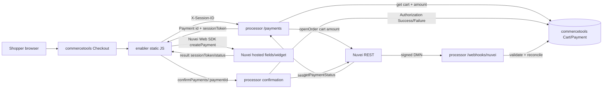
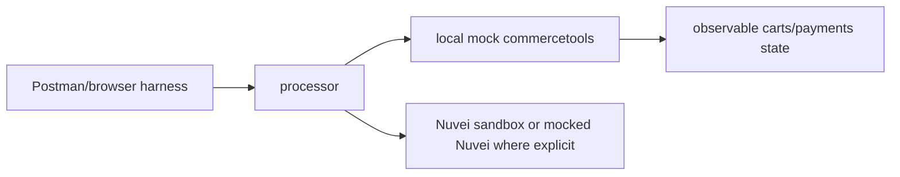

# Architecture Patterns

**Domain:** Nuvei commercetools Checkout payment connector
**Researched:** 2026-06-02
**Overall confidence:** HIGH for repository-observed architecture; MEDIUM for Nuvei DMN field behavior until sandbox payloads prove exact correlation fields.

## Recommended Architecture

The connector should remain a two-application commercetools Connect payment connector:

- `enabler` is a browser asset package that renders Nuvei-hosted payment UI and calls the processor with the commercetools Checkout session header. It must never handle PAN outside Nuvei-hosted fields.
- `processor` is the only backend integration boundary for commercetools Payments, Checkout operations, Nuvei REST APIs, and Nuvei DMN webhooks.
- Nuvei is the execution-state source of truth; commercetools Payment is the commerce-state ledger. Browser confirmation is a fast path, not the final reconciliation authority. DMN processing is the canonical eventual-consistency path.

This matches the commercetools payment integration template: the enabler exposes frontend payment capabilities, the processor performs PSP operations, updates Payments, exposes Payment Intents/Transactions operations, and listens to asynchronous PSP events. The implementation should be treated as a customized template, not production-ready by default.

## Component Boundaries

| Component | Responsibility | Must Not Do | Communicates With |
|-----------|----------------|-------------|-------------------|
| `enabler/src/index.ts` / `NuveiEnabler` | Public browser API; validates constructor options; returns card component and embedded drop-in builders. | Create commercetools Payments directly; call Nuvei server APIs; store secrets. | Checkout/custom storefront, card/drop-in builders. |
| `enabler/src/components/card.ts` | Loads Nuvei SDK, calls `POST /payments` with `{ paymentMethodOptions: { card: {} } }`, renders Nuvei card Web Component, forwards approved result to processor confirmation. | Decide final payment state; hardcode long-term shopper/billing defaults; expose PAN. | `api-service`, Nuvei Web SDK. |
| `enabler/src/dropin/dropin-embedded.ts` | Transitional embedded drop-in flow using the same session creation and confirmation pattern. | Diverge from card reconciliation model; become the default path until card is proven. | `api-service`, Nuvei Web SDK. |
| `enabler/src/services/api-service.ts` | Thin fetch wrapper for processor browser endpoints with `X-Session-ID`. | Interpret PSP state beyond basic callback handling; retry financial operations blindly. | Processor `/payments`, `/payments/confirmPayments/:id`. |
| `processor/src/routes/nuvei-payment.route.ts` | Browser/session routes: create payment intent/session, confirm payment, receive Nuvei DMN. | Accept unauthenticated browser payment mutation; process DMN without checksum/header validation. | `NuveiPaymentService`, auth hooks. |
| `processor/src/routes/operation.route.ts` | Checkout operation routes: config/status/components, Payment Intents capture/cancel/refund, Transactions API creation. | Use session-only auth for back-office Checkout operations. | `AbstractPaymentService`/`NuveiPaymentService`, commercetools auth hooks. |
| `processor/src/services/nuvei-payment.service.ts` | Orchestrates cart amount lookup, Nuvei `openOrder`/status/settle/void/refund, commercetools Payment creation/update, DMN reconciliation. | Trust browser-only result as final if Nuvei status/DMN contradicts it; update the wrong Payment on ambiguous identifiers. | Nuvei client, commercetools SDK services, event converter, CT payment creation service. |
| `NuveiEventConverter` | Converts DMN transaction type/status fields into commercetools transaction updates. | Fetch Payments or perform side effects; decide correlation. | `NuveiPaymentService`. |
| Local mock commercetools harness | Deterministic local visibility into cart/payment mutations and connector calls before sandbox E2E. | Replace Nuvei sandbox validation or prove real DMN field names. | Processor, mock CT endpoints, Postman/manual scenarios. |

## Data Flow

### 1. Enabler-to-Processor card flow

1. Checkout loads `connector-enabler.es.js` and instantiates `NuveiEnabler` with `processorUrl`, `sessionId`, Nuvei merchant config, environment, callbacks, and optional locale.
2. `createComponentBuilder("card")` returns `CardComponentBuilder`; unsupported component types fail at the enabler boundary.
3. `CardComponent.mount(selector)` concurrently loads the Nuvei SDK and calls `api.createPayment({ paymentMethodOptions: { card: {} } })`.
4. `api-service` sends `POST {processorUrl}/payments` with `Content-Type: application/json` and `X-Session-ID: {sessionId}`.
5. Processor session auth derives the cart/session context. `createPaymentIntent()` loads the cart, derives amount from cart payment amount, calls Nuvei `openOrder`, creates/links a commercetools Payment with the Nuvei session token as the initial interaction/interface identifier, and returns `sessionToken`, `paymentReference`, and `merchantReturnUrl`.
6. The enabler initializes Nuvei `SafeCharge` with merchant config and calls `sfc.createPayment` using:
   - `sessionToken` from processor,
   - `merchant_unique_id: paymentReference`,
   - Nuvei-hosted card collection,
   - current first-pass billing defaults (`country: "US"`, empty email) that should be replaced by validated Checkout/cart/shopper inputs.
7. On Nuvei callback, the enabler calls processor confirmation only for `transactionStatus === "APPROVED"`; failures currently go straight to `onError`.

Architectural direction: keep `sessionToken` private to the active session context and treat `paymentReference` (commercetools Payment ID) as the browser-visible Payment correlation key. Replace binary callback handling with an explicit approved/rejected/pending model once delayed Nuvei confirmation behavior is validated.

### 2. Processor-to-Nuvei session and operation flow

| Processor action | Nuvei API | commercetools update | Identifier used |
|------------------|-----------|----------------------|-----------------|
| Browser/session payment creation | `openOrder` | Create/link Payment; store session token as initial interaction/interface ID. | `sessionToken` for session, Payment ID for CT reference. |
| Server-driven transaction creation | `openOrder` | Create/link Payment for `transactionDraft.cartId`; return pending transaction status. | Cart ID as `clientUniqueId`, `sessionToken` as interaction. |
| Browser confirmation | `getPaymentStatus(sessionToken)` | Add Authorization Success with Nuvei `transactionId`, or Failure with `sessionToken`. | Session token input; Nuvei `transactionId` for approved authorization. |
| Capture | `settleTransaction(relatedTransactionId)` | Payment Intents response with approved PSP reference. | Last successful Authorization `interactionId`; fallback to `payment.interfaceId`. |
| Cancel authorization | `voidTransaction(relatedTransactionId)` | Payment Intents response with approved PSP reference. | Last successful Authorization `interactionId`; fallback to `payment.interfaceId`. |
| Refund | `refundTransaction(relatedTransactionId)` | Payment Intents response with received/approved PSP reference. | Provided transaction ID, else last successful Charge `interactionId`, else `payment.interfaceId`. |

The critical implementation rule is to promote from session identifier to financial transaction identifier as soon as Nuvei returns `transactionId`. Later capture/cancel/refund must use the successful Authorization/Charge interaction ID, not the openOrder session token, except as a safe fallback for legacy/incomplete states.

### 3. Browser confirmation reconciliation flow

1. `POST /payments/confirmPayments/:paymentReference` requires session-header auth.
2. Service loads the commercetools Payment by ID.
3. `assertSessionPaymentAccess()` verifies the supplied session token is already associated with that Payment and that the Payment is attached to the authenticated session cart.
4. Processor calls `getPaymentStatus({ sessionToken })`.
5. For approved status (`status === "SUCCESS"` and `transactionStatus === "APPROVED"`), processor requires `transactionId`, verifies cart/client ID, amount, and currency, and adds a successful Authorization with `interactionId: transactionId`.
6. For non-approved status, processor adds an Authorization Failure using the session token.

Architectural direction: confirmation should never create success from browser callback alone. It must verify against Nuvei status and amount/currency. If Nuvei status is inconclusive, the endpoint should represent pending explicitly rather than forcing rejection, because DMN may later authorize the same Payment.

### 4. Nuvei DMN reconciliation flow

1. Nuvei sends DMN to `POST /webhooks/nuvei`.
2. Route authenticates with Nuvei header/checksum hook and preserves raw body for checksum verification.
3. `processNuveiDmn()` validates the DMN checksum using configured algorithm and validates merchant/site IDs against connector config.
4. DMN correlation currently reads `merchant_unique_id` as the commercetools Payment ID. This is the intended canonical correlation path because the browser sets `merchant_unique_id` to `paymentReference` when creating the Nuvei payment.
5. Processor loads that Payment and checks duplicate processing by matching DMN `TransactionID`/`TransactionId` against existing transaction `interactionId`s.
6. Converter maps DMN data to one or more Payment transaction updates and optional payment method metadata.
7. Processor rejects unsafe updates where DMN amount/currency does not match the Payment. For successful Authorization/Charge DMNs, it calls Nuvei `getPaymentStatus` using the stored Payment session token and requires:
   - Nuvei status confirms success,
   - returned session token matches `payment.interfaceId` when present,
   - returned `transactionId` matches DMN PSP reference,
   - DMN `clientUniqueId` matches Nuvei status `clientUniqueId`,
   - amount/currency match the Payment.
8. Processor applies each transaction update and then payment method metadata updates.

Architectural direction: keep DMN processing strict. A DMN that cannot prove Payment ID, merchant account, Nuvei transaction ID, amount, and currency must fail closed. Duplicate DMNs must be acknowledged without duplicating transactions once the same Nuvei transaction ID is already present.

## Transaction Identifier Strategy

| Identifier | Origin | Store in commercetools | Use For | Risk if misused |
|------------|--------|------------------------|---------|-----------------|
| Cart ID / `clientUniqueId` | Processor sends to Nuvei `openOrder`. | Not as Payment primary interface ID; verify against session context/status. | Ensure Nuvei status/DMN belongs to the authenticated cart. | Cart ID alone can be too broad when retries create multiple Payments. |
| commercetools Payment ID / `paymentReference` | Created by processor during Payment creation. | Native Payment resource ID. | Canonical `merchant_unique_id` sent by enabler to Nuvei and expected back in DMN. | If Nuvei does not echo it in every DMN, reconciliation cannot safely load one Payment. |
| Nuvei `sessionToken` | Returned by `openOrder`. | Initial Payment `interfaceId`/interaction ID. | Browser session, `getPaymentStatus`, access assertion before confirmation. | Not the final financial transaction ID; capture/refund may target wrong object if used after authorization. |
| Nuvei `transactionId` / DMN `TransactionID` | Returned by status/DMN/settle/void/refund. | Successful transaction `interactionId`; `pspReference` in updates. | Idempotency, capture/cancel/refund, support lookup. | Missing/duplicated IDs cause duplicate or untraceable financial transactions. |
| Payment transaction `interactionId` | Processor writes from Nuvei IDs. | Each CT transaction. | Idempotency check and selecting related transaction for later operations. | Non-unique or session-token fallback can misattribute operations. |

Recommended canonical policy:

1. Use commercetools Payment ID as Nuvei `merchant_unique_id` for browser-originated payments.
2. Use cart ID only as `clientUniqueId` and as a secondary validation field.
3. Store `sessionToken` only as the openOrder/session identifier.
4. Store Nuvei `transactionId` on every successful financial transaction and prefer it for capture/cancel/refund.
5. Reject DMNs that lack a usable Payment ID or whose financial fields do not match the loaded Payment.
6. Prove with Nuvei sandbox payloads that `merchant_unique_id` is echoed for authorization, decline, 3DS, capture, cancel, refund, duplicate, and mismatch events before treating the architecture as production-ready.

## Mocked commercetools Local Testing Architecture

Local testing should isolate connector behavior before full commercetools Checkout/Nuvei sandbox E2E:

Use the mock commercetools layer to validate:

- Payment creation links the Payment to the expected cart and amount.
- `interfaceId`/transaction `interactionId` transitions from session token to Nuvei transaction ID correctly.
- Duplicate DMN payloads do not add duplicate transactions.
- Amount/currency mismatches fail closed.
- Capture/cancel/refund select the latest successful Authorization/Charge interaction ID.

Do not use mock CT tests as proof of Nuvei behavior. Mocking is for deterministic connector state transitions and request visibility; real Nuvei sandbox fixtures are still required for DMN field names, status values, 3DS behavior, and delayed confirmation timing.

## Patterns to Follow

### Pattern 1: Processor as the only financial orchestration boundary

**What:** All Nuvei REST calls and all commercetools Payment writes happen in `NuveiPaymentService` behind authenticated routes.

**Why:** Browser code should only load PSP-hosted UI and request/confirm sessions. This reduces PCI exposure and prevents shoppers from forging Payment updates.

**Implementation rule:** New payment methods add enabler rendering plus processor validation, but do not bypass `createPaymentIntent()`, `confirmPayment()`, or DMN reconciliation.

### Pattern 2: Validate before mutating Payment

**What:** Every successful financial state update must be preceded by identifier, amount, currency, merchant account, and PSP-status validation.

**Why:** The core failure mode is duplicate, missing, or misattributed transactions. Validation must happen before `ctPaymentService.updatePayment()`.

**Current examples:** `assertSessionPaymentAccess`, `assertNuveiStatusMatchesPayment`, `assertDmnMatchesConfig`, `assertDmnUpdateMatchesPayment`, and `assertDmnMatchesNuveiStatus`.

### Pattern 3: Idempotency by PSP transaction ID

**What:** DMN duplicate detection uses Nuvei `TransactionID`/`TransactionId` matched against existing transaction `interactionId`s.

**Why:** PSP webhooks may retry. A repeated notification should produce the same Payment state, not another transaction row.

**Required hardening:** Ensure every converter path emits stable interaction IDs; handle duplicate failure/pending events as deliberately as success events.

### Pattern 4: Native commercetools Payment fields only

**What:** Use `interfaceId`, `paymentMethodInfo`, `paymentStatus.interfaceCode`, and `transactions[]`; do not introduce Custom Types for the current card-first architecture.

**Why:** The current project decision keeps deployment simpler and avoids post-deploy/pre-undeploy schema lifecycle risk. Only add Custom Types if a future phase proves native fields cannot safely hold required non-sensitive metadata.

## Anti-Patterns to Avoid

### Anti-Pattern 1: Browser callback as final truth

**What:** Treating `onResult(APPROVED)` as enough to complete checkout.

**Why bad:** Browser callbacks can be delayed, stale, interrupted, or inconsistent with final PSP settlement. The processor must verify with Nuvei and DMN must reconcile final state.

**Instead:** Browser callback triggers `confirmPayment`; DMN remains the eventual authority.

### Anti-Pattern 2: Ambiguous Payment correlation

**What:** Loading a Payment from cart ID, session token, or free-form DMN fields without a one-to-one mapping.

**Why bad:** Retries and duplicate sessions can create multiple Payments per cart; using a broad key can update the wrong Payment.

**Instead:** Use Payment ID in `merchant_unique_id`; use cart ID only as secondary validation.

### Anti-Pattern 3: Expanding methods before card reconciliation is proven

**What:** Adding wallets/APMs/drop-in variants before card DMN/confirmation/capture/refund paths are correct.

**Why bad:** Every method multiplies correlation, metadata, redirect, and webhook cases.

**Instead:** Complete card-first reconciliation, then add one method at a time through a typed method registry and shared tests.

### Anti-Pattern 4: Mock-only production confidence

**What:** Treating local mock CT or unit tests as proof that Nuvei/commercetools Checkout work end-to-end.

**Why bad:** The unresolved risk is real DMN payload shape and real Checkout session behavior.

**Instead:** Use mocks for fast state-transition checks, then capture sandbox fixtures and run Checkout Complete Checkout and Payment Only scenarios.

## Integration Risks

| Risk | Severity | Why It Matters | Mitigation |
|------|----------|----------------|------------|
| Nuvei DMN does not echo `merchant_unique_id` as Payment ID for every event type. | Critical | Processor cannot safely load exactly one Payment. | Capture sandbox DMNs for auth, decline, 3DS, capture, cancel, refund; adjust canonical ID strategy only from observed payloads. |
| `clientUniqueId` remains cart ID while `merchant_unique_id` is Payment ID. | High | Mixing the two as primary keys can misattribute retries. | Document and enforce: Payment ID is primary; cart ID is validation only. |
| Session token used after authorization as related transaction ID. | High | Capture/cancel/refund can target wrong Nuvei object. | Prefer latest successful Authorization/Charge `interactionId` populated with Nuvei `transactionId`. |
| Delayed/inconclusive Nuvei confirmation treated as rejection. | High | Shopper may see failure while DMN later authorizes funds. | Add pending outcome and bounded polling; let DMN reconcile final state. |
| Hardcoded billing country/email in card component. | Medium | 3DS/risk checks and regional behavior may fail or be inaccurate. | Source billing/shopper fields from Checkout/cart/options with runtime validation. |
| DMN duplicate handling only checks existing interaction IDs. | Medium | Missing/variant IDs could duplicate failure or pending transactions. | Normalize transaction ID extraction and define duplicate semantics for every converter output. |
| Payment method support drifts between enabler and processor. | Medium | Merchant Center may render unsupported methods or options that Nuvei ignores. | Use a single typed supported-method registry mirrored by generated/shared package data. |
| Logs leak tokens/checksums/raw payload details. | Medium | Payment integrations handle sensitive identifiers. | Keep redaction helpers; audit route/service logs; never log raw DMN or session tokens. |

## Suggested Build Order

1. **Lock the card correlation contract**
   - Prove `merchant_unique_id = commercetools Payment ID` in real Nuvei sandbox DMNs.
   - Record which fields appear for authorization, decline, 3DS, capture, cancel, refund, duplicates, and mismatches.
   - Update converter/correlation code only after observed payloads justify the change.

2. **Harden DMN reconciliation before adding features**
   - Make DMN duplicate detection and mismatch rejection explicit for all mapped transaction types.
   - Keep checksum, merchant/site, transaction ID, amount, currency, and Nuvei status checks ahead of Payment updates.
   - Add local mock CT scenarios for duplicate, out-of-order, mismatch, and unknown Payment events.

3. **Fix browser confirmation semantics**
   - Change binary approved/rejected handling to approved/rejected/pending.
   - Add bounded polling or explicit pending callback behavior for delayed Nuvei status.
   - Ensure browser completion cannot conflict with later DMN success/failure.

4. **Correct Checkout-facing contracts**
   - Replace hardcoded card billing data with validated inputs from Checkout/cart/shopper options.
   - Centralize supported payment method definitions so enabler builders and `/payment-components` cannot drift.
   - Decide whether embedded drop-in is production-supported or transitional.

5. **Stabilize Payment Intents operations**
   - Verify capture, cancel, refund, and reverse always choose the correct Nuvei financial transaction ID.
   - Exercise operations against Payments that were authorized by browser confirmation and by DMN.

6. **Run sandbox E2E after local state transitions are deterministic**
   - Complete Checkout and Payment Only modes.
   - Successful authorization, decline, 3DS, duplicate DMN, capture, cancel authorization, refund.
   - Preserve real fixtures for regression tests and runbooks.

7. **Only then expand payment methods**
   - Add each wallet/APM through the same method registry, identifier strategy, DMN validation, and operation tests.

## Scalability Considerations

| Concern | At local/dev | At initial production | At high volume |
|---------|--------------|-----------------------|----------------|
| DMN processing | Synchronous processing is acceptable for debugging. | Keep strict validation and return deterministic 2xx only after idempotent state is applied/skipped. | Consider durable event persistence/queue if Nuvei retries or commercetools latency threatens webhook response times. |
| Payment lookup | Load by Payment ID from `merchant_unique_id`. | Same, with defensive mismatch rejection. | Avoid search-by-cart or broad queries; preserve O(1) lookup by Payment ID. |
| Duplicate events | Unit/local fixtures. | Interaction ID idempotency for every Nuvei transaction ID. | Add event fingerprinting if Nuvei sends duplicate event types with missing/variant transaction fields. |
| Observability | Local mock state and logs. | Redacted logs keyed by Payment ID, cart ID, session token suffix, Nuvei transaction ID. | Dashboards on DMN failures, mismatch rejects, capture/refund rejects, and pending confirmations. |

## Sources

- Repository: `.planning/PROJECT.md` (core value, requirements, constraints, mock CT context).
- Repository: `docs/ARCHITECTURE.md` (existing connector shape, endpoint auth model, mapping policy).
- Repository: `docs/PLAN.md` and `docs/NEXT_STEPS_PLAN.md` (known production gaps and phase ordering).
- Repository source: `processor/src/routes/nuvei-payment.route.ts` and `processor/src/routes/operation.route.ts` (route boundaries and auth).
- Repository source: `processor/src/services/nuvei-payment.service.ts` (Nuvei/CT orchestration, confirmation, DMN validation, operation identifier selection).
- Repository source: `enabler/src/index.ts`, `enabler/src/components/card.ts`, `enabler/src/dropin/dropin-embedded.ts`, `enabler/src/services/api-service.ts` (browser-to-processor flow).
- commercetools docs: Payment integration template implementation and best practices, https://docs.commercetools.com/connect/templates/payment-integration.md (processor/enabler architecture, idempotency, webhooks, PCI, failure design).
