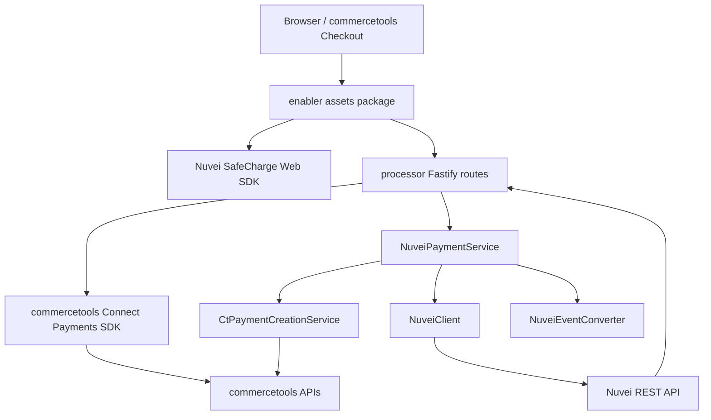

<!-- Generated by GSD. Do not edit manually. -->
# Architecture

## System overview

The Nuvei commercetools Connector is a commercetools Connect payment integration with two deployed applications: an `assets` application (`enabler`) that runs in the browser and renders either Nuvei Simply Connect or Nuvei Web SDK card mode, and a `service` application (`processor`) that exposes Fastify HTTP routes for commercetools Checkout, creates and updates commercetools Payments, and calls Nuvei server APIs. The primary inputs are commercetools session- or OAuth-authenticated payment requests, Nuvei widget callbacks, and Nuvei Direct Merchant Notification (DMN) webhooks. The primary outputs are Nuvei payment sessions or transaction operations and updated commercetools Payment transactions. The architecture is layered around a thin routing layer, a payment orchestration service, external API clients, and browser-side widget adapters.

## Component diagram



## Data flow

### Checkout payment creation and confirmation

1. A storefront or commercetools Checkout page instantiates the Checkout-facing `Enabler` adapter from `enabler/src/index.ts` with the processor URL, commercetools session ID, locale/country when available, and completion/error callbacks. Nuvei merchant identifiers and environment are fetched from the processor, not supplied by the shopper page.
2. The caller asks the enabler for a card component builder (`card`). The adapter returns the Web SDK card builder path by default because it is host-submit compatible (`componentHasSubmit = true`).
3. `apiService.getConfig()` sends `GET /operations/config` with `X-Session-ID`; the processor returns Nuvei frontend configuration from secured Connect configuration.
4. `WebSdkCardComponent` loads the Nuvei SafeCharge Web SDK from `https://cdn.safecharge.com/safecharge_resources/v1/websdk/safecharge.js` and calls the processor through `apiService` in `enabler/src/services/api-service.ts`.
5. `apiService.createPayment()` sends `POST /payments/session` with `X-Session-ID`. The processor registers this route in `processor/src/server/plugins/nuvei-payment.plugin.ts` and authenticates it with the commercetools session header hook. The request body can include `paymentMethodOptions` and defaults to `card` when omitted.
6. `NuveiPaymentService.createPaymentSession()` reads the cart ID from request context, fetches the cart through the commercetools Connect Payments SDK, calculates the planned payment amount, calls `NuveiClient.openOrder()`, and creates a commercetools Payment through `CtPaymentCreationService.handleCtPaymentCreation()`.
7. The processor returns the cart ID, Nuvei `sessionToken`, commercetools payment reference, and merchant return URL to the enabler.
8. The enabler renders the Nuvei card field using `SafeCharge(...).fields().create("card", ...)`. On submit it calls `SafeCharge(...).createPayment(...)` with the Nuvei session token, sends `clientUniqueId` as the commercetools cart ID, and sends the commercetools Payment ID through Nuvei merchant-reference aliases (`merchant_unique_id`, `merchantUniqueId`, and `merchantUniqueID`). The exact CT Payment is correlated by `merchant_unique_id` when it is a CT Payment ID, by DMN `sessionToken` matching `Payment.interfaceId`, or, for legacy/cart-referenced DMNs, by matching Nuvei transaction identifiers against existing cart Payment transactions.
9. After the widget reports a result, `confirmPaymentResult()` calls `POST /payments/confirm/:paymentReference` with the Nuvei session token.
10. `NuveiPaymentService.confirmPayment()` retrieves the commercetools Payment, verifies that the authenticated session cart owns that Payment, calls `NuveiClient.getPaymentStatus()`, classifies the Nuvei status, and returns a tri-state outcome: `approved`, `rejected`, or `pending`. Terminal approved and rejected confirmations write one CT `Authorization` transaction. The interaction ID prefers Nuvei `PPP_TransactionID`, then Nuvei `TransactionID`/`transactionId`, then the already-bound Nuvei session token as a final idempotency key. Pending (inconclusive or unknown Nuvei status) does not write a CT transaction.

### Server-driven transaction creation

1. commercetools Checkout can call `POST /transactions` using OAuth2 plus `manage_checkout_transactions` authorization.
2. `operationsRoute` forwards the request to `NuveiPaymentService.handleTransaction()`.
3. The service fetches the cart, determines the requested or cart-derived amount, opens a Nuvei order, creates a commercetools Payment, attaches it to the cart, and returns a transaction status (`Pending` or `Failed`).

### Payment modification operations

1. commercetools Checkout calls `POST /payment-intents/:id` using OAuth2 plus `manage_checkout_payment_intents` authorization.
2. `operationsRoute` passes the request to the local `AbstractPaymentService.modifyPayment()` flow in `processor/src/services/abstract-payment.service.ts`, with Nuvei-specific methods implemented by `NuveiPaymentService`.
3. `NuveiPaymentService.capturePayment()` calls Nuvei `settleTransaction` and returns an approved modification response.
4. `NuveiPaymentService.cancelPayment()` calls Nuvei `voidTransaction` and returns an approved modification response.
5. `NuveiPaymentService.refundPayment()` calls Nuvei `refundTransaction` and returns a received modification response because refunds can complete asynchronously.
6. `NuveiPaymentService.reversePayment()` chooses refund when a successful `Charge` exists, cancel when a successful `Authorization` exists, and otherwise rejects the operation as invalid.

### Nuvei DMN webhook reconciliation

1. Nuvei sends a DMN webhook to `POST /webhooks/nuvei`.
2. Fastify captures the raw body for `/webhooks/nuvei` and routes the request through `NuveiHeaderAuthHook`.
3. `NuveiPaymentService.processNuveiDmn()` validates Nuvei's SHA-256 DMN checksum with `NuveiClient.validateDmnChecksum()` and verifies the merchant ID and merchant site ID against configured values.
4. The service resolves the exact commercetools Payment by `merchant_unique_id` when it is a CT Payment ID. If `merchant_unique_id` is absent or not a CT Payment ID, it falls back to `sessionToken -> Payment.interfaceId`. If Nuvei sent a cart ID in `merchant_unique_id`, the service loads linked cart Payments and disambiguates by amount/currency plus existing Nuvei transaction identity or a single existing terminal Payment.
5. The service skips processing if the DMN terminal transaction is already represented on the Payment, including cases where `/payments/confirm/:id` previously wrote the terminal state with a fallback Nuvei transaction ID.
6. `NuveiEventConverter.convertDmnToPaymentUpdate()` maps the Nuvei transaction type and `ppp_status` into a commercetools transaction type and state.
7. For successful authorization or charge DMNs, the service confirms the DMN against `getPaymentStatus`, verifies currency, amount, transaction ID, and cart identity, then updates the commercetools Payment.
8. Optional card metadata from the DMN (`cardCompany`, `cardType`) updates `paymentMethodInfo.method` and `paymentMethodInfo.name`.

## Key abstractions

| Abstraction | Location | Role |
| --- | --- | --- |
| `Enabler` | `enabler/src/index.ts` | Checkout-facing payment-template-compatible adapter; accepts `processorUrl` and `sessionId`, fetches Nuvei config from the processor, and returns the Web SDK card builder. |
| `NuveiSimplyConnectEnabler` | `enabler/src/index.ts` | Nuvei-specific browser entry point for Simply Connect mode; returns the Simply Connect card builder. |
| `NuveiWebSdkEnabler` | `enabler/src/index.ts` | Nuvei-specific browser entry point for Web SDK mode; returns the Web SDK card builder. |
| `NuveiEnabler` | `enabler/src/index.ts` | Nuvei-specific facade that requires an explicit mode parameter (`simply-connect` or `web-sdk`) and delegates to the matching card enabler. |
| `PaymentEnabler`, `PaymentComponentBuilder` | `enabler/src/payment-enabler/payment-enabler.ts` | Frontend contracts consumed by commercetools Checkout or custom storefront code. |
| `PAYMENT_METHOD_REGISTRY` | `enabler/src/payment-enabler/method-registry.ts`, `processor/src/dtos/operations/payment-components.dto.ts` | Registry of supported payment methods: `card` only. |
| `SimplyConnectCardBuilder` / `SimplyConnectCardComponent` | `enabler/src/components/simply-connect-card.ts` | Browser card integration for Simply Connect mode; creates a payment session, loads Nuvei SDK, renders the widget, and routes tri-state confirmation outcomes. Not the default whitelabel Checkout path because Nuvei owns the internal pay button. |
| `WebSdkCardBuilder` / `WebSdkCardComponent` | `enabler/src/components/web-sdk-card.ts` | Browser card integration for Web SDK mode; creates a payment session, loads Nuvei SDK, renders the card field, awaits mount/submit lifecycle calls, and routes tri-state confirmation outcomes. |
| `apiService` | `enabler/src/services/api-service.ts` | Thin fetch client for `GET /operations/config`, `POST /payments/session`, and `POST /payments/confirm/:id`. |
| `NuveiClient` | `processor/src/clients/nuvei.client.ts` | Server-side Nuvei REST client for `openOrder`, `getPaymentStatus`, `settleTransaction`, `voidTransaction`, `refundTransaction`, and DMN checksum validation. |
| `NuveiPaymentService` | `processor/src/services/nuvei-payment.service.ts` | Core orchestration service for configuration, status, payment creation, transaction handling, payment modifications, confirmation, and DMN processing. |
| `CtPaymentCreationService` | `processor/src/services/ct-payment-creation.service.ts` | Creates commercetools Payments and attaches them to carts. |
| `NuveiEventConverter` | `processor/src/services/converters/nuvei-event.converter.ts` | Converts Nuvei DMN payload fields into commercetools Payment transaction update data. |
| `paymentSDK` | `processor/src/payment-sdk.ts` | Configures the commercetools Connect Payments SDK clients, auth hooks, context propagation, and logging adapter. |
| `setupFastify` | `processor/src/server/server.ts` | Builds the Fastify server, security headers, CORS policy, raw webhook body support, request context, plugins, and error handler. |

## HTTP route structure

| Method | Path | Implemented in | Auth model | Purpose |
| --- | --- | --- | --- | --- |
| `GET` | `/config` | `processor/src/routes/operation.route.ts` | commercetools session header | Return frontend Nuvei environment, merchant ID, and merchant site ID. |
| `GET` | `/status` | `processor/src/routes/operation.route.ts` | JWT | Run commercetools permission and Nuvei reachability checks. |
| `GET` | `/health` | `processor/src/routes/operation.route.ts` | None | No auth. Returns `{ status: ok|degraded, commit: string, checks: [{name, status}] }` based on config-var presence plus the running commit hash. |
| `GET` | `/payment-components`, `/operations/payment-components` | `processor/src/routes/operation.route.ts` | JWT | Return supported components and express methods. |
| `POST` | `/payment-intents/:id`, `/operations/payment-intents/:id` | `processor/src/routes/operation.route.ts` | OAuth2 + `manage_checkout_payment_intents` | Capture, cancel, refund, or reverse a payment intent. |
| `POST` | `/transactions`, `/operations/transactions` | `processor/src/routes/operation.route.ts` | OAuth2 + `manage_checkout_transactions` | Create a server-driven Nuvei order and commercetools Payment for a cart. |
| `POST` | `/payments/session` | `processor/src/routes/nuvei-payment.route.ts` | commercetools session header | Create a payment session for the `card` payment method, defaulting to `card` if omitted. |
| `POST` | `/payments/confirm/:id` | `processor/src/routes/nuvei-payment.route.ts` | commercetools session header | Confirm a payment with Nuvei and return `{ outcome: "approved" \| "rejected" \| "pending" }`. HTTP `200` for approved and pending, `402` for rejected. CT `Authorization` `interactionId` prefers Nuvei `PPP_TransactionID`, then Nuvei transaction ID, then the bound session token. |
| `POST` | `/webhooks/nuvei` | `processor/src/routes/nuvei-payment.route.ts` | Nuvei checksum/header hook | Process Nuvei DMN webhooks and reconcile Payment transactions. |

## Transaction and status mapping

`processor/src/services/payment-converter.ts` defines the mapping from Nuvei events to commercetools Payment transactions.

| Nuvei transaction type | commercetools transaction type |
| --- | --- |
| `Auth`, `PreAuth` | `Authorization` |
| `Settle`, `Sale` | `Charge` |
| `Credit` | `Refund` |
| `Void` | `CancelAuthorization` |
| `Chargeback` | `Chargeback` |

| Nuvei `ppp_status` | commercetools transaction state |
| --- | --- |
| `OK` | `Success` |
| `FAIL` | `Failure` |
| Any other value | `Pending` |

`getStatusInterfaceCode()` derives the following `paymentStatus.interfaceCode` values only when the transaction is successful and the transaction amount equals the planned payment amount.

| Transaction type | Interface code |
| --- | --- |
| `Authorization` | `authorized` |
| `Charge` | `paid` |
| `Refund` | `refunded` |
| `CancelAuthorization` | `cancelled` |
| Any failed transaction | `failed` |

## Directory structure rationale

```text
.
├── connect.yaml
├── enabler/
│   ├── src/
│   │   ├── components/
│   │   ├── payment-enabler/
│   │   └── services/
│   └── package.json
├── processor/
│   ├── src/
│   │   ├── clients/
│   │   ├── config/
│   │   ├── connectors/
│   │   ├── dtos/
│   │   ├── libs/
│   │   ├── routes/
│   │   ├── server/
│   │   └── services/
│   └── package.json
└── examples/
    └── nuvei-web-ui/
```

- `connect.yaml` is the commercetools Connect deployment descriptor. It declares the `enabler` assets application and `processor` service application, plus required standard and secured configuration keys.
- `enabler/` is a Vite-built browser package. Its source is split by public payment contracts (`payment-enabler/`), explicit mode card components (`components/`), and external service wrappers (`services/`).
- `enabler/src/components/` contains the explicit mode card integrations. The current implemented components are `simply-connect-card.ts` and `web-sdk-card.ts`.
- `enabler/src/services/` isolates browser-side external effects: loading the Simply Connect and Web SDK loaders (`simply-connect-sdk.ts`, `web-sdk.ts`) and calling the processor API.
- `processor/` is a TypeScript Fastify service. Its source is split by HTTP concerns (`server/`, `routes/`, `dtos/`), business orchestration (`services/`), external clients (`clients/`), configuration (`config/`), Connect lifecycle scripts (`connectors/`), and shared infrastructure (`libs/`).
- `processor/src/server/` owns Fastify construction, plugin autoloading, request context, security headers, CORS, raw body handling, and global error handling.
- `processor/src/routes/` maps HTTP endpoints to service calls and keeps authentication/authorization requirements close to route definitions.
- `processor/src/services/` owns payment behavior that must remain independent of Fastify route syntax: payment session creation, commercetools Payment creation, Nuvei transaction operations, DMN conversion, and reconciliation.
- `processor/src/clients/` contains the Nuvei API client so request signing, endpoint normalization, timeout handling, and checksum validation are centralized.
- `processor/src/dtos/` defines TypeBox schemas for route validation and response typing.
- `examples/nuvei-web-ui/` contains the phase 2 evidence harness, the mock commercetools server, and the mode selector page at `index.html`.

## Runtime configuration boundaries

The processor reads runtime configuration from environment variables in `processor/src/config/config.ts`; `connect.yaml` declares the Connect-facing configuration keys. Required values include commercetools project/client configuration, commercetools API/Auth/Session/Checkout/JWKS URLs, Nuvei merchant identifiers, Nuvei secret key, and Nuvei API base URL. `validateConfig()` rejects missing required values, unsupported DMN checksum algorithms, and non-HTTPS URLs for commercetools, Nuvei, return URL, and configured CORS origins.

The Checkout-facing frontend `Enabler` receives only host-provided Checkout values (`processorUrl`, `sessionId`, locale/country, callbacks). It retrieves Nuvei merchant ID, merchant site ID, and environment from `GET /operations/config`. Nuvei-specific helper classes still validate explicit merchant ID, merchant site ID, and environment when used directly by custom harnesses.

## Security and reliability boundaries

- Browser-to-processor payment creation and confirmation require a commercetools session ID through `X-Session-ID`.
- Checkout operations that modify payment intents or create transactions use OAuth2 authentication plus explicit authority checks.
- DMN webhook processing validates Nuvei checksum material and configured merchant identifiers before updating commercetools Payment data.
- DMN processing is idempotent: duplicate notifications are short-circuited by exact Nuvei transaction identity and by already-recorded equivalent terminal transactions for the same amount/state.
- Payment confirmation verifies that the Payment belongs to the authenticated cart session before accepting a Nuvei session token.
- Successful payment confirmations validate Nuvei-reported amount, currency, and cart identity before writing CT transactions. CT `Authorization` `interactionId` prefers canonical Nuvei `PPP_TransactionID`, then Nuvei `TransactionID`/`transactionId`, then the already-bound session token as the last stable idempotency key.
- Successful DMNs validate Nuvei-reported amount, currency, and cart identity before updating commercetools Payment data; cart-referenced DMNs are only accepted when they resolve to one exact linked Nuvei Payment.
- Fastify sets defensive response headers (`x-content-type-options`, `referrer-policy`, `x-frame-options`, and `permissions-policy`) for all responses.
- CORS allows requests with no `Origin`, the configured commercetools Checkout URL, the Merchant Center origin derived from `CTP_JWT_ISSUER`, and any explicitly configured `CORS_ALLOWED_ORIGINS`.
- The Nuvei SDK script is loaded with a fixed subresource integrity hash from `enabler/src/services/nuvei-sdk.ts`.

> **SECURITY GAP — requires follow-up:** Nuvei does not publish versioned CDN URLs for `safecharge.js`. The script is served from a mutable path (`/v1/websdk/safecharge.js`) that Nuvei can update at any time without notice. This means:
> - The pinned SRI hash in `NUVEI_SDK_INTEGRITY` will silently break when Nuvei pushes a CDN update, blocking all payment widget rendering.
> - There is no way to audit what changed between the version we pinned and the version now live — Nuvei does not publish changelogs tied to CDN deploys.
> - In the worst case, a supply-chain compromise of the Nuvei CDN would go undetected until the next time someone checks the hash manually.
>
> **Mitigations still required:**
> 1. Add a CI step that fetches `safecharge.js`, computes its SHA-384 hash, and fails the build (or opens an alert) when it diverges from `NUVEI_SDK_INTEGRITY`. This converts a silent production break into a detected drift.
> 2. Raise a support request with Nuvei asking for an immutable, versioned CDN URL or an official SRI hash publication channel.
> 3. Evaluate self-hosting a pinned copy of the script (noting PCI-DSS implications of serving payment JS from merchant infrastructure).
