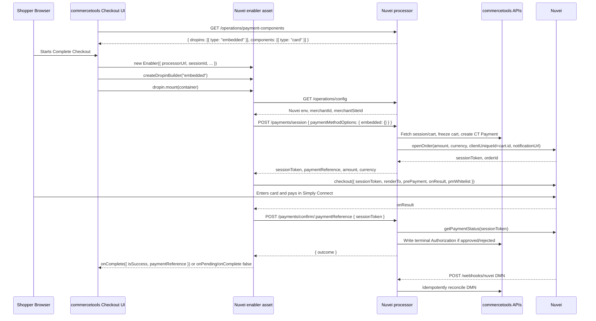

# Plan: Nuvei Simply Connect Drop-in for commercetools Checkout

## Goal

Expose Nuvei Simply Connect as a commercetools Checkout `DropIn` payment integration while keeping the existing Web SDK card component path available. After this plan is implemented, a merchant should be able to configure a Nuvei drop-in integration in Merchant Center, attach it to a Complete Checkout or Payment Only Application, run Checkout through the commercetools Browser SDK, and complete a sandbox card payment through Nuvei Simply Connect with commercetools Payment reconciliation.

The first working demo must stay card-first. Nuvei Simply Connect can render many payment methods, but this connector must not expose non-card APMs until each method has its own Nuvei setup, browser behavior, DMN mapping, operation support, fixtures, and runbook evidence.

## Source Findings

### commercetools Checkout and Connect

- Checkout Applications are configured in Merchant Center and connect to payment providers through installed Connectors. Complete Checkout and Payment Only Applications both use Payment Integrations. Source: [Checkout overview](https://docs.commercetools.com/checkout/overview.md).
- Merchant Center supports two standard payment integration types for normal payment integrations: `Web components` and `Drop-in`. Drop-in renders all payment methods in a connector/PSP-controlled container. Source: [Set up Checkout - Payment Integration types](https://docs.commercetools.com/learning-implement-checkout/implement-commercetools-checkout/set-up-checkout.md#payment-integration-types).
- When adding a Drop-in integration in Merchant Center, the operator selects the Connector, selects `Drop-in`, enters a Drop-in integration name, optionally enters a Payment integration key, saves it, and activates it. Source: [Connectors and Applications - Create a Complete Checkout Application](https://docs.commercetools.com/checkout/connectors-and-applications.md#create-a-complete-checkout-application).
- The Checkout Payment Integrations API represents this as `componentType: "DropIn"`. `PaymentIntegrationDraft` requires `application`, `connectorDeployment`, `name`, `type`, and `componentType`; `type` is the connector-advertised UI type. Source: [Checkout Payment Integrations API](https://docs.commercetools.com/checkout/payment-integrations-api.md).
- The Checkout Application API has `paymentsConfiguration.activePaymentComponentType` with enum values `Component`, `DropIn`, and `Express`. A demo Application that should use Nuvei Simply Connect drop-in must have the active payment component type set to `DropIn`. Source: [Checkout Applications API](https://docs.commercetools.com/checkout/applications-api.md).
- The Connect payment integration template uses two apps: an `assets` enabler that delivers browser payment UI code and a `service` processor that creates/updates Payments and handles PSP operations/webhooks. Source: [Payment integration template](https://docs.commercetools.com/connect/templates/payment-integration.md).
- The template processor exposes `GET /operations/payment-components` returning `{ dropins, components, express }`. Template drop-in types are `embedded` and `hpp`; the embedded drop-in builder sets `dropinHasSubmit = false`. Source: [connect-payment-integration-template payment-enabler contract](https://github.com/commercetools/connect-payment-integration-template/blob/main/enabler/src/payment-enabler/payment-enabler.ts) and [dropin-embedded.ts](https://github.com/commercetools/connect-payment-integration-template/blob/main/enabler/src/dropin/dropin-embedded.ts).
- The Checkout Browser SDK starts hosted Checkout with `checkoutFlow({ projectKey, sessionId, region, ... })` for Complete Checkout and `paymentFlow(...)` for Payment Only. Source: [Checkout Browser SDK](https://docs.commercetools.com/checkout/browser-sdk.md).

### Nuvei Simply Connect

- Nuvei Simply Connect is the appropriate drop-in-like browser product. It renders an embedded, PSP-controlled payment UI on the merchant page. Source: [Nuvei Simply Connect overview](https://docs.nuvei.com/documentation/accept-payment/simply-connect/).
- The backend must call `/openOrder` and return `sessionToken` to the browser. Required request material includes merchant identifiers, `clientRequestId`, amount, currency, timestamp, and a checksum built with the secret key. The secret key must stay backend-only. Source: [Quick Start to Simply Connect](https://docs.nuvei.com/documentation/accept-payment/simply-connect/quick-start-for-checkout/).
- The browser loads `https://cdn.safecharge.com/safecharge_resources/v1/checkout/checkout.js` and calls `checkout({ sessionToken, env, merchantId, merchantSiteId, amount, currency, country, renderTo, onResult, ... })`. Source: [Quick Start to Simply Connect](https://docs.nuvei.com/documentation/accept-payment/simply-connect/quick-start-for-checkout/#3-perform-a-checkout-payment).
- Browser `onResult` is not authoritative. The merchant server must verify the outcome through `/getPaymentStatus` or by processing DMN webhooks. `/getPaymentStatus` must not be used for polling. Source: [Simply Connect response verification](https://docs.nuvei.com/documentation/accept-payment/simply-connect/quick-start-for-checkout/#4-response-verification).
- Nuvei DMNs are server-to-server notifications. They should be acknowledged with HTTP 200 after processing/persisting the event, can be POSTed, include transaction outcome fields, and require checksum validation. Source: [Nuvei Webhooks/DMNs](https://docs.nuvei.com/documentation/integration/webhooks/) and [Payment DMNs](https://docs.nuvei.com/documentation/integration/webhooks/payment-dmns/).
- Simply Connect supports `prePayment`, `onResult`, `onPaymentEvent`, and other callbacks. `prePayment` can pause payment and call `resolve()` or `reject()`, which is the right place to invoke Checkout-provided pre-submit gating when Nuvei owns the pay button. Source: [Simply Connect Event Callbacks](https://docs.nuvei.com/documentation/accept-payment/simply-connect/event-callbacks/).
- Simply Connect can whitelist or blacklist APMs through `pmWhitelist` or `pmBlacklist`. For this connector's first demo, use this to keep the drop-in card-only until APM-specific reconciliation is implemented. Source: [Simply Connect payment customization](https://docs.nuvei.com/documentation/accept-payment/simply-connect/payment-customization/#apm-whitelistingblacklisting).

### Current Repository State

- `connect.yaml` already declares the required Connect app split: `enabler` as `assets` and `processor` as `service`.
- The enabler already exports a Checkout-facing `Enabler`, but it currently exposes `createComponentBuilder("card")` as the default Checkout path and rejects every drop-in request in `enabler/src/payment-enabler/checkout-enabler.ts`.
- `NuveiSimplyConnectEnabler` and `SimplyConnectCardBuilder` already load Simply Connect and call `checkout(...)`, but they are modeled as a card component, not as a commercetools `DropIn` builder.
- The processor already has the core server primitives needed for Simply Connect drop-in: `POST /payments/session` creates a Nuvei `openOrder`, creates a CT Payment, freezes the cart, and returns `sessionToken`; `POST /payments/confirm/:id` calls `getPaymentStatus`; `POST /webhooks/nuvei` validates and reconciles DMNs.
- `GET /operations/payment-components` currently returns `dropins: []` and `components: [{ type: "card" }]`.
- The processor registry currently only treats `card` as supported. Earlier roadmap/docs explicitly removed embedded/drop-in support, so tests and docs must be updated as an intentional reversal.

## Target Architecture

### Merchant Center Surface

The connector must advertise two UI surfaces:

| Checkout UI type | Connector-advertised type | Purpose | Initial PSP methods |
| --- | --- | --- | --- |
| `Component` | `card` | Existing Web SDK card component path where Checkout owns submit. | Card |
| `DropIn` | `embedded` | New Nuvei Simply Connect embedded drop-in where Nuvei owns submit. | Card only for MVP |

`embedded` is the correct connector type because Nuvei Simply Connect renders in-place in the Checkout page. Do not use `hpp` because this is not a hosted payment page redirect integration.

### Browser Enabler Contract

The Checkout-facing enabler should support both builder paths:

```ts
const enabler = new Enabler({ processorUrl, sessionId, locale, countryCode, onComplete, onError });

const cardBuilder = await enabler.createComponentBuilder("card");
const dropinBuilder = await enabler.createDropinBuilder("embedded");
```

The drop-in builder must use the template drop-in contract, not the card component contract:

```ts
type PaymentDropinBuilder = {
  dropinHasSubmit: boolean;
  build(config: DropinOptions): DropinComponent;
};
```

For Simply Connect, `dropinHasSubmit` must be `false` because Nuvei renders and owns the pay button inside the widget. The component should still implement `submit()` defensively, but Checkout should not need to call it.

### Runtime Flow



## Implementation Plan

### 1. Restore Drop-in as a First-Class UI Type

Files:

- `enabler/src/payment-enabler/method-registry.ts`
- `processor/src/dtos/operations/payment-components.dto.ts`
- `processor/src/services/nuvei-payment.service.ts`
- `processor/test/unit/contract/payment-method-contract.test.ts`

Changes:

- Add a UI registry entry for the embedded Simply Connect drop-in:

```ts
{
  key: "embedded",
  kind: "dropin",
  advertisedType: "embedded",
  displayName: "Nuvei Simply Connect",
  transitional: false,
  pspMetadata: {},
}
```

- Keep the existing `card` entry as a `component`.
- Expand registry types from only `"card"` to `"card" | "embedded"` where the registry is used as the accepted UI method list.
- Change `NuveiPaymentService.getSupportedPaymentComponents()` to return:

```json
{
  "dropins": [{ "type": "embedded" }],
  "components": [{ "type": "card" }],
  "express": []
}
```

- Update `validatePaymentMethodOptions()` so `POST /payments/session` accepts exactly one of `card` or `embedded`, with an empty object payload for each. Continue rejecting unsupported keys, multiple keys, arrays, or non-empty arbitrary payloads.
- For `embedded` sessions, pass `paymentMethod: "embedded"` into CT Payment creation. This records that the payment attempt started from the drop-in. DMN processing can still update `paymentMethodInfo.method` or name later with Nuvei-provided card metadata.
- Update tests that currently assert `dropins: []` and `card` only.

Rationale:

- Merchant Center can only offer Drop-in if the processor advertises at least one drop-in type through the standard payment-components response.
- `embedded` is the commercetools template type that maps to an in-page drop-in. It avoids inventing a new non-template type such as `dropin` or `simply-connect`.

### 2. Add a Real Simply Connect Drop-in Builder

Files:

- `enabler/src/payment-enabler/payment-enabler.ts`
- `enabler/src/payment-enabler/checkout-enabler.ts`
- `enabler/src/components/simply-connect-dropin.ts` or `enabler/src/dropin/simply-connect-dropin.ts`
- `enabler/src/components/simply-connect-card.ts`
- `enabler/src/index.ts`
- `enabler/test/unit/checkout-enabler.test.ts`

Changes:

- Update the public enabler interfaces to match the payment-template drop-in shape:
  - `createDropinBuilder(type: string): Promise<PaymentDropinBuilder>` stays on `PaymentEnabler`.
  - `PaymentDropinBuilder` must expose `dropinHasSubmit`, not `componentHasSubmit`.
  - Add `DropinOptions` and `DropinComponent` types if needed. They can initially mirror `ComponentOptions` and `PaymentComponent`.
- Implement `SimplyConnectDropinBuilder` with `dropinHasSubmit = false`.
- Move the Simply Connect rendering logic out of `SimplyConnectCardComponent` into shared code or into the new drop-in component. Keep `SimplyConnectCardBuilder` only if the custom local harness still needs it, but the Checkout-facing path should use the drop-in builder.
- Implement `Enabler.createDropinBuilder("embedded")` in `checkout-enabler.ts`. It should:
  - Validate only `embedded` is supported.
  - Fetch processor config through the existing cached `getConfig()` path.
  - Build a `SimplyConnectDropinBuilder` with Nuvei merchant config resolved from `/operations/config`.
- Keep `Enabler.createComponentBuilder("card")` returning the Web SDK card builder so existing Web Components integrations still work.
- Keep unsupported drop-in types such as `hpp`, `card`, `simply-connect`, and `dropin` rejected with a safe `METHOD_UNSUPPORTED` error.
- Export `SimplyConnectDropinBuilder` from `enabler/src/index.ts` for tests and custom storefronts.

Rationale:

- commercetools Checkout distinguishes web components and drop-ins. Modeling Simply Connect as a card component with `componentHasSubmit = false` is ambiguous. A drop-in must use `dropinHasSubmit = false` so Checkout knows the connector owns the internal submit UI.

### 3. Gate the Nuvei-Owned Pay Button Through `prePayment`

Files:

- `enabler/src/components/simply-connect-dropin.ts`
- `enabler/src/services/simply-connect-sdk.ts`
- `enabler/test/unit/simply-connect-sdk.test.ts`
- `enabler/test/unit/checkout-enabler.test.ts`

Changes:

- Extend `CheckoutFunction` typing to include `prePayment` and `onPaymentEvent`.
- In the drop-in `checkout(...)` call, pass `prePayment`:

```ts
prePayment: async ({ resolve, reject }) => {
  try {
    await this.componentOptions.onPayButtonClick?.();
    resolve();
  } catch (error) {
    reject("Payment could not be started.");
  }
}
```

- Keep the rejection message generic and safe. Do not expose validation internals, shopper data, Nuvei tokens, or thrown error details through the widget.
- If Checkout does not pass `onPayButtonClick`, `prePayment` should resolve immediately.
- Do not expose stored payment support through this path yet. If `onPayButtonClick` returns `{ storePaymentDetails: true }`, ignore it for MVP or reject with an explicit unsupported stored-payment error only if Checkout requires a visible failure. The preferred MVP is to keep stored payment methods disabled so this return value is not used.
- Add optional `onPaymentEvent` handling for evidence only, recording safe stage names such as `challengeStarted`, `challengeEnded`, `redirectionStarted`, and `redirectionEnded` if needed by the harness. Do not log raw event payloads in production.

Rationale:

- In a drop-in, Nuvei owns the visible pay button. Checkout may still need a hook for terms acceptance, final validation, or order readiness. Nuvei `prePayment` is the only safe bridge before the PSP starts authorization.

### 4. Keep the Drop-in Card-Only for the First Demo

Files:

- `enabler/src/components/simply-connect-dropin.ts`
- `processor/src/config/config.ts` only if a config flag is chosen
- `connect.yaml` only if a config flag is chosen
- `docs/CONFIGURATION.md`

Changes:

- Pass a Nuvei Simply Connect payment-method whitelist for the MVP:

```ts
pmWhitelist: ["cc_card"]
```

- Do not expose PayPal, Google Pay, Apple Pay, or regional APMs in the first drop-in demo.
- If implementation decides this should be configurable, add a standard configuration key such as `NUVEI_SIMPLY_CONNECT_PM_WHITELIST` with a default of `cc_card`. Keep production docs explicit that only `cc_card` has been validated until further evidence exists.

Rationale:

- The repository's core value is card-first reconciliation. Simply Connect can display multiple methods, but enabling them without method-specific DMN and operation evidence risks missing, duplicate, or misattributed transactions.

### 5. Reuse the Existing Processor Session and Confirmation Contract

Files:

- `enabler/src/services/api-service.ts`
- `processor/src/routes/nuvei-payment.route.ts`
- `processor/src/services/nuvei-payment.service.ts`
- `processor/src/clients/nuvei.client.ts`
- `processor/src/services/ct-payment-creation.service.ts`

Changes:

- Keep using `POST /payments/session` for both card component and drop-in:
  - Component request body: `{ "paymentMethodOptions": { "card": {} } }`
  - Drop-in request body: `{ "paymentMethodOptions": { "embedded": {} } }`
- Keep `PaymentResponseSchema` as-is: `cartId`, `sessionToken`, `paymentReference`, `merchantReturnUrl`, `amount`, `currency`.
- Keep using the current `openOrder` implementation. It already sends amount/currency, cart ID as `clientUniqueId`, shopper details from the cart when available, and `urlDetails.notificationUrl` when `CONNECT_SERVICE_URL` is available.
- Keep `POST /payments/confirm/:id` as the synchronous browser verification step after Nuvei `onResult`.
- Keep existing DMN fallback resolution:
  - `merchant_unique_id` if it is a CT Payment ID.
  - `sessionToken -> Payment.interfaceId`.
  - Cart ID fallback with amount and transaction identity disambiguation.
- Confirm whether Simply Connect actually echoes `merchant_unique_id` from the checkout config into DMNs. The drop-in component should pass the same aliases currently used by the card integrations:
  - `merchant_unique_id`
  - `merchantUniqueId`
  - `merchantUniqueID`

Rationale:

- A separate `/payments/dropin/session` endpoint would duplicate the existing payment lifecycle and increase reconciliation risk. The current session endpoint already represents the payment attempt and should be parameterized by UI method.

### 6. Remove Unsafe Browser Exposure in the Simply Connect Path

Files:

- `enabler/src/components/simply-connect-dropin.ts`
- `enabler/src/components/simply-connect-card.ts`
- `enabler/src/services/simply-connect-sdk.ts`
- `README.md`
- `docs/ARCHITECTURE.md`

Changes:

- Do not `console.log` raw Simply Connect result objects.
- Do not pass `sessionToken`, card number fragments, BIN, UPO IDs, or raw Nuvei errors to `onComplete`.
- Keep public callback payloads template-compatible:

```ts
onComplete({ isSuccess: true, paymentReference })
onComplete({ isSuccess: false, paymentReference })
onError(error, { paymentReference })
onPending?.({ paymentReference })
```

- Keep the current `confirmPaymentResult` approach where approved/rejected are terminal, pending goes to `onPending` if provided, and if not provided uses bounded retries before returning `onComplete({ isSuccess: false, paymentReference })`.
- Ensure browser evidence captures only safe booleans and lengths, never raw tokens.

Rationale:

- The Nuvei browser result can contain sensitive or semi-sensitive fields. The project constraint forbids logging or exposing secrets, PANs, or tokens.

### 7. Update Merchant Center and Programmatic Configuration Docs

Files:

- `README.md`
- `docs/DEPLOYMENT.md`
- `docs/CONFIGURATION.md`
- `docs/ARCHITECTURE.md`
- `docs/TEST_SCENARIOS.md`

Changes:

- Document that the connector now supports both:
  - Web Components: `card`
  - Drop-in: `embedded` / Nuvei Simply Connect
- Add Merchant Center setup instructions:
  1. Install/deploy the Organization Connector.
  2. Create or open a Complete Checkout Application.
  3. In Payment integrations, add Standard Payments.
  4. Select the Nuvei connector deployment.
  5. Select `Drop-in` as the payment integration type.
  6. Enter a name such as `Nuvei Simply Connect`.
  7. Optionally set key `nuvei-simply-connect-dropin`.
  8. Save and activate the Payment Integration.
  9. Set the Application status active.
  10. For programmatic setup, ensure `paymentsConfiguration.activePaymentComponentType` is `DropIn`.
- Add a Payment Integrations API example:

```json
{
  "key": "nuvei-simply-connect-dropin",
  "application": { "typeId": "application", "id": "<application-id>" },
  "connectorDeployment": { "typeId": "connector-deployment", "id": "<deployment-id>" },
  "componentType": "DropIn",
  "type": "embedded",
  "name": "Nuvei Simply Connect",
  "status": "Active",
  "sortingInfo": { "priority": 0 }
}
```

- Update required scopes documentation. The processor has a `/transactions` route guarded by `manage_checkout_transactions`, so `connect.yaml`, README, and deployment docs should include `manage_checkout_transactions` alongside `manage_checkout_payment_intents`, `manage_payments`, `manage_orders`, `view_sessions`, `view_api_clients`, and `introspect_oauth_tokens`.
- Keep the deployment warning: this agent must not deploy or redeploy. The user handles deployment manually.

Rationale:

- The code change alone is not enough. Merchant Center operators need to select Drop-in, not Web components, and Complete Checkout demos need the Application's active payment component type to match.

### 8. Update the Local Demo Harness

Files:

- `examples/nuvei-web-ui/index.html`
- `examples/nuvei-web-ui/mock-commercetools-server.mjs`
- `examples/nuvei-web-ui/scripts/*` evidence scripts where mode lists are defined
- `examples/nuvei-web-ui/README.md`

Changes:

- Add a new local mode that uses the Checkout-facing adapter and the real drop-in path:

```ts
const enabler = new Enabler({ processorUrl, sessionId, locale, onComplete, onError, onPending });
const builder = await enabler.createDropinBuilder("embedded");
const dropin = builder.build({ onPayButtonClick });
await dropin.mount("#payment-container");
```

- Keep existing explicit `NuveiSimplyConnectEnabler` and `NuveiWebSdkEnabler` modes for comparison, but mark the new `Enabler drop-in` mode as the Merchant Center/Checkout-compatible path.
- Update mock `/payment-components` to return object arrays and include `dropins: [{ type: "embedded" }]` plus `express: []`.
- Update mock `/payments/session` to recognize `paymentMethodOptions.embedded` and set `paymentMethodInfo.method = "embedded"`.
- Capture safe evidence for:
  - Advertised payment components.
  - Drop-in builder selection.
  - `prePayment` invocation.
  - Session creation without raw token value.
  - Confirm outcome.
  - DMN reconciliation.

Rationale:

- The current harness can prove Simply Connect loads, but it does not prove commercetools Checkout will request and mount a DropIn builder.

### 9. Add Unit and Contract Tests

Enabler tests:

- `new Enabler({ processorUrl, sessionId })` accepts template-style options.
- `createDropinBuilder("embedded")` returns a builder with `dropinHasSubmit = false`.
- `createDropinBuilder("hpp")`, `createDropinBuilder("card")`, and unknown types reject safely.
- Drop-in mount fetches `/operations/config`, creates a payment session with `{ embedded: {} }`, loads `checkout.js`, and calls `checkout(...)` with safe config.
- `prePayment` calls `onPayButtonClick` and resolves when it succeeds.
- `prePayment` rejects with a generic safe message when `onPayButtonClick` throws.
- `onResult` calls `confirmPaymentResult` and never passes `sessionToken` to `onComplete`.
- `loadSimplyConnectSdk()` can retry after a failed script load.

Processor tests:

- Registry parity includes exactly one component (`card`) and one drop-in (`embedded`).
- `GET /operations/payment-components` returns `{ dropins: [{ type: "embedded" }], components: [{ type: "card" }], express: [] }`.
- `validatePaymentMethodOptions()` accepts `{ card: {} }` and `{ embedded: {} }` and rejects unsupported, ambiguous, empty, or non-empty payloads.
- `createPaymentSession()` creates a CT Payment with `paymentMethodInfo.method = "embedded"` for drop-in.
- `isNuveiPayment()` recognizes drop-in-started Payments for DMN fallback resolution.
- Existing card tests continue passing.

Build and validation commands:

```bash
npm run test --prefix enabler
npm run test --prefix processor
npm run build --prefix enabler
npm run build --prefix processor
commercetools connect validate .
```

### 10. Sandbox and Checkout Demo Acceptance Tests

The implementation is not complete until these are captured with sanitized evidence.

Local browser plus processor:

- Start the processor with Nuvei sandbox credentials.
- Start `examples/nuvei-web-ui`.
- Mount the Checkout-facing drop-in mode.
- Complete an approved card authorization through Simply Connect.
- Confirm CT Payment has exactly one successful `Authorization` for the planned amount.
- Confirm duplicate confirm/DMN events are idempotent.

Real commercetools Complete Checkout:

- User manually installs/deploys the connector.
- Merchant Center Application has `Drop-in` payment integration active for the Nuvei connector.
- Checkout session is created for that Complete Checkout Application.
- Storefront starts `checkoutFlow({ projectKey, sessionId, region })`.
- Checkout renders the Nuvei Simply Connect drop-in.
- Sandbox card authorization succeeds.
- Checkout creates or verifies the Order according to Checkout behavior.
- CT Payment is linked to the cart/order and has expected transactions.
- Nuvei dashboard transaction, processor confirm response, and DMN agree on amount/currency/payment identity.

Real commercetools Payment Only:

- Same as Complete Checkout, but using a Payment Only Application and `paymentFlow(...)`.
- Confirm the flow works with a cart that already has required billing/shipping information.

Required evidence files:

- Checkout UI screenshot or safe browser event export showing Drop-in rendered.
- `/operations/payment-components` response.
- `/payments/session` sanitized response with token presence/length only.
- `/payments/confirm/:id` response.
- CT cart after payment.
- CT Payment after confirm.
- CT Payment after DMN.
- Nuvei dashboard transaction or API export with sensitive fields redacted.
- Processor logs with no raw session tokens, PANs, checksums, or shopper-sensitive data.

## Expected End State by File

| File | Expected result |
| --- | --- |
| `processor/src/dtos/operations/payment-components.dto.ts` | Registry and response schema include `embedded` drop-in. |
| `processor/src/services/nuvei-payment.service.ts` | Advertises drop-in and accepts `embedded` session requests. |
| `processor/src/services/ct-payment-creation.service.ts` | Creates CT Payments for drop-in attempts with safe display name. |
| `enabler/src/payment-enabler/payment-enabler.ts` | Drop-in builder contract matches commercetools template. |
| `enabler/src/payment-enabler/checkout-enabler.ts` | Checkout-facing `Enabler` supports `createDropinBuilder("embedded")`. |
| `enabler/src/components/simply-connect-dropin.ts` | New Simply Connect DropIn component renders `checkout.js`, gates through `prePayment`, and confirms through processor. |
| `enabler/src/services/simply-connect-sdk.ts` | Typing includes needed callbacks and loader retry is safe. |
| `examples/nuvei-web-ui/*` | Harness can exercise the Checkout-facing drop-in path. |
| `README.md` and `docs/*` | Docs describe Merchant Center Drop-in setup and card-only MVP constraint. |

## Non-Goals for This Change

- Do not deploy, redeploy, or trigger commercetools Connect deployment actions.
- Do not enable non-card Nuvei APMs in the drop-in demo.
- Do not add stored payment methods.
- Do not add Express Payments.
- Do not migrate to Simply Connect 2.0; Nuvei marks it beta, while the current code already targets v1 `checkout.js`.
- Do not replace the existing Web SDK card component path.

## Risks and Decisions

| Risk | Decision |
| --- | --- |
| Checkout may not invoke `onPayButtonClick` for DropIn exactly like local template harnesses. | Use Nuvei `prePayment` and verify with real Complete Checkout evidence. |
| Merchant Center may require exact template type `embedded`. | Use `embedded` because it matches the commercetools template; verify in Merchant Center Add payment integration. |
| Nuvei `pmWhitelist: ["cc_card"]` value may differ by account/config. | Verify in Nuvei sandbox; if Nuvei account uses another identifier, adjust before demo evidence. |
| Simply Connect may not echo `merchant_unique_id` into every DMN. | Keep session-token fallback and capture actual DMN fields in sandbox. |
| Drop-in pending states may outlive the browser confirm call. | Keep `pending` non-terminal and let DMN finalize. Do not mark success without Nuvei approval. |
| Application `activePaymentComponentType` may prevent using web component and drop-in in one Checkout Application. | Use a dedicated demo Application for DropIn if needed. |

## Open Questions to Close During Implementation

1. Does Merchant Center show `embedded` as the Drop-in option immediately after `/operations/payment-components` advertises it?
2. Does Complete Checkout call `createDropinBuilder("embedded")` or another type string for Drop-in integrations?
3. Does Checkout pass a usable `onPayButtonClick` callback into DropIn builder config?
4. Does Nuvei Simply Connect card-only whitelist require `cc_card` for this merchant account?
5. Which exact fields appear in real Simply Connect DMNs for `merchant_unique_id`, `sessionToken`, `clientUniqueId`, `PPP_TransactionID`, `TransactionID`, amount, currency, and status?
6. Does Checkout treat a bounded pending-to-unsuccessful callback as recoverable, or does it need explicit `onPending` support?

## Implementation Order

1. Update processor and enabler registries to advertise `card` component plus `embedded` drop-in.
2. Add the enabler drop-in types and `SimplyConnectDropinBuilder`.
3. Wire `Enabler.createDropinBuilder("embedded")` to the Simply Connect drop-in.
4. Add `prePayment` gating and safe callback handling.
5. Update processor validation for `embedded` session creation.
6. Update unit and contract tests.
7. Update local harness and docs.
8. Run build/test/connect validation.
9. User performs manual deployment/install if needed.
10. Capture real Nuvei sandbox and real commercetools Complete Checkout evidence.

## Acceptance Criteria

- Merchant Center can create and activate a Nuvei Drop-in Payment Integration for the connector.
- `/operations/payment-components` advertises `embedded` in `dropins` and `card` in `components`.
- Checkout-facing `Enabler` supports both `createComponentBuilder("card")` and `createDropinBuilder("embedded")`.
- Simply Connect drop-in renders inside Complete Checkout.
- A sandbox card authorization through the drop-in creates one CT Payment attempt and one terminal CT `Authorization` outcome.
- Browser callbacks and logs do not expose Nuvei session tokens, PANs, checksums, or raw Nuvei result payloads.
- DMN processing remains idempotent and resolves to the correct CT Payment.
- Existing Web SDK card component tests still pass.
