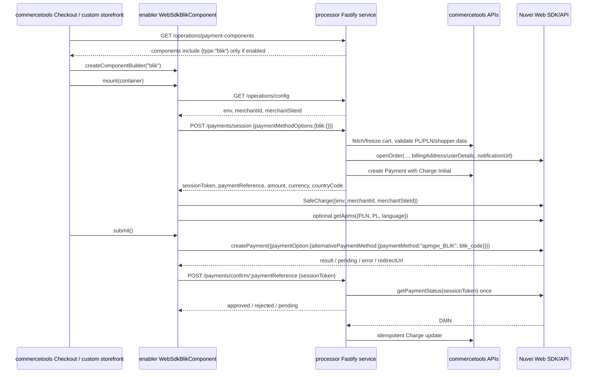

# Plan: Web SDK BLIK implementation

## Purpose

This plan describes how to implement **BLIK through Nuvei Web SDK** in parallel with the Simply Connect BLIK plan in `docs/BLIK_APM_IMPLEMENTATION_PLAN.md`.

The goal is not to replace the recommended Simply Connect first path. The goal is to make a Web SDK BLIK workstream independently implementable, with a shared processor contract so both BLIK integrations can be built and tested without fighting over the same abstractions.

## Decision

Implement Web SDK BLIK as a **new Checkout Web Component method** named `blik`:

```ts
const builder = await enabler.createComponentBuilder("blik");
const component = builder.build({ onPayButtonClick });
await component.mount("#payment-container");
await component.submit();
```

Keep existing methods intact:

- `createComponentBuilder("card")` -> Web SDK card.
- `createComponentBuilder("blik")` -> new Web SDK BLIK component.
- `createDropinBuilder("embedded")` -> existing Simply Connect drop-in, optionally configured to BLIK by the separate Simply Connect plan.

Expose `blik` from `/operations/payment-components` by default. The method is implemented, but production claims still require merchant BLIK enablement, PLN/PL cart data, and real Nuvei sandbox evidence.

Operators can choose either:

- Web Components integration type `blik` for merchant-owned BLIK UI and host-owned submit.
- Drop-in integration type `embedded` with `NUVEI_SIMPLY_CONNECT_PAYMENT_METHOD=blik` for Nuvei-owned BLIK UI.

Do not enable both on the same Checkout application unless the merchant deliberately wants two BLIK entries; use separate test applications for evidence collection.

## Official source facts

Sources:

- Nuvei Web SDK APM guide: <https://docs.nuvei.com/documentation/accept-payment/web-sdk/apm-payments/>
- Nuvei BLIK guide: <https://docs.nuvei.com/documentation/europe-guides/blik/>
- Nuvei APM testing guide: <https://docs.nuvei.com/documentation/integration/testing/testing-apms/>

Relevant facts:

- Web SDK APMs still require a backend `/openOrder`; secret-key checksum generation is backend-only.
- Web SDK APM payments use `sfc.createPayment(...)` with `paymentOption.alternativePaymentMethod.paymentMethod` set to the APM code.
- Web SDK can call `sfc.getApms({ currencyCode, countryCode, languageCode })` to retrieve account/country/currency-supported APMs and metadata.
- If `country` and `email` are not included in `/openOrder`, Nuvei says they must be included later in `createPayment()`.
- Redirect-based APMs can return `redirectUrl`; merchant code must handle it.
- BLIK country is Poland and currency is PLN.
- BLIK code must be exactly 6 digits, displayed as `[3 digits][space][3 digits]`, and should open the numeric keyboard on mobile.
- Nuvei REST API 1.0 BLIK uses `paymentOption.alternativePaymentMethod.paymentMethod: "apmgw_BLIK"` and `blik_code`.
- Nuvei REST API 1.0 BLIK lists `deviceDetails.ipAddress`, `billingAddress.firstName/lastName/country/email`, and `userDetails.firstName/lastName/country/email` as mandatory payment fields.
- BLIK sample response is `transactionStatus: "PENDING"`; final result arrives through DMN.
- Nuvei's BLIK sample DMN contains `payment_method=apmgw_BLIK`, `transactionType=Sale`, `currency=PLN`, amount, PPP transaction identity, fiscal transaction identity, and final status.
- Test BLIK success code: any six-digit code starting with `777`; non-`777` code declines.

## Current repository constraints

### Browser

Relevant files:

- `enabler/src/payment-enabler/method-registry.ts`
- `enabler/src/payment-enabler/checkout-enabler.ts`
- `enabler/src/payment-enabler/payment-enabler.ts`
- `enabler/src/components/web-sdk-card.ts`
- `enabler/src/services/web-sdk.ts`
- `enabler/src/services/api-service.ts`

Observed state:

- The enabler registry contains `card` and `embedded` only.
- `Enabler.createComponentBuilder(type)` accepts only `card`.
- `WebSdkCardComponent` is card-specific: it creates `sfc.fields({}).create("card", {})`, stores the field as `SafeChargeCardField`, and submits `paymentOption: this.scard`.
- `SafeChargeInstance.createPayment` typing currently accepts only `paymentOption: SafeChargeCardField`.
- `WebSdkCardComponent` sends CT Payment aliases (`merchant_unique_id`, `merchantUniqueId`, `merchantUniqueID`) and `clientUniqueId` to Nuvei for reconciliation. BLIK should reuse the same reference strategy if Nuvei Web SDK accepts those aliases for APMs.
- `confirmPaymentResult()` currently retries pending confirmation when `onPending` is absent. That is not suitable for BLIK because Nuvei says `/getPaymentStatus` is not for repeated polling.

### Processor

Relevant files:

- `processor/src/dtos/operations/payment-components.dto.ts`
- `processor/src/dtos/nuvei-payment.dto.ts`
- `processor/src/services/nuvei-payment.service.ts`
- `processor/src/services/ct-payment-creation.service.ts`
- `processor/src/services/converters/nuvei-event.converter.ts`
- `processor/src/services/payment-converter.ts`
- `processor/src/clients/nuvei.client.ts`

Observed state:

- `validatePaymentMethodOptions()` currently returns a single supported UI method and rejects non-empty method payloads.
- `createPaymentSession()` already does the right outer flow: session auth, cart fetch, cart freeze, amount calculation, Nuvei `/openOrder`, CT Payment creation, and safe response to the browser.
- CT Payment creation always creates an Initial `Authorization` transaction.
- `confirmPayment()` always writes terminal `Authorization`, regardless of Nuvei `transactionType`.
- DMN converter already maps `transactionType=Sale` to CT `Charge`, but it does not map BLIK `payment_method` metadata.
- Capture/cancel/refund operations are card-authorization-oriented and need method guards before BLIK is enabled.

## Parallel implementation contract

This is the shared contract both BLIK paths should implement against. Agree on it before splitting work across agents/branches.

### Public payment methods

Add `blik` as a component method, keep `embedded` as a drop-in method:

```ts
export enum PaymentMethod {
  card = "card",
  blik = "blik",
  embedded = "embedded",
}
```

Registry and processor advertisement intent:

| Key | Kind | Advertised type | Meaning | Processor advertisement |
| --- | --- | --- | --- | --- |
| `card` | `component` | `card` | Existing Web SDK card | always |
| `blik` | `component` | `blik` | New Web SDK BLIK | always |
| `embedded` | `dropin` | `embedded` | Simply Connect drop-in | always, but actual tender remains config-driven |

Processor `/operations/payment-components` should return:

```json
{
  "dropins": [{ "type": "embedded" }],
  "components": [{ "type": "card" }, { "type": "blik" }],
  "express": []
}
```

### Session request bodies

Keep browser payloads small and typed. Never send BLIK code to the processor.

```ts
// Existing card component.
{ paymentMethodOptions: { card: {} } }

// New Web SDK BLIK component.
{ paymentMethodOptions: { blik: {} } }

// Existing Simply Connect card drop-in.
{ paymentMethodOptions: { embedded: {} } }

// Simply Connect BLIK drop-in from the separate plan.
{ paymentMethodOptions: { embedded: { paymentMethod: "blik" } } }
```

### Processor selection model

Do not overload the current `paymentMethod` string. Split UI surface from actual tender:

```ts
type CheckoutUiMethod = "card" | "blik" | "embedded";
type NuveiTender = "card" | "blik";
type NuveiIntegrationSurface = "web-sdk" | "simply-connect";

type PaymentSelection =
  | { uiMethod: "card"; tender: "card"; surface: "web-sdk" }
  | { uiMethod: "blik"; tender: "blik"; surface: "web-sdk" }
  | { uiMethod: "embedded"; tender: "card" | "blik"; surface: "simply-connect" };
```

`validatePaymentMethodOptions()` should return `PaymentSelection`.

### Payment session response

Extend the session response with safe method metadata used by both frontends:

```ts
type PaymentSessionResponse = {
  cartId: string;
  sessionToken: string;
  paymentReference: string;
  merchantReturnUrl: string;
  amount: string;
  currency: string;
  uiMethod: "card" | "blik" | "embedded";
  paymentMethod: "card" | "blik";
  integrationSurface: "web-sdk" | "simply-connect";
  countryCode?: string;
};
```

Do not return first name, last name, email, IP address, or any BLIK code-related data. The processor should prefill shopper fields on `/openOrder`; the browser should not receive cart PII solely to satisfy Nuvei.

### CT Payment semantics

BLIK is a sale-style APM in Nuvei examples. Store it as CT `Charge`, not card `Authorization`.

| Tender | Initial CT transaction | Terminal CT transaction | CT method | CT name |
| --- | --- | --- | --- | --- |
| `card` | `Authorization Initial` | `Authorization Success/Failure` | `card` | current card/drop-in names |
| `blik` | `Charge Initial` | `Charge Success/Failure/Pending` | `blik` | `BLIK` or `Nuvei BLIK` |

### Shared processor phases

These phases are shared with the Simply Connect BLIK plan and should be done once, by one processor-focused workstream:

1. Add `PaymentSelection` parsing and feature flags.
2. Add BLIK prerequisite validation: config enabled, PLN, PL, required shopper identity from cart/session.
3. Add BLIK CT Payment metadata and `Charge Initial` support.
4. Derive `confirmPayment()` transaction type from Nuvei `transactionType` when present.
5. Map BLIK DMNs (`payment_method=apmgw_BLIK`) to BLIK method metadata.
6. Guard capture/cancel/refund by tender.
7. Add shared fixtures for BLIK approved, declined, pending, duplicate, amount mismatch, currency mismatch.

After this shared contract is in place, Web SDK BLIK frontend and Simply Connect BLIK frontend can proceed independently.

## Target Web SDK BLIK architecture



## Browser implementation plan

### 1. Add BLIK method registry and builder routing

Files:

- `enabler/src/payment-enabler/method-registry.ts`
- `enabler/src/payment-enabler/checkout-enabler.ts`
- `enabler/src/index.ts`
- `enabler/test/unit/payment-enabler.test.ts`
- `enabler/test/unit/checkout-enabler.test.ts`

Changes:

1. Add `PaymentMethod.blik = "blik"`.
2. Add registry entry:

   ```ts
   {
     key: PaymentMethod.blik,
     kind: "component",
     advertisedType: PaymentMethod.blik,
     displayName: "BLIK",
     transitional: false,
     pspMetadata: {},
   }
   ```

3. Update `getComponentPaymentMethods()` expected order to `card`, `blik`.
4. Update `Enabler.createComponentBuilder()` routing:
   - `card` -> `CheckoutCardBuilder`;
   - `blik` -> new `CheckoutBlikBuilder`;
   - other values -> existing `METHOD_UNSUPPORTED` error.
5. Export `WebSdkBlikBuilder` from `enabler/src/index.ts`.

Acceptance:

- Existing `card` builder behavior unchanged.
- `createComponentBuilder("blik")` returns `componentHasSubmit = true`.
- `createDropinBuilder("blik")` rejects; BLIK Web SDK is a component, not a drop-in.

### 2. Extend Web SDK service typings

Files:

- `enabler/src/services/web-sdk.ts`
- `enabler/test/unit/web-sdk.test.ts`

Changes:

Add Web SDK APM types without weakening card type safety:

```ts
export type SafeChargeAlternativePaymentMethod = {
  alternativePaymentMethod: {
    paymentMethod: "apmgw_BLIK";
    blik_code: string;
  };
};

export type SafeChargePaymentOption = SafeChargeCardField | SafeChargeAlternativePaymentMethod;

export type SafeChargeCreatePaymentParams = {
  sessionToken: string;
  clientUniqueId?: string;
  merchant_unique_id?: string;
  merchantUniqueId?: string;
  merchantUniqueID?: string;
  paymentOption: SafeChargePaymentOption;
  billingAddress?: Record<string, string>;
  userDetails?: Record<string, string>;
  deviceDetails?: Record<string, string>;
  savePM?: boolean | "false" | "true";
};

export type SafeChargeApm = {
  paymentMethod: string;
  paymentMethodDisplayName?: Array<{ language: string; message: string }>;
  countries?: string[];
  currencies?: string[];
  logoURL?: string;
  fields?: Array<{ name: string; type: string; caption?: unknown[] }>;
};
export type SafeChargeGetApmsResult = {
  paymentMethods?: SafeChargeApm[];
  status?: string;
  errCode?: string | number;
  reason?: string;
};
```

Extend `SafeChargeInstance`:

```ts
createPayment(params: SafeChargeCreatePaymentParams, callback: (res: SafeChargeResult) => void): void;
getApms?(params: { currencyCode: string; countryCode: string; languageCode?: string }, callback: (res: SafeChargeGetApmsResult) => void): void;
```

Acceptance:

- Card component still compiles with `paymentOption: this.scard`.
- BLIK component can compile with `paymentOption.alternativePaymentMethod`.
- Tests cover `getApms` optional absence and response parsing.

### 3. Add `WebSdkBlikComponent`

New file:

- `enabler/src/components/web-sdk-blik.ts`

Tests:

- `enabler/test/unit/web-sdk-blik.test.ts`

Responsibilities:

1. Use the same `ApiService` and config loading pattern as `WebSdkCardComponent`.
2. On `mount(selector)`:
   - find the mount target;
   - call `POST /payments/session` with `{ paymentMethodOptions: { blik: {} } }`;
   - load Web SDK;
   - verify response `paymentMethod === "blik"`, `currency === "PLN"`, and `countryCode === "PL"` when present;
   - optionally call `sfc.getApms({ currencyCode: "PLN", countryCode: "PL", languageCode })` and confirm `apmgw_BLIK` exists;
   - render connector-owned BLIK form.
3. On `submit()`:
   - ensure mounted;
   - run `componentOptions.onPayButtonClick?.()` before reading/submitting the code;
   - validate code is exactly six digits;
   - call `sfc.createPayment(...)`;
   - clear the local code field after handing it to Web SDK;
   - handle result through one confirmation call and/or `onPending`.
4. `isValid()` returns true only when mounted and code has exactly six digits.
5. `getState()` returns `{}`. Do not expose BLIK code to Checkout state.
6. `showValidation()` marks the local input invalid and focuses it.
7. `isAvailable()` uses Web SDK availability plus optional `getApms` result when the SDK is present.

### 4. BLIK UI requirements

The component owns BLIK UI because Web SDK APM path does not render a hosted BLIK form.

Minimum DOM:

```html
<div class="nuvei-blik">
  
  <label for="nuvei-blik-code">BLIK code</label>
  <input
    id="nuvei-blik-code"
    inputmode="numeric"
    autocomplete="one-time-code"
    pattern="[0-9]*"
    maxlength="7"
    aria-describedby="nuvei-blik-help nuvei-blik-error"
  />
  <p id="nuvei-blik-help">Enter the 6-digit BLIK code from your bank app.</p>
  <p id="nuvei-blik-error" role="alert" hidden>Enter a 6-digit BLIK code.</p>
</div>
```

Behavior:

- Accept pasted or typed digits only; strip spaces and non-digits.
- Store raw code as exactly six digits internally.
- Display formatted value as `123 456`.
- Reject submit before six digits.
- After successful local validation and before Web SDK call, show: “Confirm the payment in your bank’s app.”
- Prefer the logo URL from `getApms()` when available. If unavailable, render text-only `BLIK` instead of bundling a stale logo.
- Do not log code, raw input events, or Web SDK payloads.

### 5. Web SDK createPayment payload

Payload shape:

```ts
this.sfc.createPayment(
  {
    sessionToken: this.sessionToken,
    clientUniqueId: this.cartId,
    merchant_unique_id: this.paymentReference,
    merchantUniqueId: this.paymentReference,
    merchantUniqueID: this.paymentReference,
    paymentOption: {
      alternativePaymentMethod: {
        paymentMethod: "apmgw_BLIK",
        blik_code: blikCode,
      },
    },
    // Only include browser-side billingAddress if sandbox proves openOrder prefill
    // is insufficient and if the value was explicitly supplied to the enabler.
    ...(this.baseOptions.shopperEmail && {
      billingAddress: {
        email: this.baseOptions.shopperEmail,
        country: "PL",
      },
    }),
    savePM: false,
  },
  (res) => void this.handleWebSdkResult(res),
);
```

Important decisions:

- Processor must prefill `billingAddress` and `userDetails` on `/openOrder` from the cart so the browser does not need returned shopper PII.
- Do not include first name, last name, or email in the session response for Web SDK convenience.
- Include `billingAddress` from `baseOptions.shopperEmail` only if explicitly provided by caller; do not synthesize fallback email/country values.
- Never send BLIK code to the processor.
- Clear the code input after `createPayment` returns synchronously; if the user must retry, they can enter a fresh one-time code.

### 6. Result handling

Do not reuse the card pending retry default for BLIK.

Add a BLIK-specific confirmation wrapper or add options to `confirmPaymentResult()`:

```ts
confirmPaymentResult(paymentReference, sessionToken, api, onComplete, onError, onPending, {
  retryDelaysMs: [],
});
```

Preferred BLIK behavior:

- `APPROVED` browser result: call processor confirmation once; use processor outcome.
- `DECLINED` browser result: still call processor confirmation once when Nuvei supplied enough session context; otherwise call `onComplete({ isSuccess: false, paymentReference })`.
- `PENDING` browser result: call processor confirmation once; if processor says pending, call `onPending({ paymentReference })` and rely on DMN.
- `ERROR`: call `onError(new Error("Nuvei Web SDK returned ERROR."), { paymentReference })` with sanitized message.
- `cancelled === true`: call `onComplete({ isSuccess: false, paymentReference })`.
- `redirectUrl`: do not silently navigate. For first implementation, treat as `onError` with a safe message and record sandbox evidence. If sandbox shows BLIK needs redirect handling, add a separate explicit UX decision.

## Processor implementation plan

This processor work should be shared with the Simply Connect BLIK implementation.

### 1. Advertised components

Files:

- `processor/src/dtos/operations/payment-components.dto.ts`
- `processor/src/services/nuvei-payment.service.ts`
- `processor/test/unit/routes/operation.route.test.ts`
- `processor/test/unit/contract/payment-method-contract.test.ts`

Changes:

1. Add `blik` to supported method registry as a component entry.
2. Return both component methods from `getSupportedPaymentComponents()`:
   - `card`;
   - `blik`;
   - keep `embedded` drop-in unchanged.
3. Keep `isSupportedPaymentMethod("blik")` true at code-contract level and accept BLIK session creation by default.

Acceptance:

- Default `/operations/payment-components` includes `card`, `blik`, and `embedded`.

### 2. Request validation

Files:

- `processor/src/dtos/nuvei-payment.dto.ts`
- `processor/src/services/nuvei-payment.service.ts`
- `processor/test/unit/services/nuvei-payment.service.test.ts`

Changes:

1. Replace `SupportedPaymentMethod` return value with `PaymentSelection`.
2. Accept `{ paymentMethodOptions: { blik: {} } }` by default.
3. Reject non-empty BLIK payloads. BLIK code is browser-to-Nuvei only.
4. Reject `apmgw_BLIK` as a browser request key. The processor API speaks connector method keys, not raw Nuvei method IDs.
5. Preserve existing malformed-body behavior for arrays, multiple keys, and unsupported keys.

Acceptance:

- Invalid BLIK setup fails before cart freeze, Nuvei `/openOrder`, or CT Payment creation.

### 3. BLIK prerequisite validation

Files:

- `processor/src/services/nuvei-payment.service.ts`
- `processor/test/unit/services/nuvei-payment.service.test.ts`

Validation before `/openOrder`:

- Cart planned currency is exactly `PLN`.
- Billing or shipping country is exactly `PL`.
- Shopper email exists on billing/shipping address or cart customer email.
- Shopper first and last name exist on billing or shipping address.
- `CONNECT_SERVICE_URL` is configured for DMNs in non-local evidence runs.

Decision:

- For Web SDK BLIK, fail setup if required shopper fields are absent. Do not rely on browser field collection because this Web SDK path uses merchant-owned UI and the session response must not expose shopper PII.
- If sandbox proves Web SDK BLIK absolutely requires `deviceDetails.ipAddress` in `createPayment()` and Web SDK does not supply it automatically, stop the Web SDK BLIK path and prefer Simply Connect or a server-side BLIK payment endpoint. Do not pass IP-derived data from browser without a separate privacy/security decision.

Acceptance:

- Non-PLN, non-PL, and missing-shopper-field carts return setup errors without external side effects.

### 4. Nuvei `/openOrder`

Files:

- `processor/src/clients/nuvei.client.ts`
- `processor/src/services/nuvei-payment.service.ts`
- `processor/test/unit/clients/nuvei.client.test.ts`

Changes:

1. Reuse existing `openOrder` call and checksum flow.
2. Continue passing:
   - `clientUniqueId: cart.id`;
   - `urlDetails.notificationUrl` when configured;
   - `billingAddress` and `userDetails` from the cart.
3. Consider adding `preventOverride: "1"` to `OpenOrderParams` if sandbox shows Web SDK `createPayment` can overwrite prefilled shopper fields with incomplete browser values.
4. Do not add BLIK code to `/openOrder`.

Acceptance:

- Open order payload contains no BLIK code and no secrets in logs.

### 5. CT Payment creation

Files:

- `processor/src/services/ct-payment-creation.service.ts`
- `processor/src/dtos/operations/payment-components.dto.ts`
- `processor/test/unit/services/ct-payment-creation.service.test.ts`

Changes:

1. Add an input like:

   ```ts
   paymentMethod: "card" | "blik";
   initialTransactionType: "Authorization" | "Charge";
   ```

2. For Web SDK BLIK:
   - `paymentMethodInfo.method = "blik"`;
   - `paymentMethodInfo.name.en = "BLIK"`;
   - initial transaction `{ type: "Charge", state: "Initial", interactionId: sessionToken }`.
3. Keep card and embedded-card behavior unchanged.

Acceptance:

- BLIK CT Payment has no authorization transaction.
- Card tests remain unchanged.

### 6. Confirmation

Files:

- `processor/src/services/nuvei-payment.service.ts`
- `processor/src/services/payment-converter.ts`
- `processor/test/unit/services/nuvei-payment.service.test.ts`

Changes:

1. In `confirmPayment()`, inspect the CT Payment method or stored initial transaction to determine tender.
2. For BLIK, derive terminal transaction type from Nuvei `transactionType` when available:
   - `Sale` -> `Charge`.
3. If status is pending, return `{ outcome: "pending" }` and do not write terminal state.
4. If status is approved/rejected but lacks a stable identity, prefer pending for BLIK until DMN arrives unless sandbox proves session-token fallback is safe for Web SDK BLIK.
5. Deduplicate against existing terminal `Charge` for BLIK, not only `Authorization`.

Acceptance:

- BLIK confirmation success writes `Charge Success` exactly once.
- BLIK confirmation pending writes nothing.
- Existing card confirmation still writes `Authorization`.

### 7. DMN mapping

Files:

- `processor/src/services/converters/nuvei-event.converter.ts`
- `processor/src/services/nuvei-payment.service.ts`
- `processor/test/unit/services/dmn-processing.service.test.ts`
- `processor/test/unit/services/nuvei-event.converter.test.ts`
- `processor/test/unit/fixtures/dmn.fixtures.ts`

Changes:

1. Recognize BLIK by allowlisted fields:
   - `payment_method=apmgw_BLIK`;
   - `paymentMethod=apmgw_BLIK` if observed;
   - REST 2.0-style `paymentOption.alternativePaymentMethod.name=blik` only if a future parser handles JSON webhook bodies.
2. Set `paymentMethodInfo.method = "blik"` and `paymentMethodInfo.name = { en: "BLIK" }`.
3. Preserve existing card metadata mapping for card DMNs.
4. Continue amount, currency, merchant, session, and duplicate checks.
5. Ensure a DMN that references cart ID instead of CT Payment ID can still resolve through the existing cart/session fallback.

Acceptance:

- BLIK approved DMN writes one `Charge Success`.
- BLIK declined DMN writes one `Charge Failure` or a documented failed terminal mapping.
- Duplicate BLIK DMN is ignored.
- Mismatched amount/currency is rejected.

### 8. Operations support

Files:

- `processor/src/services/nuvei-payment.service.ts`
- `processor/test/unit/services/nuvei-payment.service.test.ts`

Rules:

- Capture: reject for BLIK; no authorization exists.
- Cancel authorization: reject for BLIK unless sandbox proves a valid Nuvei void semantics and CT model is updated.
- Refund: allow after successful BLIK `Charge`; use the charge interaction ID as `relatedTransactionId`.
- Partial refund: allow only if existing refund path and Nuvei sandbox evidence prove it for BLIK.

Acceptance:

- Capture/cancel for BLIK do not call Nuvei.
- Refund for successful BLIK charge calls Nuvei with charge transaction identity.

## Parallel workstream split

### Workstream 0 — Shared contract and processor foundation

Owner: one processor-focused implementer.

Files:

- `processor/src/config/config.ts`
- `processor/src/dtos/operations/payment-components.dto.ts`
- `processor/src/dtos/nuvei-payment.dto.ts`
- `processor/src/services/nuvei-payment.service.ts`
- `processor/src/services/ct-payment-creation.service.ts`
- `processor/src/services/converters/nuvei-event.converter.ts`
- shared processor tests

Output:

- Feature flags.
- `PaymentSelection` parser.
- BLIK validation.
- BLIK CT semantics.
- BLIK confirm/DMN/operation support.

Dependency:

- Must publish the exact session request/response contract before frontend work merges.
- Can be built with tests and mock frontend payloads before either frontend is complete.

### Workstream 1 — Web SDK BLIK frontend

Owner: enabler/frontend implementer.

Files:

- `enabler/src/components/web-sdk-blik.ts`
- `enabler/src/services/web-sdk.ts`
- `enabler/src/payment-enabler/method-registry.ts`
- `enabler/src/payment-enabler/checkout-enabler.ts`
- `enabler/src/index.ts`
- `enabler/test/unit/web-sdk-blik.test.ts`
- `enabler/test/unit/web-sdk.test.ts`
- `enabler/test/unit/checkout-enabler.test.ts`

Output:

- New `blik` component builder.
- BLIK input UI and validation.
- Web SDK APM payload.
- Pending-safe result handling.

Dependency:

- Can use mocked `apiService.createPayment()` response matching the shared contract while processor workstream runs.

### Workstream 2 — Simply Connect BLIK frontend

Owner: separate enabler/frontend implementer.

Files:

- `enabler/src/components/simply-connect-dropin.ts`
- `enabler/src/services/simply-connect-sdk.ts`
- `enabler/src/services/api-service.ts`
- relevant Simply Connect tests

Output:

- `embedded` drop-in can run card or BLIK mode.
- `pmWhitelist: ["apmgw_BLIK"]` when configured.

Dependency:

- Shares processor `PaymentSelection` and `PaymentSessionResponse` contract.
- Should not edit `web-sdk-blik.ts`.

### Workstream 3 — Example harness and evidence

Owner: test/harness implementer after Workstreams 0 and 1 have contract fixtures.

Files:

- `examples/nuvei-web-ui/index.html`
- `examples/nuvei-web-ui/mock-commercetools-server.mjs`
- `examples/nuvei-web-ui/api-e2e-test.mjs`
- `examples/nuvei-web-ui/README.md`
- `docs/TEST_SCENARIOS.md`
- `docs/TESTING.md`

Output:

- Local modes:
  - Checkout drop-in card;
  - Checkout drop-in BLIK;
  - Web SDK card;
  - Web SDK BLIK.
- Mock BLIK DMNs and operation tests.
- Sandbox evidence checklist.

## Implementation sequence

### Phase A — Shared processor contract

1. Add `blik` registry entry and default advertisement.
2. Replace single-string method validation with `PaymentSelection`.
3. Add typed session response method metadata.
4. Add tests for all four request bodies:
   - card component;
   - BLIK component;
   - embedded card;
   - embedded BLIK.

Acceptance:

- Default runtime advertises card, BLIK, and embedded.
- Unsupported methods and malformed BLIK payloads fail before side effects.

### Phase B — Web SDK service and component skeleton

1. Extend Web SDK typings.
2. Add `WebSdkBlikBuilder` and component file.
3. Add builder routing and exports.
4. Build static BLIK form.
5. Add unit tests for mount, submit before mount, invalid code, valid code, and callbacks.

Acceptance:

- Enabler can build a BLIK component under tests.
- No browser path logs or exposes BLIK code.

### Phase C — Processor BLIK semantics

1. Add BLIK prerequisites.
2. Add BLIK CT Payment creation as `Charge Initial`.
3. Add BLIK confirmation terminal mapping.
4. Add BLIK DMN mapping and duplicate tests.
5. Add operation guards.

Acceptance:

- BLIK success creates one `Charge Success` through confirm or DMN.
- BLIK and card paths stay isolated.

### Phase D — Web SDK BLIK createPayment

1. Call `sfc.getApms()` after SDK load when available.
2. Render BLIK logo/display name from `getApms()` if available.
3. Submit `paymentOption.alternativePaymentMethod.paymentMethod = "apmgw_BLIK"` and `blik_code`.
4. Handle pending without confirm polling.
5. Fail safely on unexpected `redirectUrl` until sandbox decides redirect behavior.

Acceptance:

- Unit test asserts exact Web SDK APM payload.
- Pending result calls `onPending` after one confirmation attempt.

### Phase E — Local harness and sandbox evidence

1. Add Web SDK BLIK mode to example harness.
2. Add mock BLIK success/decline/pending flows.
3. Add manual sandbox checklist.
4. Collect Nuvei sandbox evidence:
   - `777xxx` approval;
   - non-`777` decline;
   - pending/abandonment;
   - DMN before browser confirmation;
   - browser confirmation before DMN;
   - duplicate DMN;
   - refund after charge.

Acceptance:

- No production readiness claim until evidence answers all open questions below.

## Tests to add

### Enabler tests

- `method-registry` contains `card`, `blik`, `embedded` in deterministic order.
- `createComponentBuilder("blik")` returns component builder with `componentHasSubmit=true`.
- `createDropinBuilder("blik")` rejects.
- `WebSdkBlikComponent.mount()` calls `api.createPayment({ paymentMethodOptions: { blik: {} } })`.
- `WebSdkBlikComponent` renders input with `inputmode="numeric"`, label, help text, and error text.
- Input formats `777654` as `777 654`.
- Invalid code prevents Web SDK `createPayment`.
- Valid code submits `paymentOption.alternativePaymentMethod.paymentMethod="apmgw_BLIK"` and `blik_code`.
- BLIK code is not returned from `getState()`.
- Component clears input after submit handoff.
- `PENDING` browser/processor result calls `onPending` without retries.
- `ERROR` result calls `onError` with sanitized error.
- `cancelled` result calls failed `onComplete`.
- `redirectUrl` result fails safely until explicitly supported.

### Processor tests

- Default config does not advertise `blik`.
- Enabled config advertises `blik` component.
- `{ paymentMethodOptions: { blik: {} } }` parses to Web SDK BLIK selection.
- Non-empty BLIK payload is rejected.
- Raw `apmgw_BLIK` request key is rejected.
- BLIK disabled rejects before cart freeze/openOrder/payment creation.
- BLIK non-PLN rejects before openOrder.
- BLIK non-PL rejects before openOrder.
- Missing BLIK shopper name/email rejects before openOrder.
- BLIK CT Payment is `Charge Initial` with method/name BLIK.
- BLIK confirm approved with `transactionType=Sale` writes `Charge Success`.
- BLIK pending confirm writes no terminal transaction.
- BLIK DMN maps `payment_method=apmgw_BLIK` to BLIK metadata.
- Duplicate BLIK DMN is idempotent.
- BLIK capture/cancel rejected without Nuvei calls.
- BLIK refund after charge uses charge interaction ID.

### Contract/e2e tests

- Processor and enabler registries stay aligned for public keys.
- Local harness can mount Web SDK BLIK mode.
- Mock API validates BLIK success, decline, pending, duplicate DMN, refund.

## Security and privacy rules

- BLIK code never goes to the processor.
- BLIK code never appears in logs, evidence files, errors, callbacks, or component state.
- Raw Nuvei browser result is never forwarded to Checkout callbacks.
- Raw DMN body is never logged.
- Session token remains internal to enabler/processor confirmation flow.
- No fake shopper email/name/country may be generated to satisfy Nuvei validation.
- No browser-side result is final truth; CT updates are server-verified and DMN-reconciled.

## Open sandbox questions

These block production readiness for Web SDK BLIK:

1. Does Nuvei Web SDK BLIK accept `paymentOption.alternativePaymentMethod.blik_code`, or is the BLIK code field named differently in Web SDK context?
2. Does Web SDK BLIK require `deviceDetails.ipAddress` explicitly, or does Web SDK supply browser device details automatically?
3. Does Web SDK BLIK accept CT Payment reference aliases (`merchant_unique_id`, `merchantUniqueId`, `merchantUniqueID`) and echo any of them into DMN?
4. Does `/getPaymentStatus` for Web SDK BLIK return `transactionType=Sale`, PPP identity, fiscal transaction ID, `payment_method`, `clientUniqueId`, and `sessionToken`?
5. Does Web SDK BLIK ever return `redirectUrl`?
6. Does browser callback return `PENDING` before bank-app confirmation, or only after a terminal result?
7. Does Nuvei support void/cancel for in-flight BLIK, or only refund after charge?
8. Which refund fields are required for BLIK in this merchant account?

If questions 1 or 2 fail in a way that requires sending BLIK code or shopper PII through the processor, pause and reassess against the Simply Connect path. Do not add a server-side BLIK payment endpoint without a separate security review.

## Non-goals

- BLIK One-click.
- BLIK Pay Later.
- Stored BLIK payment tokens/UPOs.
- Production deployment.
- Retrying `/getPaymentStatus` polling for BLIK.
- Returning shopper PII in `PaymentSessionResponse`.
- Sharing BLIK code with the processor.
- Implementing generic APM selection UI. This plan is BLIK-only.

## Done criteria

Web SDK BLIK is implementation-complete when:

- `blik` component is advertised by default.
- `createComponentBuilder("blik")` mounts a merchant-owned BLIK form.
- Form satisfies Nuvei BLIK code UX rules.
- Processor rejects invalid BLIK carts before Nuvei or CT state is created.
- Web SDK submits `apmgw_BLIK` with the one-time code directly to Nuvei.
- CT Payment represents BLIK as `Charge`, not `Authorization`.
- Confirm and DMN converge idempotently to one terminal CT transaction.
- Capture/cancel are blocked and refund is supported after successful charge.
- Local mock tests cover success, decline, pending, duplicate DMN, and refund.
- Nuvei sandbox evidence covers success, decline, pending/abandonment, callback fields, DMN fields, and refund.
